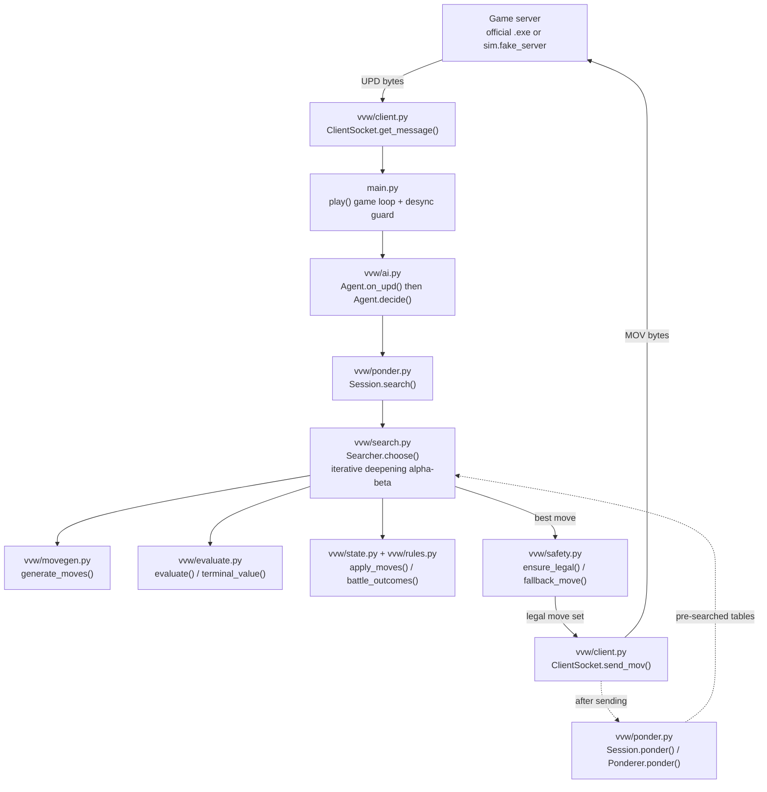
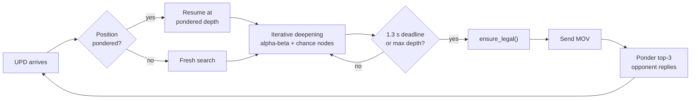

# 🧛 Nosferatu-AB: a Vampires vs Werewolves tournament AI

**Nosferatu-AB** is our entry for the *Vampires vs Werewolves* AI tournament (CentraleSupélec MSc AI, *Foundation of AI*). It connects to the course's game server over TCP and plays either species. Each turn it runs a hand-written **expectiminimax alpha-beta search** with the server's exact battle probabilities, and it scores positions on a single scale that combines material and win probability. While the opponent thinks, it keeps searching its answers to the opponent's three most likely replies. Before any move is sent, a mirror of the server's validator checks it. The whole project is plain Python 3 standard library: no third-party packages and no AI, tree or graph libraries.

   

Plain text: Python 3.8+ (tested on 3.9, 3.11 and 3.14) · standard library only · 46 unit tests passing · no AI/tree/graph libraries.

---

## Contents

- [Highlights](#highlights)
- [Quick start](#quick-start)
- [Architecture overview](#architecture-overview)
- [Project structure](#project-structure)
- [How the AI thinks in 30 seconds](#how-the-ai-thinks-in-30-seconds)
- [Key results](#key-results)
- [Documentation](#documentation)
- [Tournament-day checklist](#tournament-day-checklist)
- [Credits and license](#credits-and-license)

---

## Highlights

- **We read the referee's code.** The rules come from disassembling the server's `VVSW.Model.dll`, not just from the PDF. One example: a defender with 1.5× the attackers does *not* win automatically. It is a dice roll with P = E1/(2·E2). See [`RULES.md`](RULES.md).
- **Expectiminimax alpha-beta.** The search runs depth-limited minimax with alpha-beta pruning. Random battles become chance nodes weighted by the server's exact probability. It also uses iterative deepening under a hard deadline, a transposition table and killer moves.
- **One value scale for heuristics and outcomes.** Positions are scored as `value = raw + G · tanh(raw / k)`. This makes the AI risk-aware for free: when it is ahead it refuses coin flips, and when it is behind it takes the best gamble available.
- **Strategic move generation.** Instead of enumerating every possible split, each group gets a few purposeful options: convert humans, kill, flee, merge, attack, and split into 2 or 3 parts or detachments.
- **Pondering.** The AI keeps thinking on the opponent's time. Against engines, the position it pondered turns out to be the real one on **77%** of turns.
- **Adaptive opponent model.** The AI measures how often the opponent plays the reply it predicted. Against opponents it cannot predict well, it starts favouring moves that set traps.
- **Never forfeit.** Every outgoing move is checked by a line-by-line mirror of the server's `CheckMoves`, with a guaranteed-legal fallback. A hard 1.3 s deadline is checked at every node, and a desync guard stops stale moves from being sent. Across all our simulated games there were 0 illegal moves and 0 timeouts.
- **Tested end to end.** A byte-exact fake server, a referee that rolls real dice, baseline bots, frozen older versions for regression matches, and 46 unit tests.

---

## Quick start

You only need Python 3. There is nothing to install. Run every command from the project root.

### Play a local game (3 terminals)

```bash
# Terminal 1: the byte-exact fake server (first client to connect = Vampires)
python3 -m sim.fake_server --port 5555

# Terminal 2: our AI, logging its decisions to the terminal
python3 main.py --log - 127.0.0.1 5555

# Terminal 3: the opponent (here a second copy of our AI)
python3 main.py --name Rival 127.0.0.1 5555
```

The server prints a result line when the game ends, for example
`[server] {'winner': 0, 'reason': 'max plays', 'plies': 40, 'totals': (16, 14), ...}`.

> 💡 **Tip:** With `uv` installed, `uv run --no-project python ...` works the same way. On Windows, use `python` or `py -3` instead of `python3`, or use `run.bat`.

### Run the tests

```bash
python3 -m unittest discover -s tests
# Ran 46 tests in ~15s ... OK
```

### Tournament launch

The tournament launcher appends the IP and port to the end of the command line, so they are **always the last two arguments**:

```bash
./run.sh  <server_ip> <server_port>      # Linux / macOS
run.bat   <server_ip> <server_port>      # Windows (CTI machines)
python main.py --name Nosferatu-AB 10.0.0.12 5555
```

For every option, the protocol and troubleshooting, see [docs/08-running-and-protocol.md](docs/08-running-and-protocol.md).

---

## Architecture overview

A turn flows from the server's `UPD` bytes down through the agent and the search, and back up as one `MOV` packet. After the move is sent, the same search machinery keeps running as a ponderer until the next message arrives.



| Module | Role |
|---|---|
| `main.py` | `parse_args` (IP/port = last two args), `play` (game loop, END/BYE, desync guard) |
| `vvw/client.py` | `ClientSocket`: byte-exact protocol, exact-length reads, single-write `MOV` |
| `vvw/ai.py` | `Agent`: state tracking from MAP/UPD, species detection, ply/time accounting, `decide` |
| `vvw/ponder.py` | `Session` (one game's thinking), `Ponderer` (opponent's-time search), `OpponentTracker` |
| `vvw/search.py` | `Searcher`: expectiminimax alpha-beta, iterative deepening, transposition table, per-root `RootContext` |
| `vvw/movegen.py` | `generate_moves`, `group_options`: strategic candidate turns |
| `vvw/evaluate.py` | `evaluate`, `terminal_value`, `win_value`, `utility_k`, `root_slope` |
| `vvw/state.py` | `Board`, `State`, `validate` (server mirror), `apply_moves` |
| `vvw/rules.py` | `win_probability`, `battle_outcomes`, `attack_ev`: the server's exact battle math |
| `vvw/safety.py` | `fallback_move`, `ensure_legal`: a legal move no matter what |

The full walkthrough is in [docs/02-architecture.md](docs/02-architecture.md).

---

## Project structure

```text
.
├── main.py               # entry point: parse_args (ip/port = last two args) + play() loop
├── run.sh                # Linux/macOS launcher: cd to script dir, python3 main.py "$@"
├── run.bat               # Windows launcher: python main.py %*, falls back to py -3
├── vvw/                  # the AI itself (this is what plays)
│   ├── client.py         #   TCP socket, byte-exact message parsing, single-write MOV
│   ├── ai.py             #   Agent: game state from MAP/UPD, species, plies left, decide()
│   ├── ponder.py         #   Session, Ponderer (opponent's-time search), OpponentTracker
│   ├── search.py         #   Searcher: expectiminimax alpha-beta, TT, iterative deepening
│   ├── movegen.py        #   strategic candidate moves, splits, joint turns
│   ├── evaluate.py       #   evaluation: material, human race, threats, G·tanh utility
│   ├── state.py          #   Board geometry, State, validate (server mirror), apply_moves
│   ├── rules.py          #   battle probabilities and outcomes, exactly as the server
│   └── safety.py         #   always-legal fallback move
├── sim/                  # testing tools (not needed to play)
│   ├── fake_server.py    #   byte-exact stand-in for the official server (TCP)
│   ├── referee.py        #   in-process referee with real dice
│   ├── bots.py           #   baseline bots: random, greedy, aggressive; AI and snapshot wrappers
│   ├── tournament.py     #   parallel head-to-head matches on many maps, both species
│   ├── tune.py           #   weight tuning by coordinate descent on self-play
│   ├── fuzz.py           #   many full games of real main.py processes over TCP
│   ├── trace.py          #   print a game ply by ply
│   ├── maps.py           #   server XML map loader + point-symmetric random maps
│   ├── maps/             #   testmap2.xml, thetrap.xml (course sample maps)
│   └── snapshots/        #   frozen earlier versions (v1-v6) for regression matches only
├── tests/                # 46 unit tests (unittest)
│   ├── test_rules.py     #   22: battle math, validation, move resolution
│   ├── test_engine.py    #   9: legality, deadline, when to gamble and when not to
│   ├── test_protocol.py  #   8: byte parsing, CLI, END->new game, full games via fake server
│   ├── test_edge_cases.py#   4: whole games on odd boards, boxed-in groups, 255 byte limit
│   └── test_ponder.py    #   3: pondered hit == fresh search, prompt stop, miss
├── docs/                 # this documentation (chapters 01-08)
├── REPORT.md             # the course report: algorithms -> files/functions, results
├── RULES.md              # exact server rules recovered from VVSW.Model.dll
├── Projectv10.pdf        # course brief
├── pyproject.toml        # metadata only (no dependencies), ruff/ty settings
└── *.zip                 # course material: server v3.2.1, map generator, starter kit
```

---

## How the AI thinks in 30 seconds

1. **Read the board.** `UPD` lists the changed cells, and the agent patches its copy of the state.
2. **Was this position foreseen?** If pondering already searched it, the search resumes at the depth it reached, with its tables intact.
3. **Generate a few smart moves per group.** These are things like "go eat those 4 humans", "flee from the big group", "split 3 off for the far house". They are combined into whole-turn candidates.
4. **Look ahead.** The AI searches 1, 2, 3, … plies deep with alpha-beta. Our turns maximize and the opponent's turns minimize. A random battle splits the tree into a win branch and a loss branch, weighted by the server's exact probability.
5. **Score the leaves** with expected final material plus a win-probability term: `raw + G·tanh(raw/k)`.
6. **Stop at 1.3 s.** It keeps the best move of the deepest finished iteration, checks that the move is legal and sends it.
7. **Ponder.** It guesses the opponent's 3 most likely replies and pre-searches its answer to each until the server speaks again.



---

## Key results

These figures are for the final engine (v6) and are copied from [`REPORT.md`](REPORT.md) §5. Each map is played as both species, and all maps are point-symmetric random maps. Against an equally careful engine most games are draws, so wins against losses is the comparison that matters.

| Match | Win / Draw / Loss | Score |
|---|---|---|
| v6 vs v5, 0.5 s/move, 204 games on maps never used in development | 40 / 133 / 31 | 0.522 |
| new move generation vs v5, 0.1 s/move, 404 games | 88 / 260 / 56 | 0.540 (p ≈ 0.01) |
| pondering vs the same engine without it, 0.1 s/move, 404 games | 77 / 265 / 62 | 0.519 |
| *for scale:* double thinking time vs the same engine, 404 games | 88 / 260 / 56 | 0.540 |
| v6 vs greedy, 0.1 s/move, 404 games | 313 / 0 / 91 | 0.775 (v5: 0.780) |
| v6 vs aggressive, 0.1 s/move, 404 games | 321 / 0 / 83 | 0.795 (v5: 0.797) |

> ℹ️ The two 88 / 260 / 56 rows are two different matches (new move generation vs v5, and 0.2 s vs 0.1 s for the same engine) that happened to end with identical counts.

**Timing** at the real 1.3 s budget with pondering on: the worst move took 1300 ms on 30×30 to 50×50 maps, and **1310 ms with the machine fully loaded** (26 simultaneous games, 520 moves, none above 1.4 s). No test produced a forfeit or a timeout.

> ⚠️ **Watch out:** A 100% win rate is impossible. Battles are dice rolls, and on symmetric maps many games against greedy bots come down to a pure 50/50 battle. The AI has **not yet been run against the official Windows server**. Every test so far used our byte-exact re-implementation of it. Details are in [docs/07-testing-and-results.md](docs/07-testing-and-results.md).

---

## Documentation

| # | Chapter | What's inside |
|---|---|---|
| 01 | [Game rules](docs/01-game-rules.md) | The game rules, the rules as the server actually enforces them, and battle math with worked examples |
| 02 | [Architecture](docs/02-architecture.md) | Modules, data flow, classes and the lifecycle of one turn |
| 03 | [Search](docs/03-search.md) | Expectiminimax alpha-beta, iterative deepening, transposition table, chance nodes, tempo, risk |
| 04 | [Evaluation](docs/04-evaluation.md) | The evaluation function: material, human race, threats and the G·tanh utility |
| 05 | [Move generation](docs/05-move-generation.md) | Strategic move generation, splits, legality filters and the safety net |
| 06 | [Pondering and opponent model](docs/06-pondering-and-opponent-model.md) | Thinking on the opponent's time and the adaptive opponent model |
| 07 | [Testing and results](docs/07-testing-and-results.md) | Unit tests, simulator, fake server, benchmarks and known limitations |
| 08 | [Running and protocol](docs/08-running-and-protocol.md) | How to run it, the byte-level protocol, logs, troubleshooting and what to upload |

Reference documents: [`REPORT.md`](REPORT.md) (the course report, with every algorithm mapped to a file and function) and [`RULES.md`](RULES.md) (server rules recovered from the binary).

---

## Tournament-day checklist

- [ ] **Python works on the CTI machine.** `python --version` or `py -3 --version` shows Python 3 (3.8 or newer).
- [ ] **The folder is unzipped.** Run from a normal folder, never from inside a zip. `main.py`, `vvw/`, `run.sh` and `run.bat` must sit side by side.
- [ ] **Do a dry run against the official server.** Start `VampiresVSWerewolvesGameServer.exe` with `PlayersCount` = 2, then run `run.bat 127.0.0.1 5555` twice. Watch one full game end with `END`/`BYE`. This step has never been done before the tournament, so do it first. See [docs/08](docs/08-running-and-protocol.md#playing-on-a-windows-cti-machine-with-the-official-server).
- [ ] **The IP and port are the last two arguments**, and any options come before them.
- [ ] **Turn on logging** with `--log game.log`, so a bad game can be replayed afterwards from its decisions.
- [ ] **CPU cores.** If both AIs share one CPU core, add `--no-ponder`, because pondering needs a free core.
- [ ] **The firewall** allows the connection to the server's port. Windows may show a prompt the first time.
- [ ] **After each game, check the log** for `crashed`. A crash still sends a legal fallback move, but it should be reported.
- [ ] **Prepare the 5-minute pitch**: REPORT.md §6.

---

## Credits and license

This is a course project for the CentraleSupélec MSc AI course *Foundation of AI* (project brief by Jean-Philippe Poli). The team wrote the AI, the simulator, the tests and this documentation. The course provided the game server v3.2.1, the map generator, the sample maps and the starter kit. The repository has no license file: it is academic coursework.
