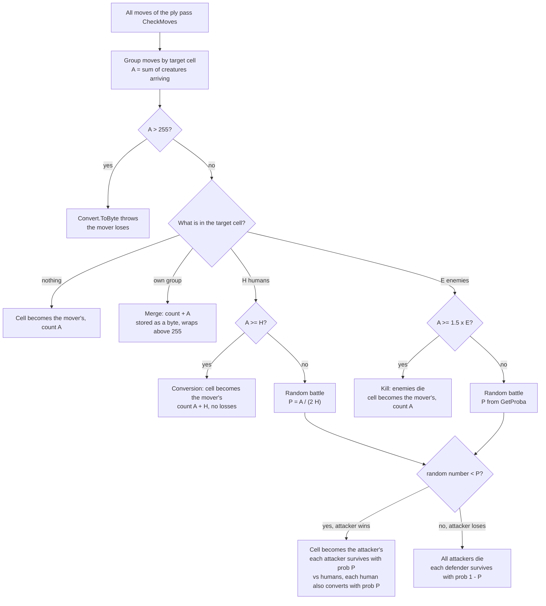

# 🧛 Game rules and battle math

This chapter explains Vampires vs Werewolves from zero, then covers the exact rules the tournament server applies (recovered from its binary) and the battle math every later chapter depends on.

> **At a glance**
> - Two monster species fight on a grid full of human houses. You win by having more creatures than the opponent when the game ends, or by wiping the opponent out.
> - Humans are free food: enter a human cell with at least as many creatures and they all join you, with no losses and no dice.
> - Monsters kill monsters with no dice only at **attacker ≥ 1.5 × defender** (inclusive). Anything less is a **random battle** that destroys a lot of material on average.
> - The PDF and the server disagree on several points. The server wins: a defender with 1.5× is *not* safe, moves into one cell are summed, an illegal or empty move is an instant loss, and a timeout only skips the turn.
> - All of this is coded once in `vvw/rules.py` and mirrored in `vvw/state.py`.

**Contents**
1. [The game in one minute](#the-game-in-one-minute)
2. [The board, the species and a turn](#the-board-the-species-and-a-turn)
3. [Goal and end of the game](#goal-and-end-of-the-game)
4. [The six movement rules](#the-six-movement-rules)
5. [What happens when creatures enter a cell](#what-happens-when-creatures-enter-a-cell)
6. [Random battles: probability and survivors](#random-battles-probability-and-survivors)
7. [Worked examples](#worked-examples)
8. [What the PDF says vs what the server really does](#what-the-pdf-says-vs-what-the-server-really-does)
9. [How the server rules were found](#how-the-server-rules-were-found)
10. [Strategic consequences](#strategic-consequences)
11. [Where it lives in the code](#where-it-lives-in-the-code)
12. [Key takeaways](#key-takeaways)

---

## The game in one minute

Picture a chessboard-like grid at night. Some squares hold houses full of humans. One square holds all the **Vampires**, another holds all the **Werewolves**. Players take turns. On your turn you move some or all of your creatures one step in any of the 8 directions, and you may split a group into several parts that go different ways.

- Step onto humans with **at least as many** creatures as there are humans: the humans are bitten or scratched and **become your species**. Your group grows by their number.
- Step onto enemy monsters with **at least 1.5 times** their number: they die and you lose nobody.
- Anything weaker than that starts a **random battle**: dice decide who wins, and the winner loses creatures too.

The game ends when one species is wiped out, or at "daylight" (a ply or time limit). Then the species with more creatures wins. Humans don't count.

## The board, the species and a turn

| Concept | Meaning |
|---|---|
| Grid | `rows × cols` cells (the server's `SET` message sends rows first, then columns). Fully observable: both players see everything. |
| Coordinates | `(x, y)`: `x` = column, `y` = row, `(0, 0)` at the top left, zero-based. |
| Cell contents | At most one species per cell: humans, vampires or werewolves, with a count. |
| Humans | Neutral. They never move. They are converted or fight back only when monsters enter their cell. |
| Vampires | Player 0. **They move first.** |
| Werewolves | Player 1. |
| Start | Each species starts in a single cell with all its creatures. |
| Group | All of one species' creatures in one cell. Groups can split and merge freely. |
| Ply | One player's whole turn: a list of moves sent in one `MOV` message. The players alternate plies: Vampires play plies 0, 2, 4, … and Werewolves plies 1, 3, 5, … |
| Move | `(source cell, number of creatures, target cell)`, the target being one of the 8 neighbours. |

A turn can contain many moves: "send 5 north-east and 3 south from this cell, and move that other group west" is one ply.

## Goal and end of the game

| The game ends when … | Who wins |
|---|---|
| A species has **0 creatures** after any move | The other species, immediately. |
| The **ply limit** is reached: `MaxPlays`, 200 by default, counting *both* players' plies, so 100 moves each | The species with the **larger total**. Humans don't count. |
| The **game time limit** is reached: `MaxGameDuration`, 5 minutes by default, checked only after the Werewolves' moves | Same: larger total wins. |
| Ply or time limit with **equal totals** | Nobody: a draw. |
| A player sends an **illegal or empty move**, or the server crashes on it | That player **loses on the spot** (the server treats it as cheating). |
| A player doesn't answer within the move time (2 s in the PDF) | Nothing ends: that player's **turn is skipped**. |

> ⚠️ **Watch out:** a draw wins nothing in the tournament. That's why the evaluation in [chapter 4](./04-evaluation.md) values a draw slightly below a fair coin flip at the very end of the game.

## The six movement rules

The PDF lists six rules. The server's `Board.CheckMoves` enforces them, and **any single violation makes the whole move set illegal, which loses the game**.

| Rule | PDF wording | What the server checks |
|---|---|---|
| 1 | At least one movement by ply | An empty `MOV` raises `NoMoveException` ("stayed static"): **loss**. |
| 2 | You can only move your species' groups | Every source cell must hold the player's species. |
| 3 | Enough creatures on a cell for all the moves from it | The counts leaving one source are **summed**, and the sum must be ≤ the cell's count. |
| 4 | Move in 8 directions (unless on borders) | `dx` and `dy` each in −1, 0, +1. There is **no bounds check on the target**: an off-board target crashes the handler, which also counts as a loss. |
| 5 | In one ply a cell cannot be both target and source | No target may also be a source, and no source may also be a target, across the whole move set. So "staying put" (target = source) is not a legal move either. |
| 6 | Move at least one creature | A move of 0 creatures is illegal. |

Rule 5 forbids "conveyor belts": you can't move group A into cell B while group B leaves B in the same ply. It does **not** forbid several moves into the same target. Those are summed, which is how two groups join one attack (see [Example 5](#example-5-two-groups-merge-into-one-attack)).

## What happens when creatures enter a cell

After validation, `Board.PerformMoves` groups the moves by target cell and sums the arrivals. Call that sum **A**. Then each target is resolved as follows:



In words:

| Target cell holds | Condition | Result |
|---|---|---|
| Nothing | — | The arrivals occupy it: count `A`. |
| Your own group | — | Merge: `count + A`. |
| `H` humans | `A ≥ H` | **Conversion**: count `A + H`, deterministic, nobody dies. |
| `H` humans | `A < H` | Random battle with `P = A / (2H)`. |
| `E` enemies | `A ≥ 1.5·E` (inclusive) | **Kill**: enemies removed, count `A`, deterministic, you lose nobody. |
| `E` enemies | `A < 1.5·E` | Random battle with `P` from the formula below. |

## Random battles: probability and survivors

### The win probability

The server's `Board.GetProba(E1, E2, vsHumans)`, with `E1` = attackers and `E2` = defenders, and `C = 1.0` against humans or `1.5` against monsters:

| Case | P (attacker wins) |
|---|---|
| `E1 == E2` | `0.5` |
| `E1 ≥ C · E2` | `1` (never reached in practice: the deterministic conversion and kill catch these cases first) |
| `E1 < E2` | `E1 / (2 · E2)` |
| otherwise, monsters only: `E2 < E1 < 1.5 · E2` | `E1 / E2 − 0.5` |

The curve is continuous. It rises linearly from 0 to 0.5 at equal numbers, then from 0.5 to 1 at 1.5×.

Every number below was computed with `vvw.rules.win_probability`, `vvw.rules.battle_outcomes` and `vvw.rules.attack_ev`:

**Monster vs monster**

| Attackers v defenders | Ratio | P(attacker wins) | If the attacker wins, attackers left ≈ | If it loses, defenders left ≈ | Expected margin swing (`attack_ev`) |
|---|---|---|---|---|---|
| 2 v 10 | 0.20 | 0.10 | 0 | 9 | −0.08 |
| 5 v 10 | 0.50 | 0.25 | 1 | 8 | −0.31 |
| 4 v 6 (defender has 1.5×) | 0.67 | 0.333 | 1 | 4 | −0.22 |
| 8 v 10 | 0.80 | 0.40 | 3 | 6 | −0.32 |
| 9 v 10 | 0.90 | 0.45 | 4 | 6 | −0.20 |
| 10 v 10 | 1.00 | 0.50 | 5 | 5 | 0.00 |
| 11 v 10 | 1.10 | 0.60 | 7 | 4 | +1.36 |
| 12 v 10 | 1.20 | 0.70 | 8 | 3 | +2.98 |
| 13 v 10 | 1.30 | 0.80 | 10 | 2 | +4.92 |
| 14 v 10 | 1.40 | 0.90 | 13 | 1 | +7.24 |
| 29 v 20 | 1.45 | 0.95 | 28 | 1 | +17.12 |
| 15 v 10 | 1.50 | 1 (kill, no dice) | 15 | — | +10.00 |
| 20 v 10 | 2.00 | 1 (kill, no dice) | 20 | — | +10.00 |

`attack_ev` is the expected change of (attacker − defender) material. It is positive for **any** size advantage, not just at 1.5×, which is why the evaluation in [chapter 4](./04-evaluation.md) treats a 1.3× neighbour as a real threat.

**Monsters vs humans**

| Attackers v humans | P(attacker wins) | If the attacker wins, its creatures ≈ (attackers + humans, each kept with prob P) | If it loses, humans left ≈ |
|---|---|---|---|
| 2 v 10 | 0.10 | 1 | 9 |
| 3 v 4 | 0.375 | 3 | 2 |
| 5 v 10 | 0.25 | 4 | 8 |
| 8 v 10 | 0.40 | 7 | 6 |
| 9 v 10 | 0.45 | 9 | 6 |
| 10 v 10 | conversion, no dice | 20 | — |
| 11 v 10 | conversion, no dice | 21 | — |

### Who survives a random battle

| Outcome | Cell afterwards | Survivors |
|---|---|---|
| Attacker wins vs monsters | Attacker's | Each of the `E1` attackers survives independently with probability `P`. |
| Attacker wins vs humans | Attacker's | Each attacker survives with probability `P`, **and** each of the `E2` humans survives with probability `P` and is converted. |
| Attacker loses (either case) | Defender's | All attackers die. Each defender survives independently with probability `1 − P`. |

If every survivor roll fails, the cell ends up **empty**.

That gives these expected counts, before you know who won:

- expected attacker creatures afterwards: `P · (P · E1)` = **`P² · E1`** (or `P² · (E1 + E2)` against humans),
- expected defenders afterwards: **`(1 − P)² · E2`**.

| Battle | P | E[attackers after] | E[defenders after] | Material before → expected after |
|---|---|---|---|---|
| 6 V attack 8 W | 0.375 | 0.375² · 6 = 0.84 | 0.625² · 8 = 3.13 | 14 → 3.97 |
| 10 V attack 10 W | 0.5 | 2.50 | 2.50 | 20 → 5.00 |
| 13 V attack 10 W | 0.8 | 8.32 | 0.40 | 23 → 8.72 |
| 3 V attack 4 H | 0.375 | 0.375² · 7 = 0.98 | 0.625² · 4 = 1.56 | 3 monsters → 0.98 monsters |

> 💡 **Tip:** a fair 10 v 10 fight destroys three quarters of the creatures involved on average. Random battles are a material furnace. Only fight one when the dice are worth it.

> ⚠️ **Watch out:** the search does not branch on every possible survivor count. `battle_outcomes` gives two outcomes (win / loss), each carrying the **expected survivor count given that outcome, rounded** with Python's `round` (so 2.5 rounds to 2). The real server rolls every survivor separately, so a 6 v 8 win can leave anything from 0 to 6 vampires. The in-process referee `sim/referee.py` rolls real dice like the server does.

## Worked examples

All grids use this legend: `V` = vampires, `W` = werewolves, `H` = humans, the number is the count, `.` is empty. Vampires are to move. Every result below was produced by `vvw.state.apply_moves`, and every move set was checked legal by `vvw.state.validate`.

### Example 1: converting humans

Vampires move all 5 from (1,1) to (2,1), onto 4 humans. 5 ≥ 4, so it's a conversion.

```
Before                       After (certain)
      x=0 x=1 x=2 x=3              x=0 x=1 x=2 x=3
y=0    .   .   .   .         y=0    .   .   .   .
y=1    .   V5  H4  .         y=1    .   .   V9  .
y=2    .   .   .   W7        y=2    .   .   .   W7
```

The vampires go from 5 to **9** with no risk. Before the move the werewolves (7) outnumbered them. After it, the vampires lead 9 to 7.

### Example 2: a deterministic kill, and why "inclusive" matters

9 vampires attack 6 werewolves. 9 ≥ 1.5 × 6 = 9, so it's a kill.

```
Before                       After (certain)
      x=0 x=1 x=2 x=3              x=0 x=1 x=2 x=3
y=0    .   .   .   .         y=0    .   .   .   .
y=1    .   V9  .   .         y=1    .   .   .   .
y=2    .   .   W6  .         y=2    .   .   V9  .
```

With 8 vampires instead of 9, the same attack is a random battle: P = 8/6 − 0.5 = **0.833**.

```
Attacker wins (p = 0.833)    Attacker loses (p = 0.167)
      x=0 x=1 x=2 x=3              x=0 x=1 x=2 x=3
y=0    .   .   .   .         y=0    .   .   .   .
y=1    .   .   .   .         y=1    .   .   .   .
y=2    .   .   V7  .         y=2    .   .   W1  .
```

One creature less turns a free kill into a 1-in-6 chance of losing the whole group.

### Example 3: a random battle against monsters

6 vampires attack 8 werewolves: 6 < 8, so P = 6 / (2 × 8) = **0.375**.

```
Before                       Attacker wins (p = 0.375)    Attacker loses (p = 0.625)
      x=0 x=1 x=2 x=3              x=0 x=1 x=2 x=3              x=0 x=1 x=2 x=3
y=0    .   .   .   .         y=0    .   .   .   .         y=0    .   .   .   .
y=1    .   V6  W8  .         y=1    .   .   V2  .         y=1    .   .   W5  .
y=2    .   .   .   .         y=2    .   .   .   .         y=2    .   .   .   .
```

Expected survivors given each outcome: 6 × 0.375 = 2.25 ≈ 2 vampires, or 8 × 0.625 = 5 werewolves. Either way, 14 creatures become about 2 to 5.

### Example 4: a random battle against humans

3 vampires attack 4 humans: 3 < 4, so P = 3 / (2 × 4) = **0.375**.

```
Before                       Attacker wins (p = 0.375)    Attacker loses (p = 0.625)
      x=0 x=1 x=2 x=3              x=0 x=1 x=2 x=3              x=0 x=1 x=2 x=3
y=0    .   .   .   W9        y=0    .   .   .   W9        y=0    .   .   .   W9
y=1    .   V3  H4  .         y=1    .   .   V3  .         y=1    .   .   H2  .
y=2    .   .   .   .         y=2    .   .   .   .         y=2    .   .   .   .
```

On a win, all 7 creatures (3 attackers + 4 humans) each survive with probability 0.375: 2.6 expected, shown rounded as 3. On a loss, the 3 vampires are gone and about 2 of the 4 humans remain. The expected vampire count afterwards is only 0.98, so this gamble loses two creatures on average. Arriving with 4 instead would have given 8 vampires for certain.

### Example 5: two groups merge into one attack

Two groups of 4 vampires both step into the cell of 5 werewolves. Arrivals are summed: 8 ≥ 1.5 × 5 = 7.5, so it's a kill. Rule 5 is respected: the two sources (1,0) and (1,2) are not targets, and the target (2,1) is not a source.

```
Before                       After (certain)
      x=0 x=1 x=2 x=3              x=0 x=1 x=2 x=3
y=0    .   V4  .   .         y=0    .   .   .   .
y=1    .   .   W5  .         y=1    .   .   V8  .
y=2    .   V4  .   .         y=2    .   .   .   .
```

If only one group attacked (4 v 5), it would be a random battle with P = 4/10 = 0.4: a win leaves about 2 vampires, a loss leaves about 3 werewolves.

### Example 6: an illegal chain (Rule 5)

Vampires try to move (0,1) → (1,1) and (1,1) → (2,1) in the same ply, to "pass the group forward":

```
      x=0 x=1 x=2 x=3
y=0    .   .   .   .
y=1    V4  V4  .   W5
y=2    .   .   .   .
```

Cell (1,1) is both a target and a source. `validate` answers `cell is both source and target`, and the server would declare an **instant loss**. Our client never sends this (see [chapter 5](./05-move-generation.md)).

### Example 7: a defender with 1.5× is not safe

4 vampires attack 6 werewolves. The PDF says the defenders, being 1.5× more numerous, "kill all the attackers". The server actually runs a random battle with P = 4 / 12 = **0.333**: one time in three the vampires win, and about 1 survives.

## What the PDF says vs what the server really does

On tournament day the referee is the server, not the PDF. Where they differ, we follow the server (⚠️ marks a real contradiction; the other rows are gaps the PDF leaves open).

| Topic | PDF (`Projectv10.pdf`) | Server v3.2.1 | Found in |
|---|---|---|---|
| ⚠️ Defender ≥ 1.5× attacker | "they will kill all the attackers" | **No automatic win.** Random battle, `P = E1/(2·E2)` (≤ 1/3) | `Board.PerformMoves`, `Board.GetProba` |
| Kill threshold | "1.5 time more numerous" (≥ or >?) | `A ≥ 1.5·E`, **inclusive** | `Board.PerformMoves` |
| Constant `C` in the formula | `(C×E2 ; 1)`, `C` not defined | `C = 1.0` vs humans, `1.5` vs monsters | `Board.GetProba` |
| Several moves into one cell | not mentioned | **Summed** before resolving | `Board.PerformMoves` |
| ⚠️ Number of moves | `0 <= n <= number of groups` | `n = 0` is an **instant loss**. **No upper limit**, so splits are free | `Board.CheckMoves`, `GameControl.GameRoutine` |
| Illegal move | not specified | **Instant loss** (treated as cheating) | `Board.CheckMoves`, `GameControl.GameRoutine` |
| Off-board target | "unless on borders" | Not checked: the handler crashes, which is a **loss** | `Board.CheckMoves` |
| Creature counts | sent as bytes | Stored as **bytes**: an arrival sum > 255 throws (loss), a merge > 255 **wraps** | `Board.PerformMoves` |
| Timeout | "the server calls the other player" | **Turn skipped**, not a loss. Unread bytes (up to 1300) are flushed before the next `UPD`. A late `MOV` arriving after that `UPD` counts as the answer to the new turn, which can be illegal there | `GameControl.GameRoutine` |
| Who moves first | "the first player" | **Vampires** (player 0, player index = `ply % 2`) | `GameControl.GameRoutine` |
| Ply limit | "a maximum number of plys" | `MaxPlays` = 200 by default, counting **both** players' plies | `GameControl.GameRoutine` |
| Time limit | "a maximum time" | `MaxGameDuration` = 5 min by default, checked only after Werewolves' moves | `GameControl.GameRoutine` |
| Winner | "the dominant species" | Larger total, humans don't count; **equal totals = no winner** | `GameControl.GameRoutine` |
| Random battle survivors | as described | As described: win, each attacker (and each human) kept with prob `P`; loss, each defender kept with prob `1 − P` | `Board.PerformRandomBattle` |

## How the server rules were found

The PDF leaves gaps that decide games (≥ or >? what is C? are moves summed?). The course provides the server as a .NET program (`Server v3.2.1 (1).zip`). Its game logic sits in `VVSW.Model.dll`. We disassembled that DLL: its CIL bytecode was read with a small hand-written metadata parser (the parser itself is not part of this repository). We then read the referee's methods one by one:

| Method | What it told us |
|---|---|
| `Board.GetProba` | The exact random-battle probability, including `C = 1.0 / 1.5`. |
| `Board.PerformMoves` | Moves grouped by target and summed, `Convert.ToByte` on the sum, merge / conversion / kill thresholds, no "defender wins automatically" branch. |
| `Board.PerformRandomBattle` | The survivor rolls: `P` per attacker (and per human), `1 − P` per defender. |
| `Board.CheckMoves` | The legality checks, which became `vvw/state.py:validate` line by line, plus the cases that crash instead of being checked (off-board target, byte overflow). |
| `GameControl.GameRoutine` | Turn order, `MaxPlays` in plies, the game timer checked after Werewolves' moves, timeout = skip, illegal = loss, flush of unread bytes, end-of-game sleep then `END` / `BYE`. |
| `GameControl.InitiatePlayerComm` | The connection handshake (`NME`, then `SET`+`HUM`+`HME` in one packet, then `MAP`). See [chapter 8](./08-running-and-protocol.md). |

The findings are written up in `RULES.md` and encoded **once** in `vvw/rules.py`. They are then cross-checked three ways:

- `tests/test_rules.py` pins the formulas (`test_defender_at_1_5x_is_not_automatic`, `test_kill_is_inclusive`, `test_moves_into_same_target_are_summed`, …).
- `sim/referee.py:perform_moves` re-implements `PerformMoves` with real dice. Tests check that it agrees with `apply_moves` on deterministic moves, and that its empirical win rate in 4,000 battles of 6 v 10 matches `GetProba` (0.30).
- `sim/fake_server.py` reproduces `GameRoutine` byte for byte, so real client processes can be tested end to end ([chapter 7](./07-testing-and-results.md)).

> ⚠️ **Watch out:** the server settings (`MaxPlays`, `MaxGameDuration`, the move time) are configurable, and a client can't read them. The defaults are 200 plies and 5 minutes. `vvw/ai.py:Agent.plies_left` extends its assumption if a game outlives it.

## Strategic consequences

### Why 1.5× matters

At **≥ 1.5×** an attack is a sure kill with zero losses. Just below it, the same attack becomes a gamble with real downside: at 14 v 10 you still lose everything 10% of the time. This line splits the whole game:

- A group is **safe** from an adjacent enemy only if the enemy has less than 1.5× its size, and even then it's only safe from *deterministic* attacks (see below).
- Merging two groups can cross the threshold (Example 5). Splitting can fall below it. Every split has to be checked against nearby enemies.
- Below 1.5×, the expected margin swing is still positive for the bigger side (`attack_ev(13, 10) = +4.92`), so "bigger" is a threat at any ratio above 1.

### Why humans are the main resource

| Action | Requirement | Effect on your margin | Risk |
|---|---|---|---|
| Convert `H` humans | `A ≥ H` (just 1×) | **+H**, and you lose nobody | none |
| Kill `E` enemies | `A ≥ 1.5·E` | +E | none |
| Attack enemies at 1.3× (13 v 10) | — | +4.92 expected | 20% chance of losing the group |

Converting needs only parity, never costs a creature, and makes your groups bigger, which unlocks bigger human cells and enemy kills later. On the sample map `sim/maps/testmap2.xml` each species starts with 10 creatures while 32 humans wait in 5 houses, one of them holding 20. So the early game is a **race for humans**: whoever converts more, sooner, enters the fighting phase with the 1.5× advantage. This is the core of the evaluation's "human race" term ([chapter 4](./04-evaluation.md)) and the reason the move generator splits groups to cover several houses at once ([chapter 5](./05-move-generation.md)).

Attacking humans with fewer than their number (Example 4) is almost always bad: 3 v 4 leaves 0.98 vampires on average, where one more creature would give 8 for certain.

### Why a lead below 1.5× isn't safe on a finite board

The end rule says the bigger total wins, so it's tempting to grab a small lead and run. That doesn't work:

- The board is finite, and both sides move at the same speed in 8 directions. A determined pursuer can push an evader against a wall, then into a corner, and force contact.
- Once contact happens and the leader is below 1.5×, it's a random battle. **Attacking gives better odds than being attacked.** With 13 against 10:

| Who attacks | P(13 wins) |
|---|---|
| The 13 attack the 10 | 0.80 |
| The 10 attack the 13 | 1 − 10/26 = 0.615 |

So a trailing player has a real reason to chase and strike first (38.5% to turn the game around). The AI plays both roles accordingly. Its endgame evaluation nudges a leader to avoid contact and keep its pursued groups off the walls, and nudges a trailer to seek contact and herd the leader toward them ([chapter 4](./04-evaluation.md)). When the battle can't be avoided, the search compares attacking with being attacked and takes the battle on its own terms ([chapter 3](./03-search.md)).

### Other consequences

- **Splits are free.** The server doesn't limit the number of moves, so one ply can send detachments to several human cells.
- **Byte limits are real.** Merging two big groups past 255 wraps the count, and an arrival sum past 255 loses the game. `validate` rejects both.
- **Never send an illegal move**, and never let a late `MOV` arrive after the next `UPD`. Either can turn a won position into a forfeit. Chapter 2 shows the layers that prevent it.

## Where it lives in the code

| File | Function / constant | What it does |
|---|---|---|
| `vvw/rules.py` | `KILL_RATIO`, `MAX_CELL` | 1.5 (inclusive) and 255 |
| `vvw/rules.py` | `win_probability` | `Board.GetProba` |
| `vvw/rules.py` | `battle_outcomes` | Deterministic result, or win / loss branches with expected survivors |
| `vvw/rules.py` | `attack_ev` | Expected margin swing of a monster attack |
| `vvw/state.py` | `validate` | Mirror of `Board.CheckMoves` plus the crash cases |
| `vvw/state.py` | `apply_moves` | Mirror of `Board.PerformMoves`, random battles as chance branches |
| `sim/referee.py` | `perform_moves`, `_random_battle`, `play_game` | The server's rules with real dice, for simulated games |
| `sim/fake_server.py` | `FakeServer.run` | Byte-exact `GameRoutine` for end-to-end tests |
| `tests/test_rules.py` | `WinProbability`, `Outcomes`, `Validation`, `Transition` | Pins all of the above |
| `RULES.md` | — | The raw findings from the disassembly |

## Key takeaways

- Conversion (`A ≥ H`) and kills (`A ≥ 1.5·E`, inclusive) are deterministic and lossless. Everything else is a random battle.
- A random battle's `P` is linear in the ratio: `E1/(2·E2)` below parity, `E1/E2 − 0.5` between 1× and 1.5×. Expected survivors are `P²·E1` and `(1−P)²·E2`, so battles burn material.
- The server, not the PDF, is the referee: a defender with 1.5× is not safe, arrivals are summed, empty or illegal moves lose instantly, timeouts skip the turn, counts are bytes, Vampires move first.
- Humans are the main resource. A lead below 1.5× can be forced into a battle on a finite board, and the attacker gets the better odds.

---

← Previous: none · [Index](../README.md#documentation) · Next: [Architecture](./02-architecture.md) →
