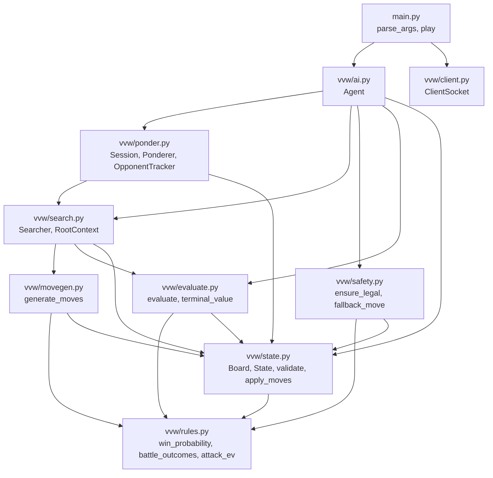
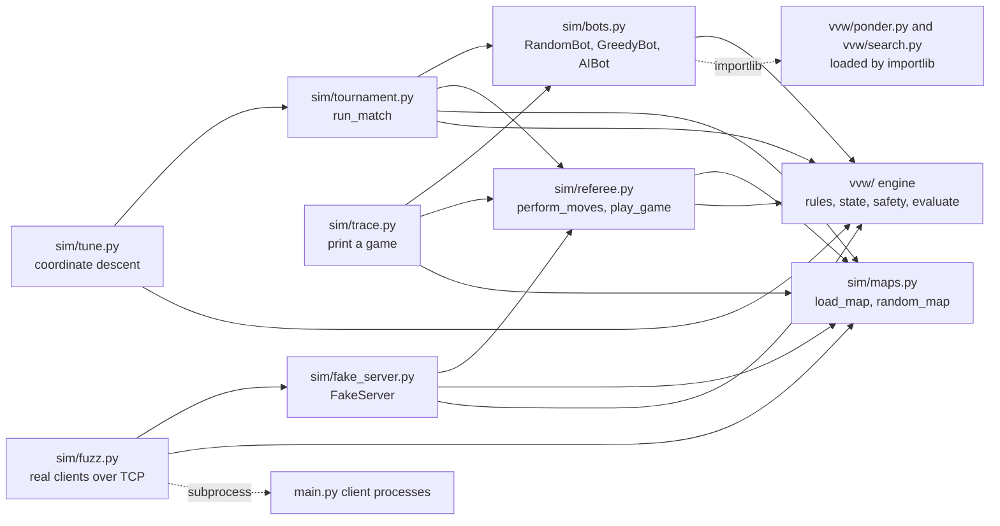
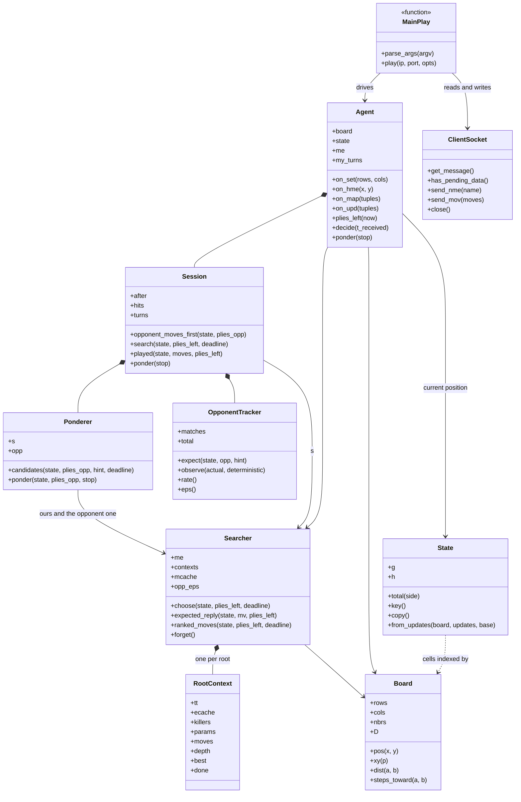
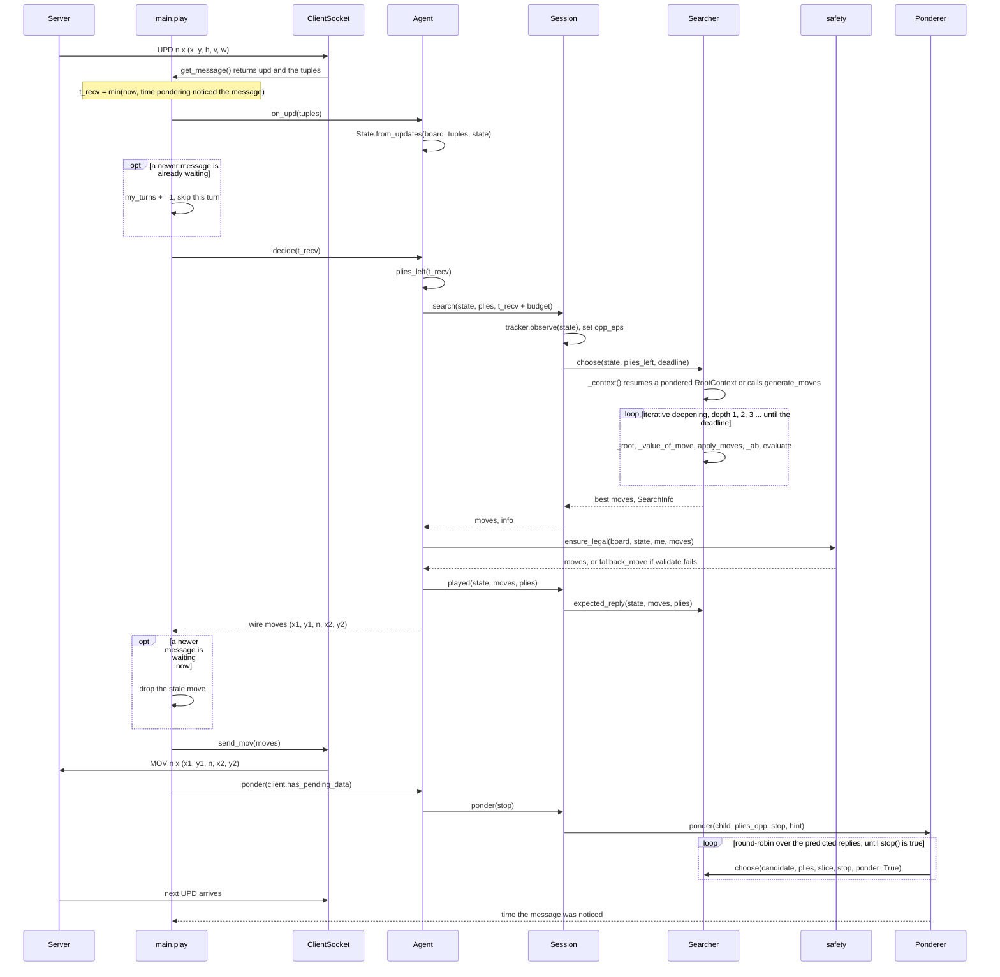
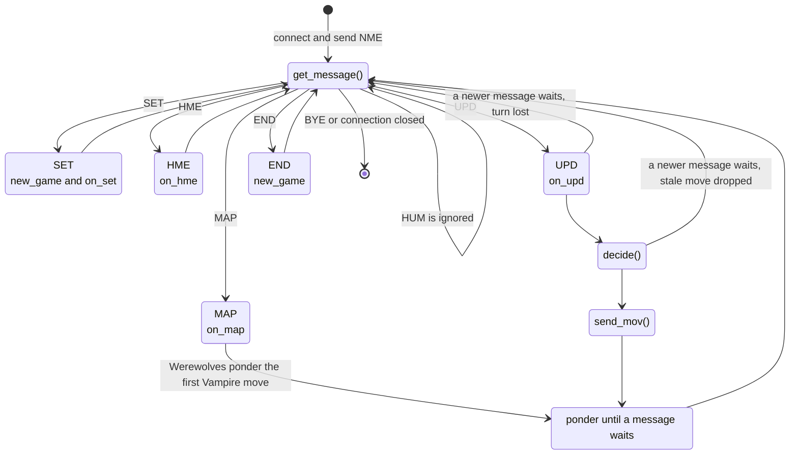
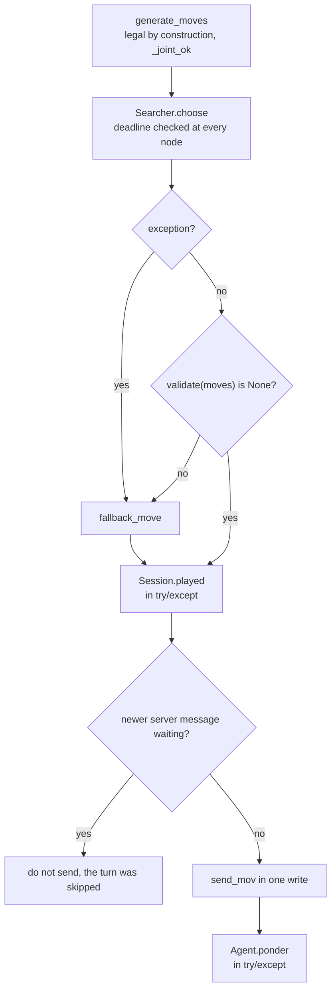

# 🏗️ Architecture

This chapter shows how the code is organised: which module does what, how a position is represented, what happens between receiving `UPD` and sending `MOV`, and the safety and performance engineering around it.

> **At a glance**
> - Pure Python 3 standard library, no dependencies. `main.py` runs a small message loop. `vvw/` is the engine, `sim/` is the test harness (referee, fake server, bots, tournaments).
> - A position is three dicts `cell → count` (vampires, werewolves, humans), with cells as integers `p = y·cols + x`. `State.key()` turns them into frozensets for hashing.
> - One turn: `Agent.on_upd` → `Agent.decide` → `Session.search` → `Searcher.choose` (iterative-deepening expectiminimax) → `ensure_legal` → `MOV`, then pondering on the opponent's time until the next message.
> - Several independent layers make sure we never forfeit: legal-by-construction moves, a server-mirroring validator, a guaranteed-legal fallback, `try/except` around anything optional, and a desync guard.
> - The cyclic garbage collector is off (it paused ~400 ms on our tables). Every cache has a cap. About 240 MB per client on 50×50 maps.

**Contents**
1. [Module map](#module-map)
2. [Responsibilities per file](#responsibilities-per-file)
3. [Data model](#data-model)
4. [Classes](#classes)
5. [The life of one turn](#the-life-of-one-turn)
6. [The main loop](#the-main-loop)
7. [Error handling: never forfeit](#error-handling-never-forfeit)
8. [Performance engineering](#performance-engineering)
9. [Design decisions](#design-decisions)
10. [Where it lives in the code](#where-it-lives-in-the-code)
11. [Key takeaways](#key-takeaways)

---

## Module map

The engine is layered. `rules.py` at the bottom knows only the battle math. `state.py` knows the board and how moves change it. Above that, three independent "brains" (move generation, evaluation, safety) are combined by the search, which is driven by the pondering session, which is driven by the agent. An arrow means "imports".



`vvw/client.py` imports nothing from the engine, and the engine knows nothing about sockets. That is what lets the simulator drive the very same engine in-process.

The test harness in `sim/` reuses the engine's rules and state, and plays the real AI through `sim/bots.py:AIBot`:



`AIBot` loads `search` and `ponder` by name with `importlib`, so the same class can also play a frozen earlier version of the engine (`sim/snapshots/<tag>`) for regression matches.

## Responsibilities per file

| File | Responsibility | Main entry points |
|---|---|---|
| `main.py` | Command line (IP and port are always the **last two** arguments, extra launcher options are tolerated), the message loop, the desync guard, `gc.disable()` | `parse_args`, `play` |
| `vvw/client.py` | Byte-exact protocol: exact-length reads, `MOV` sent in a single write, `TCP_NODELAY`, a non-blocking "is a message waiting?" check | `ClientSocket.get_message`, `send_nme`, `send_mov`, `has_pending_data` |
| `vvw/ai.py` | Keeps the game state from `MAP`/`UPD`, detects our species from `HME`, counts plies and game time, calls the search, converts cells to wire coordinates | `Agent.on_map`, `on_upd`, `decide`, `ponder`, `plies_left` |
| `vvw/ponder.py` | One game's thinking: search + pondering + opponent tracking. Shared by the client and the simulator | `Session`, `Ponderer`, `OpponentTracker` |
| `vvw/search.py` | Iterative-deepening alpha-beta expectiminimax with transposition table, killer moves, tempo bonus, risk aversion and the soft-min opponent model | `Searcher.choose`, `_root`, `_value_of_move`, `_ab`, `_soft_min`, `expected_reply`, `ranked_moves` |
| `vvw/movegen.py` | A few purposeful candidate turns per position instead of every split | `generate_moves`, `group_options`, `_split_options`, `_joint_ok` |
| `vvw/evaluate.py` | Static evaluation on one scale with game outcomes: `raw + G·tanh(raw/k)` | `evaluate`, `terminal_value`, `win_value`, `utility_k`, `root_slope`, `_tours` |
| `vvw/state.py` | Board geometry, the position, the server-mirroring validator and the turn resolver | `Board`, `State`, `validate`, `apply_moves` |
| `vvw/rules.py` | The battle math recovered from the server ([chapter 1](./01-game-rules.md)) | `win_probability`, `battle_outcomes`, `attack_ev`, `KILL_RATIO`, `MAX_CELL` |
| `vvw/safety.py` | A legal move no matter what | `ensure_legal`, `fallback_move` |
| `sim/referee.py` | The server's rules with real dice, in-process games | `perform_moves`, `play_game` |
| `sim/fake_server.py` | Byte-exact TCP stand-in for the real server | `FakeServer.run` |
| `sim/bots.py` | Baselines (random, greedy, aggressive) and our AI driven through `Session` | `make_bot`, `AIBot`, `SnapshotBot` |
| `sim/maps.py` | Server XML maps and point-symmetric random maps | `load_map`, `random_map` |
| `sim/tournament.py`, `sim/tune.py`, `sim/fuzz.py`, `sim/trace.py` | Parallel matches, weight tuning, protocol fuzzing with real client processes, game traces | `run_match`, `score`, `one_game`, `main` |

## Data model

### Cells are integers

Every cell is one integer `p = y · cols + x`. Integers are fast dict keys and list indices, and a move is just a 3-tuple of ints `(src, count, dst)`. Conversion to `(x, y)` happens only at the edges: when reading `MAP`/`UPD` (`Board.pos`) and when writing `MOV` (`Board.xs`, `Board.ys`).

Example on a 4-row × 5-column board:

```
      x=0 x=1 x=2 x=3 x=4
y=0    0   1   2   3   4
y=1    5   6   7   8   9
y=2   10  11  12  13  14
y=3   15  16  17  18  19
```

`board.pos(3, 2) = 2·5 + 3 = 13`, and `board.xy(13) = (3, 2)`.

### `Board`: static geometry, computed once per game

| Field / method | What it holds | Example (4×5 board) |
|---|---|---|
| `xs[p]`, `ys[p]` | Column and row of each cell | `xs[13] = 3`, `ys[13] = 2` |
| `nbrs[p]` | Tuple of the 8 (or fewer, on borders) neighbours | `nbrs[13] = (7, 8, 9, 12, 14, 17, 18, 19)`, `nbrs[0] = (1, 5, 6)` |
| `nbr_sets[p]` | Same as a frozenset, for O(1) adjacency checks in `validate` | |
| `D[a][b]` | Chebyshev distance `max(dx, dy)`, the number of moves between two cells | `D[13][0] = 3` |
| `steps_toward(a, b)` | Neighbours of `a` that are one step closer to `b`, cached in `_steps` | `steps_toward(13, 0) = (7, 12)`, i.e. (2,1) and (2,2) |

`D` is a `_DistRows` dict whose `__missing__` builds a row only the first time it is asked for, stored as `bytes` (one byte per cell, distances ≤ 254). A 50×50 board has 2,500 cells. A full matrix would be 6.25 million entries, but only the rows of cells that groups or humans actually occupy are ever built.

### `State`: one position

```python
class State:
    __slots__ = ("g", "h", "_key")
    # g = (vampires, werewolves): two dicts cell -> count;  g[side] for side 0 or 1
    # h = humans: dict cell -> count
```

| Member | Meaning |
|---|---|
| `g[0]`, `g[1]` | Vampires' and werewolves' groups. Indexing by side (`state.g[me]`, `state.g[1 - me]`) means no code is written twice for the two species. |
| `h` | Human cells. |
| `total(side)` | Sum of a side's creatures (what decides the game). |
| `key()` | `(frozenset(g[0].items()), frozenset(g[1].items()), frozenset(h.items()))`, computed once and cached in `_key`. The hashable identity of a position. |
| `copy()` | Fresh dicts. States are **immutable by convention**: `apply_moves` builds new dicts instead of mutating its input. |
| `from_updates(board, tuples, base)` | Applies `MAP`/`UPD` 5-tuples `(x, y, humans, vampires, werewolves)` to a copy of `base`. A count of 0 removes the cell. |

Example: the 5-tuples `(3,2,0,6,0)`, `(0,0,0,0,5)`, `(4,0,3,0,0)` give `g = ({13: 6}, {0: 5})`, `h = {4: 3}` and

```python
key() == (frozenset({(13, 6)}), frozenset({(0, 5)}), frozenset({(4, 3)}))
```

`key()` is the base of every table in the search:

| Table | Key |
|---|---|
| Transposition table, leaf-evaluation cache | `(state.key(), side_to_move, plies_left)` |
| Move-list cache `Searcher.mcache` | `(state.key(), side_to_move)` |
| Per-root search contexts `Searcher.contexts` | `(state.key(), plies_left)` |
| Opponent tracker | `key()` of the position our predicted reply leads to |

### Transitions: `apply_moves`

`apply_moves(state, side, moves)` mirrors the server's `PerformMoves` and returns a list of `(probability, next_state)`. Deterministic turns return one branch. Each random battle splits every branch into win and loss (with the expected survivors from `rules.battle_outcomes`). To keep the tree small, the number of branches per turn is capped at `MAX_BRANCHES = 4`: beyond that, a battle keeps only its most likely outcome.

## Classes



| Class | Lifetime | Role |
|---|---|---|
| `ClientSocket` | One connection | Bytes in, bytes out. Knows nothing about strategy. |
| `Agent` | The whole process. `new_game()` resets it on `SET` and `END` | Turns server messages into `State`s and asks for decisions. Holds the clock and ply bookkeeping. |
| `Session` | One game | Glue between search, pondering and opponent tracking. The same class runs in the tournament client and in `sim/bots.py:AIBot`, so the simulator tests exactly the code that plays. |
| `Searcher` | One game | The search. Its per-root `RootContext`s survive between calls, which is how a pondered search resumes. |
| `RootContext` | One root position | Transposition table, leaf cache, killer moves, the root's `(G, risk, tempo)` parameters, ordered root moves, depth reached. |
| `Ponderer` | One game | Predicts the opponent's 3 most likely replies (with a second `Searcher` playing the opponent's side) and pre-searches our answer to each. |
| `OpponentTracker` | One game | Counts how often the opponent plays the reply we predicted, and turns that into the opponent-model weight ε. |
| `Board`, `State` | One game / one position | See [Data model](#data-model). |

Search internals are in [chapter 3](./03-search.md), pondering and the opponent model in [chapter 6](./06-pondering-and-opponent-model.md).

## The life of one turn



Step by step:

1. **Receive.** `ClientSocket.get_message` reads exactly the bytes of one message. The move clock starts at `t_recv`. If pondering already noticed the message earlier, the earlier time is used, because the server's clock started when it sent the message.
2. **Update.** `Agent.on_upd` applies the changed cells to the current `State`. `UPD` contains both our last move's results (real dice) and the opponent's move.
3. **Behind?** If yet another message is already waiting, the server has moved on (our turn was skipped). We count the turn and continue without answering.
4. **Decide.** `Agent.decide` computes the plies left, then calls `Session.search` with deadline `t_recv + budget` (1.3 s by default, of the 2 s allowed). The session first updates the opponent model, then `Searcher.choose` runs. If this exact position was pondered, its `RootContext` is resumed at the depth already reached.
5. **Make it legal.** `ensure_legal` runs `validate` (a mirror of the server's `CheckMoves`) and swaps in `fallback_move` if anything is wrong.
6. **Prepare the reply.** `Session.played` records the position after our move and the reply our search expected, for the opponent tracker and for pondering.
7. **Send.** Unless a newer message arrived meanwhile, `send_mov` writes the whole `MOV` in one `sendall`.
8. **Ponder.** Until the next server message is waiting, the `Ponderer` searches our answers to the opponent's most likely replies.

## The main loop

`main.play` is a small state machine over the server's 7 message types:



| Message | Handler | Notes |
|---|---|---|
| `SET rows cols` | `agent.new_game()`, `agent.on_set` | Builds the `Board`. Resetting here makes a second game on the same connection safe. |
| `HUM` | ignored | House positions only. The counts come with `MAP`. |
| `HME x y` | `agent.on_hme` | Our start cell. |
| `MAP` | `agent.on_map`, then `agent.ponder` | Builds the `State`, detects our species (which species owns the `HME` cell), creates the `Searcher` and `Session`. Werewolves start pondering at once, since Vampires move first. For Vampires `ponder` returns immediately. |
| `UPD` | `agent.on_upd`, `agent.decide`, `client.send_mov`, `agent.ponder` | The turn described above, with the two desync checks. |
| `END` | `agent.new_game()` | Ready for another game. |
| `BYE`, or the socket closes | leave the loop | `finally` closes the socket and the log file. |

## Error handling: never forfeit

On this server an illegal or empty move is an instant loss, and a timeout skips the turn ([chapter 1](./01-game-rules.md)). So the code is built in layers, each one catching what the layer before might miss:



| Layer | Where | What it protects against |
|---|---|---|
| Legal by construction | `movegen._joint_ok`, `_part_ok`, byte checks in `group_options` | Rule 5 conflicts and byte overflows never enter the search. A property test checks the generator never proposes a move the server would reject ([chapter 5](./05-move-generation.md)). |
| Hard deadline | `Searcher._ab` raises `Timeout` once `perf_counter() > deadline`. `choose` keeps the last full depth, or a partial one if the previous best move was already searched | Running past the 2 s and losing the turn. Budget 1.3 s leaves 0.7 s of margin. |
| Crash guard | `Agent.decide`: `try` around `session.search`, `except Exception` → `fallback_move` | Any bug in search, move generation or evaluation. |
| Validator | `safety.ensure_legal` → `state.validate` | A wrong move from any source. `validate` is a line-by-line mirror of `Board.CheckMoves` plus the crash cases (off-board, more than 255 arriving or in a cell). |
| Guaranteed fallback | `safety.fallback_move` | Moves one whole group to its safest neighbour. If every neighbour would overflow 255, it moves a single creature. |
| Bookkeeping guard | `Agent.decide`: `try` around `session.played` | A failure there only disables pondering for this turn (`session.after = None`). |
| Pondering fence | `Agent.ponder`: `try/except` → `searcher.forget()`. `MAX_TABLE_ENTRIES = 1_500_000` | Pondering is optional. A crash drops its tables, and memory can't grow without bound. |
| Desync guard | `main.play`: `client.has_pending_data()` before `decide` and before `send_mov` | A late `MOV` that the server would read as the answer to the *next* turn, where it may be illegal. |
| Honest clock | `t_recv = min(now, noticed)` | The server's 2 s start when it sends `UPD`, not when pondering returns. |
| Unknown limits | `Agent.plies_left` | If the game outlives the assumed 200 plies or 5 minutes, the assumption is extended instead of panicking about a "last turn". |
| Connection | `except (ConnectionClosed, OSError)` → leave the loop, `finally: client.close()` | The server closing the socket after `BYE`, or resetting it. |

## Performance engineering

Python is slow, and every node counts: one search depth more in busy positions is worth more than any micro-tweak. The main measures:

### The garbage collector is off

`gc.disable()` is called at startup in `main.py` and again at the start of every `Searcher.choose`. The search builds dicts with millions of entries, and the cyclic collector was **measured pausing ~400 ms** on them, at random moments, on our move clock. Turning it off cut the worst-case move time from **1567 ms to 1300 ms** (`REPORT.md`).

This is only safe because the search data contains **no reference cycles**: tuples, frozensets and dicts of numbers are freed by plain reference counting as soon as they are dropped. One recursive closure in the move generator did create cycles. It was replaced, and a GC check now finds 0 cycles per search.

### Caches, and a cap on each

| Cache | Key → value | Cap / lifetime |
|---|---|---|
| `RootContext.tt` (transposition table) | position key → depth, value, bound type, best move | One per root. When the real position arrives, every other (pondered) context is dropped. |
| `RootContext.ecache` (leaf evaluations) | position key → value | Same as the TT. |
| `RootContext.killers` | ply → 2 moves that recently caused cutoffs | 2 per ply. |
| `Searcher.mcache` (move lists) | `(state.key(), side)` → candidate turns | Survives across turns. Stops inserting at 20,000 entries, cleared above 15,000 when a new root starts. |
| `Board.D` (distance rows) | cell → `bytes` row | Built lazily, only for cells that are queried. |
| `Board._steps` (`steps_toward`) | `(a, b)` → closer neighbours | Cleared above 150,000 entries. |
| `evaluate._POW_CACHE` | γ → `[γ^t for t in 0..1023]` | One list per γ value. |
| `apply_moves` branches | — | At most `MAX_BRANCHES = 4` chance branches per turn. |
| Pondering tables | all contexts' TTs | Pondering stops above `MAX_TABLE_ENTRIES = 1_500_000`. |

The leaf-evaluation cache, the γ-power table and killer moves together gave **3.6× more nodes per second**, about one extra search depth in busy positions. Killer moves alone made searches 11% faster with identical results (`REPORT.md`).

### Time and memory budget

| Quantity | Value | Source |
|---|---|---|
| Thinking budget per move | 1.3 s of the 2 s (`--budget`) | `main.py` |
| Deadline check | every search node | `Searcher._ab` |
| `stop()` poll while pondering | every 128 nodes, so pondering stops within ~1–7 ms of the message arriving | `Searcher._ab`, `REPORT.md` |
| Next depth skipped when | remaining time < 1.5 × time spent so far | `Searcher.choose` |
| Worst move, 30×30 to 50×50 maps, pondering on | 1300 ms (1310 ms with the machine fully loaded) | `REPORT.md` |
| Memory | ≈ 240 MB per client on 50×50 maps | `REPORT.md` |

> ⚠️ **Watch out:** pondering needs a free CPU core, since it runs while the opponent thinks. If both AIs share one core, run with `--no-ponder` ([chapter 8](./08-running-and-protocol.md)).

## Design decisions

| Decision | Why |
|---|---|
| Pure standard library, no third-party packages | The brief forbids AI / tree / graph libraries, and the AI must run on the CTI machines. |
| Rules coded once (`rules.py`), recovered from the server binary | The server is the referee. One source of truth, used by search, evaluation, movegen, safety and the simulator alike. |
| Cells as ints `p = y·cols + x` | Fast dict keys and list indices. `(x, y)` only at the protocol boundary. |
| State as dicts + cached frozenset `key()` | Cheap to copy and update for a few groups. Hashable for the transposition table and every cache. |
| One ply = one player's whole turn | Matches the server. A turn's moves resolve together, so they must be searched together. |
| Random battles as two chance branches with expected survivors | Branching on every survivor count would explode the tree. Win/loss captures most of the risk, and `MAX_BRANCHES` bounds the rest. |
| Purposeful move generation instead of all splits | The number of possible splits explodes. A handful of meaningful options per group lets Python reach depth 4–7 in busy positions ([chapter 5](./05-move-generation.md)). |
| Per-root `RootContext` | Lets a pondered search resume with its tables. Tempo and risk parameters are root-relative, so tables from different roots must not mix. |
| `Session` shared by client and simulator | Thousands of simulated games test exactly the code that plays the tournament. |
| Server-mirroring `validate` + `fallback_move` | An illegal move loses the game. A check that costs microseconds is always worth it. |
| 1.3 s budget, not 2 s | Margin for socket latency, OS scheduling and a loaded machine. A late move is worse than a slightly shallower one. |
| Desync guard rather than "send anyway" | A stale `MOV` read as the next turn's answer could be illegal there, and that is a loss. Skipping a turn is not. |
| GC disabled, no reference cycles | Removes ~400 ms random pauses from the move clock. |
| IP and port from the last two arguments | The tournament launcher appends them at the end of the command line (brief, "Command line parameters normalization"). |

## Where it lives in the code

| File | Function / class | Role in this chapter |
|---|---|---|
| `main.py` | `parse_args`, `play` | Entry point, message loop, desync guard, `gc.disable()` |
| `vvw/client.py` | `ClientSocket` | Protocol bytes |
| `vvw/ai.py` | `Agent.on_map`, `on_upd`, `decide`, `ponder`, `plies_left` | Game state and the turn pipeline |
| `vvw/ponder.py` | `Session.search`, `Session.played`, `Session.ponder` | Thinking for one game |
| `vvw/search.py` | `Searcher.choose`, `_context`, `RootContext` | Search with resumable per-root tables |
| `vvw/state.py` | `Board`, `_DistRows`, `State.key`, `State.from_updates`, `validate`, `apply_moves` | Data model and transitions |
| `vvw/safety.py` | `ensure_legal`, `fallback_move` | Never forfeit |
| `sim/bots.py` | `AIBot` | The same `Session` in the simulator |

## Key takeaways

- The engine is layered: `rules` → `state` → `movegen` / `evaluate` / `safety` → `search` → `ponder.Session` → `Agent` → `main.play`. Only `client.py` touches the network.
- A position is three small dicts keyed by integer cells. `State.key()` makes it hashable for every table.
- One turn is receive → update → search (possibly resumed from pondering) → validate → send → ponder. The clock starts when the server's message arrived.
- Never forfeiting is designed in: legal generation, a hard deadline, `try/except`, a server-mirroring validator, a guaranteed fallback and a desync guard.
- Speed comes from caches with caps and from disabling the cyclic GC, which is safe because the search data has no reference cycles.

---

← Previous: [Game rules and battle math](./01-game-rules.md) · [Index](../README.md#documentation) · Next: [Search](./03-search.md) →
