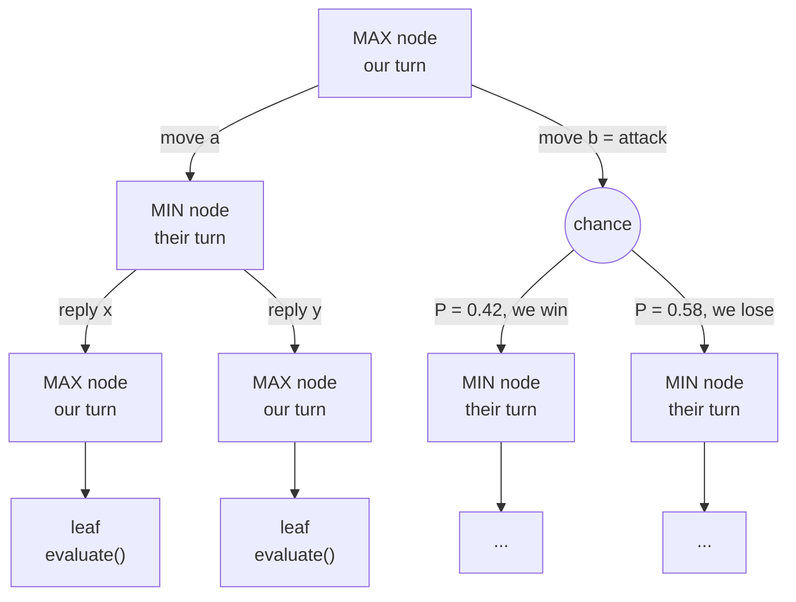
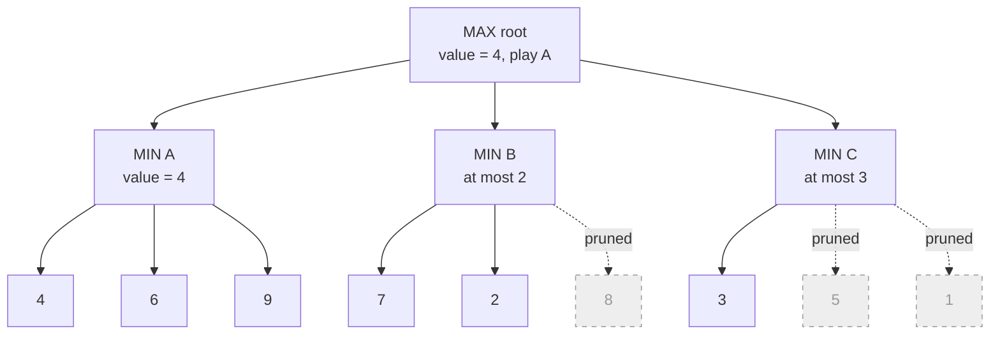
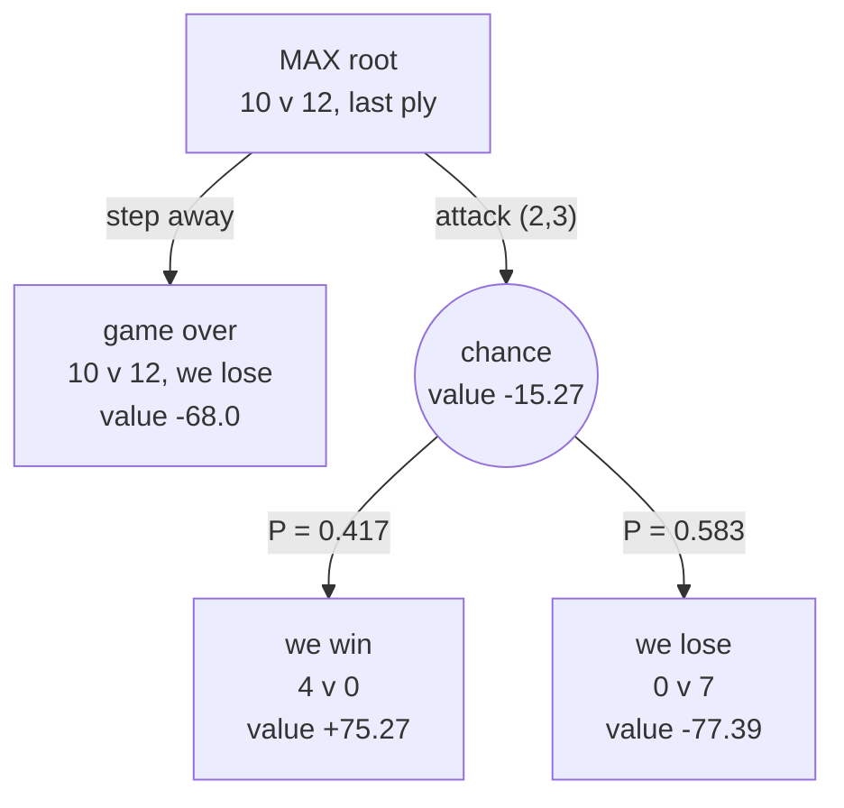
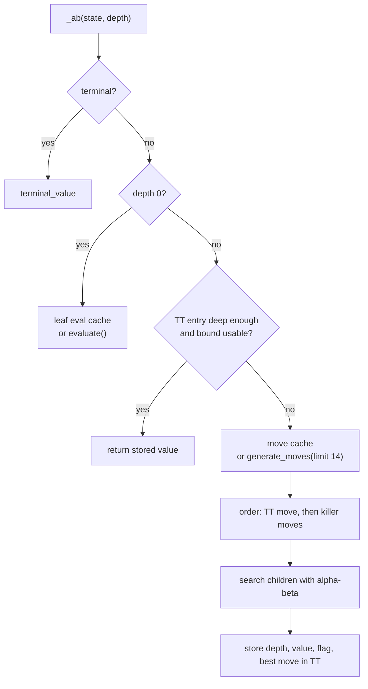

# 🌳 Looking ahead: the search

This chapter explains how the AI picks a move by imagining the next few turns of both players, then shows each trick that makes that look-ahead deep, fast and safe enough to run under a 2-second clock.

> **At a glance**
> - The AI runs **alpha-beta minimax**. It assumes the opponent is as clever as we are: it uses our own move generator and our own evaluation to pick its best reply.
> - Random battles become **chance nodes**. Each one splits into a "win" branch and a "loss" branch with the server's exact probability, so the search is really **expectiminimax**.
> - Two adjustments sit on top of plain expectiminimax. **Risk aversion** makes a fair coin flip score below a quiet move. A **tempo bonus** makes a capture now worth more than the same capture later.
> - **Iterative deepening** (depth 1, 2, 3, ...) runs under a hard 1.3 s deadline. A **transposition table**, killer moves and a 1-ply root ordering make each new depth cheap.
> - In practice it sees about **4 to 7 plies** in busy positions and up to the cap of **12** in simple endgames. Its main limit is that it only considers about 14 candidate turns per inner node.

**Contents**
1. [The game tree](#the-game-tree)
2. [Minimax and alpha-beta pruning](#minimax-and-alpha-beta-pruning)
3. [Chance nodes: random battles](#chance-nodes-random-battles)
4. [Risk aversion: no coin flips for fun](#risk-aversion-no-coin-flips-for-fun)
5. [The tempo bonus: capture now, not later](#the-tempo-bonus-capture-now-not-later)
6. [Iterative deepening under a deadline](#iterative-deepening-under-a-deadline)
7. [Making it fast: tables, killers, ordering, caches](#making-it-fast-tables-killers-ordering-caches)
8. [Per-root contexts](#per-root-contexts)
9. [The opponent model at the first reply](#the-opponent-model-at-the-first-reply)
10. [How deep does it really see?](#how-deep-does-it-really-see)
11. [Pseudocode](#pseudocode)
12. [Where it lives in the code](#where-it-lives-in-the-code)
13. [Key takeaways](#key-takeaways)

---

## The game tree

**In plain English.** Before moving, the AI plays the game forward in its head. "If I do this, they will probably answer that, then I can do this..." Writing every possibility down gives a **tree**. The current position is the root. Each branch is one possible turn, and each node below it is the position that turn leads to.

A few words we use all the time:

| Term | Meaning in this project |
|---|---|
| **Ply** | One player's **whole turn**: every group move it sends in one `MOV`. Two plies make one round (us, then them). |
| **MAX node** | A position where **we** are to move. We pick the child with the **highest** value. |
| **MIN node** | A position where the **opponent** is to move. We assume it picks the child that is **lowest** for us. |
| **Chance node** | A turn that starts a random battle. Its value is the probability-weighted average of its outcomes (see [below](#chance-nodes-random-battles)). |
| **Leaf** | Where the search stops: the game is over, or the depth budget is used up. A leaf gets a number from the evaluation function ([chapter 04](./04-evaluation.md)). |
| **Depth** | How many plies the search looks ahead from the root. |



### Why this is not a reflex agent

A **reflex agent** maps "what I see" straight to "what I do" with fixed rules, for example "always walk to the nearest human group I can eat". It never asks how the opponent will respond.

Our AI is different. At every MIN node the opponent gets **the same move generator** ([chapter 05](./05-move-generation.md)) and is scored by **the same evaluation**, and the search assumes it plays its **best** answer. A move that looks great but loses to one clever reply is rejected, because the search finds that reply. This "rational opponent" assumption is what makes minimax adversarial search.

> 💡 **Tip:** "Best for the opponent" means "lowest for us". The evaluation is always computed from our point of view (`me`), so a single number per node is enough. MAX takes the max of its children, MIN takes the min.

---

## Minimax and alpha-beta pruning

**Minimax** values every node bottom-up. Leaves get their evaluation, MIN nodes take the minimum of their children, MAX nodes the maximum. The root's best child is the move to play.

The catch is the size of the tree. With about 14 candidate turns per node, depth 6 already has 14⁶ ≈ 7.5 million leaves. **Alpha-beta pruning** gets the *same* answer while skipping branches that provably cannot change it. It carries two numbers down the tree:

| Bound | Meaning |
|---|---|
| **alpha** | The best value MAX is **already guaranteed** somewhere above. MAX will never accept less. |
| **beta** | The best value MIN is **already guaranteed** somewhere above. MIN will never allow more. |

As soon as a node finds `alpha >= beta`, the rest of its children are irrelevant. One of the two players already has a better option elsewhere, so play will never reach this node. That is a **cutoff**.

### Worked example: a hand-made tree

The root is our turn (MAX) with three candidate moves A, B and C. Each leads to an opponent turn (MIN) with three replies. The leaf numbers are evaluations from our point of view.



Here it is step by step, in the order the code visits nodes. `_root` searches each root move with the window `(alpha, +inf)`, and `_ab` updates beta at MIN nodes:

| Step | Node | Sees | alpha | beta | What happens |
|---|---|---|---|---|---|
| 1 | Root | (start) | −inf | +inf | Search move A first. |
| 2 | A | leaf A1 = 4 | −inf | 4 | MIN's best so far is 4. |
| 3 | A | leaf A2 = 6 | −inf | 4 | 6 > 4, MIN ignores it. |
| 4 | A | leaf A3 = 9 | −inf | 4 | Ignored. **A = 4** (exact). |
| 5 | Root | A = 4 | **4** | +inf | We are now guaranteed 4. |
| 6 | B | leaf B1 = 7 | 4 | 7 | 4 < 7, keep looking. |
| 7 | B | leaf B2 = 2 | 4 | **2** | `alpha 4 >= beta 2`: **cutoff**. B3 is never evaluated. |
| 8 | Root | B ≤ 2 | 4 | +inf | Whatever B3 is, MIN can hold B to 2 or less, and we already have 4. |
| 9 | C | leaf C1 = 3 | 4 | **3** | `4 >= 3`: **cutoff**. C2 and C3 are skipped. |
| 10 | Root | C ≤ 3 | 4 | +inf | **Answer: play A, value 4.** 6 of 9 leaves evaluated. |

Two things to notice:
- The answer is exactly the minimax answer. Pruning never changes the result, only the work.
- **Order matters.** If B2 (= 2) had been tried before B1, B would have been cut after one leaf. If A had been searched last, nothing would have been pruned before it. That is why the engine spends effort on move ordering ([below](#making-it-fast-tables-killers-ordering-caches)). With perfect ordering, alpha-beta needs roughly the square root of the minimax work.

> 💡 **Tip:** The value B returned (2) is only a **bound**: "B is worth at most 2". The transposition table stores it with an `UPPER` flag for exactly this reason (see [the table section](#transposition-table)).

---

## Chance nodes: random battles

**In plain English.** Some turns have no certain outcome. If 10 of our creatures attack 12 enemies, the server rolls dice ([chapter 01](./01-game-rules.md#random-battles-probability-and-survivors)). The search cannot know the roll, so it splits the turn into the possible outcomes and averages them, weighted by probability. Minimax plus averaging nodes is called **expectiminimax**.

**The precise version.**
- `state.apply_moves(state, side, moves)` resolves a turn exactly like the server's `Board.PerformMoves`. It returns a list of `(probability, next_state)` pairs: one pair for a deterministic turn, several for a turn with random battles.
- Each random battle has two outcomes from `rules.battle_outcomes(attackers, defenders, vs_humans)`. The win branch has probability `P` and keeps the **expected** number of attacker survivors, `round(P × attackers)` (against humans, `round(P × (attackers + humans))`, since the winners convert the survivors). The loss branch has probability `1 − P` and keeps `round((1 − P) × defenders)` defenders.
- A turn may contain several random battles. Their outcomes multiply (2 battles give 4 branches). The number of branches is capped by `state.MAX_BRANCHES = 4`: once another battle would push it past 4, that battle is collapsed to its single most likely outcome, with probability 1.
- `Searcher._value_of_move` searches every branch and returns `Σ p × value(branch)`, minus a risk penalty ([next section](#risk-aversion-no-coin-flips-for-fun)).

Real outcomes from `battle_outcomes` (monsters unless noted):

| Attack | P(attacker wins) | Win branch | Loss branch |
|---|---|---|---|
| 10 vs 12 | 10/24 = 0.417 | 4 attackers survive | 7 defenders survive |
| 8 vs 10 | 0.40 | 3 survive | 6 survive |
| 12 vs 12 | 0.50 | 6 survive | 6 survive |
| 14 vs 10 | 0.90 | 13 survive | 1 survives |
| 12 vs 8 | 12 ≥ 1.5 × 8: no dice | 12 survive (P = 1) | (none) |
| 3 vs 5 humans | 0.30 | 2 creatures (of 3 + 5) | 4 humans remain |

### Worked example: a chance node's value

This is the position from the test `test_trailer_takes_the_gamble_at_the_end`. We are the Vampires with 10, the Werewolves have 12 right next to us, and **this is the last ply of the game**.

```
      x=0  x=1  x=2  x=3  x=4
y=0    .    .    .    .    .
y=1    .    .    .    .    .
y=2    .    .   V10   .    .
y=3    .    .   W12   .    .
y=4    .    .    .    .    .

V = vampires (us), W = werewolves, numbers = counts
```



The numbers come from running the real code. `G = win_value(state) = max(20, 2 × 22) = 44` is the value of a win ([chapter 04](./04-evaluation.md)). Finished games are worth `±1.5 × G` plus the margin.

| Quantity | Computation | Value |
|---|---|---|
| Win branch | terminal `1.5 × 44 + 4 − 0.01` plus tempo bonus `0.88 × (+6)` | **+75.27** |
| Loss branch | terminal `−1.5 × 44 − 7 + 0.01` plus tempo bonus `0.88 × (−5)` | **−77.39** |
| Mean | `0.417 × 75.27 + 0.583 × (−77.39)` | −13.78 |
| Risk penalty | `risk × MAD = 0.02 × 74.21` (risk has faded to 0.02 on the last ply) | −1.48 |
| **Chance node** | | **−15.27** |
| Any quiet move | game ends 10 v 12: `−1.5 × 44 − 2` | **−68.0** |

So the attack (−15.27) beats standing still (−68.0), and the AI attacks. The test checks exactly that. Behind on the last ply, a 42% chance is better than a certain loss.

> ⚠️ **Watch out:** Inside a chance node every branch is searched with the **full window** `(−inf, +inf)`. Alpha-beta cannot prune there, because each branch's exact value feeds the average. Random battles are therefore the most expensive moves to search.

---

## Risk aversion: no coin flips for fun

**In plain English.** Plain expectiminimax is indifferent between "a certain 0" and "50% of +150, 50% of −150". Both average to 0. We are not indifferent: a fair coin flip throws away the chance that a weaker opponent blunders later. So the search charges a fee for gambling, proportional to how much the outcome can swing.

**The formula** (in `Searcher._value_of_move`):

```
mean  = Σ p × v                    over the chance branches
MAD   = Σ p × |v − mean|           mean absolute deviation
value = mean − risk × MAD
```

| Setting | Default | Effect |
|---|---|---|
| `Weights.risk` | 0.4 | Penalty per unit of MAD (tuned). |
| `Weights.risk_fade` | 20 | Risk aversion fades linearly over the last 20 plies. The real per-root value is `risk × min(1, plies_left / 20)`. Near the end there are no future blunders left to wait for. |
| `Weights.risk_all` | True | Also penalise the **opponent's** gambles. Positions where the opponent can start a coin flip against us look worse too. |

A deterministic move has one branch, so its MAD is 0 and it pays nothing.

### Worked example: a fair coin flip scores below a quiet move

The test position `test_tie_does_not_gamble_early`: 12 v 12, side by side, 150 plies left. We searched it at depth 3 and printed every root move's value, with and without risk aversion:

```
      x=3  x=4  x=5
y=3    .    .    .
y=4    .   V12  W12        (10 x 10 board, the rest is empty)
y=5    .    .    .
```

| Root move | Branches | Value with `risk = 0.4` | Value with `risk = 0` |
|---|---|---|---|
| Step away to (3,3) | 1 | **0.00** (chosen) | 0.00 |
| Step to (4,3), still adjacent | 1 | −54.46 | 0.00 |
| Attack (5,4): 12 v 12 | 0.5 / 0.5 | −60.28 | 0.00 |

Where −60.28 comes from: the win branch is worth +150.71 and the loss branch −150.71 (a terminal value of about ±78, i.e. ±1.5 × 48 ± 6 survivors, plus a tempo bonus of ±72.72). The mean is 0, the MAD is 150.71, and the penalty is `0.4 × 150.71 = 60.28`.

Without risk aversion all three moves tie at 0, and nothing stops the engine from flipping the coin. With it, the quiet move wins clearly. The adjacent step is punished too, because `risk_all` also charges for the coin flip it offers the opponent.

The same rule says "gamble" when it should. On the **last** ply the penalty has faded to `0.4 × 1/20 = 0.02`, and a draw is worth `−0.25 × G` ([chapter 04](./04-evaluation.md)). So a tied AI attacks on the final ply, as `test_tie_takes_the_gamble_on_the_last_ply` checks.

Measured effect (REPORT.md): games lost to a 50/50 battle **we** started went from 11 of 16 losses to 0. Risk aversion, first on our gambles and then also on the opponent's, took the score against greedy from 75% to 84% and cut losses against aggressive from 17 to 7.

---

## The tempo bonus: capture now, not later

**The problem.** Suppose we can eat 3 humans this turn or next turn. If nothing can interfere, the position at the search horizon looks the same either way, so both moves get the same value. The engine may pick "later". Next turn it reasons the same way again, and the capture is postponed forever. REPORT.md records this as seen in game traces and fixed by this bonus.

**The fix.** Material gained on a ply closer to the root earns a little extra. In `Searcher._value_of_move`, every move (ours or theirs) adds:

```
bonus = tempo_eff × tempo_decay^(ply − 1) × Δmargin

Δmargin   = (our total − their total after the move) − (the same before it)
tempo_eff = Weights.tempo (0.6) × evaluate.root_slope(root)
tempo_decay = 0.8
ply = 1 for our root move, 2 for their reply, 3 for our next move, ...
```

- The opponent's captures have a negative Δmargin, so *their* early captures are penalised in the same way.
- `root_slope` is the slope of the win-probability utility `raw + G × tanh(raw / k)` at the root's material margin: `1 + G / (k × cosh²(raw / k))`. Near a tie the curve is steep and one creature matters a lot, so the bonus is larger there. It stays meaningful relative to the evaluation's scale ([chapter 04](./04-evaluation.md)).
- The bonus is added **after** the child is searched. The window passed down is therefore shifted: `bonus + _ab(child, ..., alpha − bonus, beta − bonus)`.

### Worked example

A small 8×8 board, 100 plies left. Our 5 Vampires sit next to a group of 3 humans.

```
      x=0  x=1  x=2  x=3  x=4  x=5  x=6  x=7
y=0    .    .    .    .    .   H2    .    .
y=1    .   V5    .    .    .    .    .    .
y=2    .    .   H3    .    .    .    .    .
y=3    .    .    .    .    .    .    .    .
y=4    .    .    .    .    .    .    .    .
y=5    .    .    .    .    .    .    .    .
y=6    .    .    .    .    .    .    .    .
y=7    .    .    .    .    .    .    .   W5

V = vampires (us), W = werewolves, H = humans
```

Here `G = 30`, `k = 7.5` and the margin is 0, so `root_slope = 1 + 30 / 7.5 = 5.0` and `tempo_eff = 0.6 × 5.0 = 3.0`. The per-creature bonus by ply:

| Ply | 1 (our move now) | 2 (their reply) | 3 (our next move) | 4 | 5 |
|---|---|---|---|---|---|
| Bonus per creature | 3.00 | 2.40 | 1.92 | 1.54 | 1.23 |

Root move values at depth 3, from the real search:

| Root move | With tempo | Without tempo | Difference |
|---|---|---|---|
| All 5 onto the humans at (2,2) now | **35.99** | 26.99 | **+9.00** = 3.00 × 3 humans at ply 1 |
| 3 onto (2,2), 2 toward (2,0) | 35.71 | 26.71 | +9.00 |
| All 5 to (2,1), eat next turn | 31.32 | 25.56 | **+5.76** = 1.92 × 3 at ply 3 |
| All 5 to (2,0) | 13.88 | 13.88 | 0 (no capture within 3 plies) |

The same 3 humans are worth +9.00 eaten now but only +5.76 eaten a turn later, so "now" wins by a clear margin.

> ⚠️ **Watch out (honest note):** In this toy position the final engine eats the humans even with the tempo bonus switched off. The evaluation's human-race term already discounts future captures by γ = 0.75 per step ([chapter 04](./04-evaluation.md)). The gap without tempo is small, though: 26.99 against 25.56. The tempo bonus turns a fragile 1.4-point preference into a 4.7-point one. That robustness is what stopped the postponing seen in earlier versions.

---

## Iterative deepening under a deadline

**In plain English.** We never know in advance how deep we can search in the time we have. So we search to depth 1, then again to depth 2, then 3, and so on, and always keep the answer of the deepest search that finished. When time runs out we play that answer. Each new depth reuses what the previous one learned (best-move ordering and the transposition table), so repeating the shallow depths costs little.

**The clock.** The server allows 2 s per move. The agent's budget is **1.3 s** (`Agent(budget=1.3)`, `--budget`), which leaves margin for Python, the network and the operating system. The deadline is `t_received + 1.3 s`, where `t_received` is when the server's message was noticed (see [chapter 06](./06-pondering-and-opponent-model.md#the-move-clock-starts-when-the-message-was-noticed)). Every node checks `time.perf_counter() > deadline` and raises `Timeout` if so.

**The rules in `Searcher.choose`:**

1. Order the root moves once by a 1-ply look (`_order_root`).
2. For depth = 1, 2, 3, ...: call `_root`. It searches the root moves **in the order of the previous iteration, best first**, and returns the value, the best move and the re-sorted move list.
3. Stop when one of these happens:
   - `max_depth` (12) is reached, or a **forced result** is found (`|value| ≥ 1.5 × G`, a proven win or loss). The context is then marked `done`.
   - **The next depth can't finish.** After each completed depth, if `remaining < 1.5 × elapsed`, stop. A new depth usually costs more than all the previous ones together, so starting one that cannot finish would mostly waste the time.
   - The deadline hits in the middle of a depth: a **partial iteration**.
4. **Partial iterations are still used.** The previous best move is always searched first. If the timeout comes after at least that one root move finished at the new depth, the best move among those finished is played (`info.depth` reports the partial depth). If the timeout comes during the very first move, the previous depth's answer is kept. (While *pondering*, `choose(..., ponder=True)` keeps only completed depths as the context's answer. Its table entries from the unfinished depth stay and still help later.)

### Measured timeline

This is one real run on the 14×10 test position from `tests/test_ponder.py` (2 + 2 monster groups, 6 human cells, 22 root moves, 120 plies left), on the development laptop:

| Depth | Root value | Time for this depth | Elapsed | Nodes |
|---|---|---|---|---|
| 1 | 11.0 | <1 ms | 0 ms | 22 |
| 2 | 3.7 | 3 ms | 3 ms | 74 |
| 3 | 12.8 | 16 ms | 19 ms | 574 |
| 4 | 0.8 | 43 ms | 62 ms | 1,394 |
| 5 | 30.3 | 82 ms | 144 ms | 4,230 |
| 6 | 2.9 | 233 ms | 377 ms | 9,143 |
| 7 | 20.3 | 609 ms | 986 ms | 39,406 |
| 8 | (not started) | | | |

After depth 6: 0.923 s remain, which is more than `1.5 × 0.377 = 0.566`, so it continues. After depth 7: only 0.313 s remain, less than `1.5 × 0.987 = 1.48`, so it **stops** and plays the depth-7 move at 987 ms. Total: 54,843 nodes.

```mermaid
gantt
    title Iterative deepening on the test position (one measured run)
    dateFormat x
    axisFormat %S.%L
    section Search
    Depths 1 to 4       :done, d14, 0, 62
    Depth 5             :done, d5, 62, 144
    Depth 6             :done, d6, 144, 377
    Depth 7             :done, d7, 377, 986
    Stop as depth 8 cannot fit  :crit, idle, 986, 1300
```



A **partial** example comes from the next position of the same game, which has 40 root moves. A fresh search finished depths 1 to 6 in 357 ms. Then the deadline hit during depth 7 after **13 of the 40** root moves. The AI played the best of those 13, and the list included the depth-6 favourite. (In [chapter 06](./06-pondering-and-opponent-model.md#worked-example-a-hit) the same position, pondered in advance, gets 33 to 34 of the 40 moves done at depth 7.)

> 💡 **Tip:** The root values zig-zag between odd and even depths (11.0, 3.7, 12.8, 0.8, ...). Odd depths end right after one of *our* moves and are optimistic. Even depths give the opponent the last word. This is normal for minimax. Compare moves within one depth, never values across depths.

> ⚠️ **Watch out:** The search turns off Python's cyclic garbage collector (`gc.disable()` in `choose`, and in `main.py`). It was measured pausing about 400 ms on the big tables. Search data has no reference cycles, so reference counting frees it anyway. This took the worst-case move time from 1567 ms to 1300 ms (REPORT.md).

---

## Making it fast: tables, killers, ordering, caches

Alpha-beta prunes best when the best move is tried first, and every node it does not have to recompute is time saved for depth. These are the tools, in the order a node uses them:



### Transposition table

Different move orders often reach the same position: A-then-B equals B-then-A. The **transposition table** (TT), a dict, remembers what was learned about each position.

| Part | Content |
|---|---|
| **Key** | `(state.key(), side to move, plies_left)`. `state.key()` is three frozensets of `(cell, count)`, for Vampires, Werewolves and humans. `plies_left` is part of the key because the evaluation and the end of the game depend on it. |
| **depth** | How deep below this node the stored result was searched. |
| **value** | The value found. |
| **flag** | `EXACT`, `LOWER` or `UPPER` (below). |
| **best move** | The move that produced the value. It is tried first next time, even when the value itself can't be reused. |

Why a flag? With alpha-beta, a node that was cut off only knows a **bound**, not its exact value:

| Flag | Stored when | Means | Reused when (and stored depth ≥ needed depth) |
|---|---|---|---|
| `EXACT` | `alpha < value < beta` | true value = value | always |
| `LOWER` | `value >= beta` (fail-high, MAX found something too good) | true value ≥ value | if `value >= beta` again |
| `UPPER` | `value <= alpha` (fail-low, like B in the example above) | true value ≤ value | if `value <= alpha` again |

### Killer moves

When a move causes a cutoff at some ply, it often causes one in the sibling positions too: a strong reply tends to stay strong. `Searcher.killers[ply]` keeps the **two most recent cutoff moves** per ply, and they are tried right after the TT move. REPORT.md measured killers alone as **11% faster with identical results**. They only change the order, never the answer.

### Root ordering by a 1-ply look

The root is special. Every one of its moves is searched at every depth, and its order decides how much of the first iteration is pruned. `_order_root` gives each root move a quick score: apply it (averaging chance branches) and call `evaluate` on the result. Moves are sorted by that score. It may use up to 25% of the remaining time; any moves left unscored keep the generator's heuristic order. After each completed depth, `_root` re-sorts the root moves by their values (best first), so depth d+1 starts with depth d's favourite.

### Leaf evaluation cache and move cache

| Cache | Key | Lives | Why |
|---|---|---|---|
| Leaf eval cache `ecache` | `(state.key(), to_move, plies_left)` | per root context | `evaluate()` is the most expensive leaf operation. The same leaf is reached many times across iterations. |
| Move cache `mcache` | `(state.key(), to_move)` | the whole game (at most 20,000 stored, cleared above 15,000 when a new root starts) | Move generation is expensive, and the list does not depend on depth. It survives across turns. |
| `Board._steps` | `(from, to)` cell pair | the whole game (cleared above 150,000) | "Which neighbours are one step closer?" is asked constantly. |

REPORT.md: the leaf-evaluation cache, a γ-power table and killer moves together gave **3.6× more nodes per second**, about one extra depth in busy positions.

---

## Per-root contexts

Every search of a root position keeps its state in a `RootContext`, so the search can be **resumed** later instead of restarted:

| Field | Content |
|---|---|
| `tt`, `ecache`, `killers` | The tables above, for this root only. |
| `params` | `(G, risk, tempo)`, computed once from the root position. |
| `moves`, `ordered` | The root moves, best first after each completed depth. |
| `depth`, `best`, `best_val` | The last completed depth and its answer. |
| `done` | `max_depth` reached or a forced result found: nothing more to search. |

`Searcher.contexts` maps `(root key, plies_left)` to a context.

**Why tables are per root and not global.** The tempo bonus is **root-relative**. A position's stored value includes bonuses that depend on (a) how many plies from *this* root each capture happens and (b) this root's `root_slope`. Reach the same position from a different root and the correct value is different. `risk` (it fades with `plies_left` at the root) and `G` are fixed per root for the same reason. Mixing tables across roots would mix values on different scales. So every root gets its own tables, and its `params` stay fixed while it is searched.

The price is that the TT is **not** carried from one turn to the next. A new turn means a new root, which starts with a fresh table (the move cache is kept). [Pondering](./06-pondering-and-opponent-model.md) recovers most of that loss: it builds the next turn's context *before* the turn arrives. In a real (non-ponder) search `_context` keeps only the context that matches the actual position and drops the other pondered guesses.

---

## The opponent model at the first reply

Pure minimax assumes the opponent always finds its single best reply. Real opponents (shallower, greedy, buggy) often don't. At the opponent's **first reply** (ply 1 below the root), and only when the weight `ε = Searcher.opp_eps` is above 0, `_ab` hands over to `Searcher._soft_min`. It scores the node as:

```
value = (1 − ε) × min(replies) + ε × mean(k lowest replies)        k = 3
```

A move that leaves the opponent several good answers then scores a little below one that leaves it only one good answer: a **trap**. Pruning stays exact. Each reply is searched with `beta = the current k-th lowest value`, since a higher value cannot enter the mean. The node fails low (returns an `UPPER` bound) as soon as its upper bound `(1 − ε) × lowest + ε × mean(k lowest)` drops to alpha or below, because more replies can only lower it.

ε is not fixed. It adapts between 0 and 0.1 from how often the opponent actually plays the reply we predicted. [Chapter 06](./06-pondering-and-opponent-model.md#the-soft-min-opponent-model) has the details, a worked pruning example and the measurements.

---

## How deep does it really see?

REPORT.md's figure for busy positions is **about depth 4 to 7**. Simple positions, such as one group each and no humans left, reach the cap of **12** in milliseconds. To show the range we took positions from a real self-play game on three small maps and searched each with the real 1.3 s budget:

| Map | Position | Groups (ours + theirs) | Human cells | Root moves | Depth reached | Time |
|---|---|---|---|---|---|---|
| thetrap 5×10 | ply 1 | 1 + 1 | 4 | 8 | 10 | 759 ms |
| thetrap 5×10 | ply 11 | 2 + 2 | 1 | 14 | 7 | 819 ms |
| random 14×13 | ply 5 | 2 + 3 | 21 | 30 | 7 | 1300 ms (deadline hit) |
| random 14×13 | ply 21 | 4 + 4 | 6 | 40 | 7 | 1234 ms |
| random 12×19 | ply 41 | 2 + 2 | 0 | 12 | 9 | 887 ms |
| random 12×19 | ply 141 | 1 + 1 | 0 | 6 | 12 (cap) | 9 ms |
| random 14×13 | ply 141 | 1 + 1 | 0 | 2 | 6 (forced result) | 2 ms |

(Single runs on the development laptop. Bigger 30×30 to 50×50 maps with more groups are slower per node.)

### Honest limitations

- **Selective, not full-width.** The move generator offers at most **14 candidate turns per inner node** (`inner_limit`) and **40 at the root** (`root_limit`), chosen by strategic heuristics ([chapter 05](./05-move-generation.md)). A brilliant move the generator never proposes is invisible to the search, for us and for the opponent.
- **The horizon.** Plans longer than about 7 plies are beyond reach in busy positions. REPORT.md's example: with a 120 v 64 lead, the AI chased a group that could never be caught, while the opponent collected 50 humans.
- **Chance nodes are not pruned** internally (full window per branch), and each battle's outcome is modelled by its *expected* survivors rather than the full distribution.
- **Time helps less than hoped.** Doubling the thinking time gains only +0.04 against an equal engine (REPORT.md). The evaluation and the candidate moves limit strength more than raw depth does.

---

## Pseudocode

Simplified but faithful to `vvw/search.py`. The real code also counts nodes, polls `stop()` and has the soft-min branch.

```python
def value_of_move(state, side, move, depth, alpha, beta, ply, plies_left):
    """Value (for us) of `side` playing `move`; ply / plies_left describe the child."""
    m0 = margin(state)                                   # our total - their total
    scale = tempo_eff * TEMPO_DECAY ** (ply - 1)         # tempo weight of this ply
    branches = apply_moves(state, side, move)            # [(p, child), ...]

    if len(branches) == 1:                               # deterministic turn
        child = branches[0][1]
        bonus = scale * (margin(child) - m0)
        # the bonus is added after the search, so shift the window by it
        return bonus + ab(child, other(side), depth,
                          alpha - bonus, beta - bonus, ply, plies_left)

    vals = []                                            # chance node: full window
    for p, child in branches:
        bonus = scale * (margin(child) - m0)
        vals.append((p, bonus + ab(child, other(side), depth, -INF, INF, ply, plies_left)))
    mean = sum(p * v for p, v in vals)
    if risk and (side == ME or RISK_ALL):                # risk aversion on gambles
        mean -= risk * sum(p * abs(v - mean) for p, v in vals)
    return mean


def ab(state, to_move, depth, alpha, beta, ply, plies_left):
    if now() > deadline or (pondering and every_128_nodes and stop()):
        raise Timeout
    tv = terminal_value(state, ME, plies_left, ply, G)   # game over?
    if tv is not None:
        return tv
    if depth <= 0:
        return cached_evaluate(state, to_move, plies_left)

    key = (state.key(), to_move, plies_left)
    tt_move = None
    if key in tt:
        e_depth, e_val, e_flag, tt_move = tt[key]
        if e_depth >= depth and (e_flag == EXACT
                                 or (e_flag == LOWER and e_val >= beta)
                                 or (e_flag == UPPER and e_val <= alpha)):
            return e_val

    moves = cached_generate_moves(state, to_move, limit=14)
    if not moves:
        return evaluate(state, to_move, plies_left)
    moves = [tt_move] + killers[ply] + rest_in_generator_order   # ordering

    if to_move != ME and ply == 1 and opp_eps > 0 and len(moves) > 1:
        return soft_min(...)                             # opponent model (chapter 06)

    a0, b0 = alpha, beta
    maximizing = (to_move == ME)
    best = -INF if maximizing else INF
    for mv in moves:
        v = value_of_move(state, to_move, mv, depth - 1, alpha, beta, ply + 1, plies_left - 1)
        if maximizing:
            if v > best: best, best_mv = v, mv
            alpha = max(alpha, v)
        else:
            if v < best: best, best_mv = v, mv
            beta = min(beta, v)
        if alpha >= beta:                                # cutoff
            remember_killer(ply, mv)
            break

    flag = UPPER if best <= a0 else LOWER if best >= b0 else EXACT
    tt[key] = (depth, best, flag, best_mv)
    return best
```

And the driver, `choose`, in brief:

```python
ctx = context_for(root)                       # resumed if it was pondered
order root moves by a 1-ply look (once)
while not ctx.done and depth < 12:
    depth += 1
    try:
        value, move, moves = root_search(ctx.moves, depth)   # previous best first
    except Timeout as t:
        if a root move finished at this depth: play the best finished one
        break
    save depth / move / order in ctx
    if forced result or depth == 12: ctx.done = True; break
    if remaining_time < 1.5 * elapsed: break             # next depth can't finish
```

---

## Where it lives in the code

| File | Function / class | Role |
|---|---|---|
| `vvw/search.py` | `Searcher.choose` | Iterative deepening, deadline, stop rule, partial results |
| `vvw/search.py` | `Searcher._root` | One depth at the root, previous best first, re-sorts moves |
| `vvw/search.py` | `Searcher._ab` | Alpha-beta node: terminal / leaf / TT / ordering / cutoffs |
| `vvw/search.py` | `Searcher._value_of_move` | Chance nodes, risk aversion, tempo bonus |
| `vvw/search.py` | `Searcher._soft_min` | Opponent model at the first reply |
| `vvw/search.py` | `Searcher._order_root` | 1-ply root ordering |
| `vvw/search.py` | `Searcher._context`, `RootContext` | Per-root tables and parameters |
| `vvw/search.py` | `Searcher.expected_reply` | The opponent reply the search expected (used by pondering) |
| `vvw/state.py` | `apply_moves`, `MAX_BRANCHES`, `State.key` | Turn resolution into chance branches, position keys |
| `vvw/rules.py` | `battle_outcomes`, `win_probability` | Battle probability and expected survivors |
| `vvw/evaluate.py` | `evaluate`, `terminal_value`, `win_value`, `root_slope`, `Weights` | Leaf values, G, tempo scale, all weights |
| `vvw/movegen.py` | `generate_moves` | The candidate turns (40 at the root, 14 inside) |
| `tests/test_engine.py` | `Search` tests | Deadline, free captures, no gambling when ahead, gambling at the end |

---

## Key takeaways

- **Alpha-beta minimax with a rational opponent:** the opponent uses our move generator and evaluation, so moves that lose to one clever reply are rejected.
- **Random battles are chance nodes:** win and loss branches with the server's exact probability and expected survivors, averaged by probability (expectiminimax). At most 4 branches per turn.
- **Risk aversion** (`mean − 0.4 × MAD`, fading over the last 20 plies) makes a fair coin flip lose to a quiet move. **The tempo bonus** (`0.6 × root_slope × 0.8^(ply−1) × Δmargin`) makes earlier captures score higher.
- **Iterative deepening** under a 1.3 s deadline. It stops when the next depth can't finish, and partial iterations are still usable because the previous best is searched first.
- **Speed tricks:** a TT with EXACT/LOWER/UPPER bounds and a best move, killer moves, 1-ply root ordering, and leaf and move caches. The tables live in a per-root context because the tempo bonus is root-relative, and that same context is what lets pondering hand over a head start.
- **Honest limits:** depth 4 to 7 in busy positions, at most 14 candidates per inner node, and doubling the time gains only +0.04.

---

← Previous: [Architecture](./02-architecture.md) · [Index](../README.md#documentation) · Next: [Evaluation](./04-evaluation.md) →
