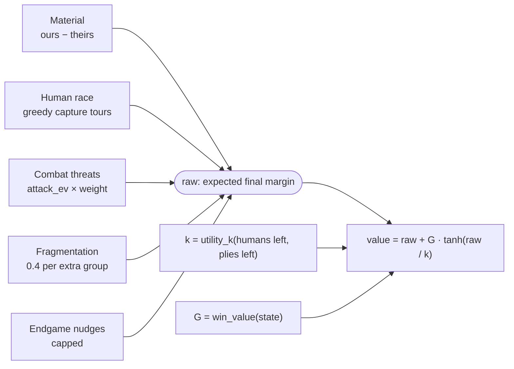
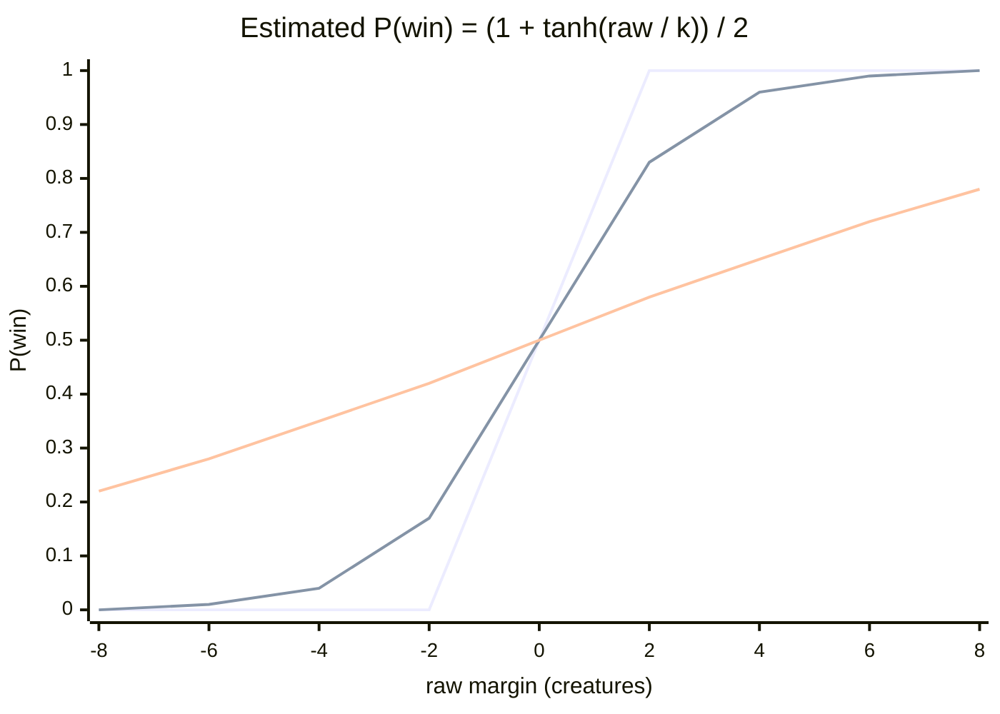

# ⚖️ Evaluation: how a position gets a score

How `vvw/evaluate.py` turns a board into one number: an estimate of the final material margin, bent by a `tanh` curve so that it also reads as a win probability.

> **At a glance**
> - One scale for everything: `value = raw + G · tanh(raw / k)`. `raw` is the expected final margin in creatures, `G` is what winning is worth, and `k` is how uncertain the result still is.
> - `raw` adds up five terms: **material**, the **human race** (greedy capture tours, so each human cell goes to whoever gets there first), **combat threats** (expected material swing of any bigger enemy nearby), **fragmentation**, and capped **endgame nudges**.
> - `(value − raw) / G` is roughly `2·P(win) − 1`. Real wins and losses are worth `±1.5·G + margin`, more than any heuristic score. A draw is worth `−0.25·G`, because a draw wins nothing.
> - Because heuristics and outcomes share one scale, expectimax becomes risk-aware without extra code: when ahead it refuses coin flips, when behind it takes them.
> - Every number in this chapter was computed by calling the real code.

**Contents**
1. [The big idea: one scale](#-the-big-idea-one-scale)
2. [Material](#-material)
3. [The human race](#-the-human-race)
4. [Combat threats](#️-combat-threats)
5. [Fragmentation](#-fragmentation)
6. [Endgame terms](#-endgame-terms)
7. [`root_slope` and the tempo bonus](#-root_slope-and-the-tempo-bonus)
8. [The `Weights` dataclass](#️-the-weights-dataclass)
9. [A full worked evaluation](#-a-full-worked-evaluation)
10. [Where it lives in the code](#where-it-lives-in-the-code)
11. [Key takeaways](#key-takeaways)

---

## 🎯 The big idea: one scale

### In plain English

The search ([chapter 03](./03-search.md)) can't see to the end of the game, so at the bottom of the tree it asks: *"how good is this position for me?"* The answer has to be comparable with real game endings found elsewhere in the tree. If a heuristic score of "+3 creatures" could beat an actual win, the AI would throw away wins.

So the evaluation works in two steps:

1. **Estimate the final margin** (`raw`): "if both sides play sensibly from here, I expect to finish about `raw` creatures ahead."
2. **Turn the margin into a win chance**: a lead of 2 creatures is almost a sure win when nothing is left to convert, but means little while 30 humans are still up for grabs. `tanh(raw / k)` captures that. It's close to ±1 when the lead is large compared with the uncertainty `k`, and close to 0 when it is small.



### The three ingredients

| Symbol | Code | Meaning | Formula |
|---|---|---|---|
| `raw` | built inside `evaluate` | Expected final material margin, from the evaluating side's point of view | sum of the terms below |
| `G` | `win_value(state)` | What winning the game is worth, in creatures. Computed **once per search** at the root, so all values in one search stay comparable | `max(20, 2 · (vampires + werewolves + humans))` |
| `k` | `utility_k(hum_total, plies_left, w)` | How uncertain the final result still is, in creatures | `k_end + k_human · humans_left`, then multiplied by `max(0.25, plies_left / k_time)` in the last `k_time` = 30 plies |

Some values of `k` with the default weights (computed with `utility_k`):

| Situation | humans left | plies left | `k` |
|---|---|---|---|
| Plenty of humans | 30 | 200 | 32.5 |
| Mid-game | 10 | 200 | 12.5 |
| Mid-game, near the end | 10 | 15 | 6.25 |
| Nothing left to convert | 0 | ≥ 30 | 2.5 |
| Nothing left, 15 plies to go | 0 | 15 | 1.25 |
| Nothing left, last few plies | 0 | ≤ 7 | 0.625 (the 0.25 floor) |

### Reading the value as a win probability

`tanh` runs from −1 to +1, so `G · tanh(raw / k)` runs from −G to +G. Map that to a probability with `P(win) ≈ (1 + tanh(raw / k)) / 2`, and you get the docstring's identity:

```
(value − raw) / G  =  tanh(raw / k)  ≈  2·P(win) − 1
```

This is a modelling choice, not a calibrated probability. It's the shape that matters: steep near 0, flat when the result is already clear.

**Table: `value` (and the implied `P(win)`) for a few margins and `k`, with `G = 40`** (for example 10 vs 10 creatures and no humans: `max(20, 2·20) = 40`). Computed with `raw + G·tanh(raw/k)`:

| `k` \ `raw` | −4 | −2 | −1 | 0 | +1 | +2 | +4 | +8 |
|---|---|---|---|---|---|---|---|---|
| **0.625** (no humans, last plies) | −44.0 (0.00) | −41.9 (0.00) | −37.9 (0.04) | 0 (0.50) | 37.9 (0.96) | 41.9 (1.00) | 44.0 (1.00) | 48.0 (1.00) |
| **2.5** (no humans) | −40.9 (0.04) | −28.6 (0.17) | −16.2 (0.31) | 0 (0.50) | 16.2 (0.69) | 28.6 (0.83) | 40.9 (0.96) | 47.9 (1.00) |
| **12.5** (10 humans left) | −16.4 (0.35) | −8.4 (0.42) | −4.2 (0.46) | 0 (0.50) | 4.2 (0.54) | 8.4 (0.58) | 16.4 (0.66) | 30.6 (0.78) |
| **32.5** (30 humans left) | −8.9 (0.44) | −4.5 (0.47) | −2.2 (0.49) | 0 (0.50) | 2.2 (0.52) | 4.5 (0.53) | 8.9 (0.56) | 17.7 (0.62) |

The same curves as a chart (estimated `P(win)` against `raw`). The steepest line is `k = 0.625`, the middle one `k = 2.5`, the flattest `k = 12.5`:



> 💡 **Why this makes the search risk-aware for free.** Take the `k = 2.5` row. Ahead by 2 with nothing left to convert, the position is worth +28.6. A pure 50/50 battle that either wins the game (≈ +1.5·G = +60) or loses it (≈ −60) averages about 0, far below +28.6, so the leader declines. Behind by 2, the position is worth −28.6, and the same coin flip (≈ 0) is now the best hope. Expectimax only averages values. The curve does the rest. ([Chapter 03](./03-search.md) adds an explicit risk penalty on top.)

### Terminal values: real endings

`terminal_value(state, me, plies_left, depth_from_root, G)` returns a value when the game is over, otherwise `None`:

| Situation | Value | Why |
|---|---|---|
| Enemy wiped out, we have creatures | `+1.5·G + ours − 0.01·depth` | Above any heuristic score. Faster wins score slightly higher |
| We are wiped out | `−1.5·G − theirs + 0.01·depth` | Slower losses score slightly higher |
| Ply limit reached, we are ahead | `+1.5·G + (ours − theirs)` | A win, plus the margin |
| Ply limit reached, we are behind | `−1.5·G + (ours − theirs)` | A loss |
| Ply limit reached, tied | `DRAW · G = −0.25·G` | A draw wins nothing |

`TERMINAL = 1.5` puts outcomes above the heuristic range. The `tanh` part never exceeds `G`, and `G` is at least twice the number of creatures and humans on the board, so the material margin alone can never reach `0.5·G`. A heuristic value `raw + G·tanh(…)` therefore normally stays below a real win's `1.5·G`.

**Why is a draw negative?** A draw earns no tournament points, so it shouldn't look as good as a fair gamble. At the very end, a 50/50 battle averages about `0.5·(+1.5·G) + 0.5·(−1.5·G) = 0`, which beats `−0.25·G`. So when tied on the last ply, the AI attacks (checked by `test_tie_takes_the_gamble_on_the_last_ply` in `tests/test_engine.py`). Earlier in the game, a tie is evaluated by the heuristic (≈ 0), not as a draw, and the risk penalty keeps the AI from gambling too soon (`test_tie_does_not_gamble_early`).

---

## 🧮 Material

The simplest term: `raw` starts at `ours − theirs` (sum of all our groups minus all theirs). Humans don't count here, because they only matter once someone converts them. That's the next term's job.

---

## 🏃 The human race

### In plain English

Humans are free material for whoever reaches them with enough creatures. The evaluation imagines each group going on a **greedy capture tour**:

1. From where it stands, pick the human cell with the best *discounted* value `c · γ^t` (c = humans in the cell, t = moves needed to get there, γ = `gamma` = 0.75). The group must be **big enough**: `c ≤ size`.
2. Walk there, absorb the humans (**size grows by c**), and repeat from the new position, up to `chain_len` = 4 captures, as long as the side still has moves left before the game ends.

Growing as it goes captures chains like *"take the 4 first, then you're big enough for the 8"*.

Each human cell is then **credited to the side that arrives first**, worth `human · c · γ^t` (`human` = 1.0) at that side's arrival time. Ties go to the side that moves next: when both need `t` moves, the side to move gets there first. In code, the side to move subtracts 0.5 from its arrival time before comparing.

### The precise rules (`_tours` and the race loop in `evaluate`)

| Detail | Code |
|---|---|
| Moves available | side to move gets `(plies_left + 1) // 2`, the other side `plies_left // 2`. A tour step is only taken if `t ≤ moves_left` |
| Distances | Chebyshev distance `board.D[a][b]` (king moves: diagonals count 1) |
| Arrival per side | the earliest arrival over all of that side's groups (`_tours` returns `{cell: time}`) |
| Discount | `γ^t` from a precomputed power table (`_powers`) |
| Credit | `+c·γ^t_mine` if we win the race, `−c·γ^t_theirs` if they do, nothing if neither side can reach it |

### The second, competition-aware pass (`compete = True`)

The first pass plans each side's tours as if the other side didn't exist. That's too optimistic: a side might plan to grow by taking a cell it will actually lose. So, when `compete` is on:

1. Compare the first-pass arrival times and mark which cells each side **loses**.
2. **Re-plan each side's tours without the cells it lost.** A side no longer detours to a cell it won't get, and can no longer count on growth from it.
3. Credit cells using the second-pass arrival times.

`compete` is marked *(validated)* in the code. REPORT.md lists "competition-aware human race + endgame cornering" as raising the score against the aggressive bot from 0.859 to 0.875 on fresh maps.

### Worked example: two groups racing for three human cells

Vampires (V) are to move, 100 plies left. An 8×5 board; V = vampires, W = werewolves, H = humans, numbers are counts. Coordinates are (x, y), x = column, y = row, (0,0) top-left.

```
       x→ 0   1   2   3   4   5   6   7
  y↓ 0    .   .   .   .   .   .   .   .
     1    .   .   .  W3   .  H1   .   .
     2   V3   .   .  H3   .   .   .   .
     3    .   .   .   .   .   .   .   .
     4    .   .  H3   .   .   .   .   .
```

**Pass 1 (each side alone).** Output of `_tours` (arrival time in own moves):

| Side | Greedy tour | Arrivals |
|---|---|---|
| V3 at (0,2) | H3 (2,4) at t=2 (size → 6), then H3 (3,2) at t=4 (→ 9), then H1 (5,1) at t=6 | (2,4): 2, (3,2): 4, (5,1): 6 |
| W3 at (3,1) | H3 (3,2) at t=1 (→ 6), then H3 (2,4) at t=3 (→ 9), then H1 (5,1) at t=6 | (3,2): 1, (2,4): 3, (5,1): 6 |

Who wins each race? V moves next, so V's times count as `t − 0.5`:

| Cell | V | W | Winner |
|---|---|---|---|
| H3 (2,4) | 2 − 0.5 = 1.5 | 3 | V |
| H3 (3,2) | 4 − 0.5 = 3.5 | 1 | W |
| H1 (5,1) | 6 − 0.5 = 5.5 | 6 | V (tie goes to the side to move) |

**Pass 2 (re-plan without lost cells).** V drops (3,2). W drops (2,4) and (5,1):

| Side | New tour | Arrivals |
|---|---|---|
| V | (2,4) at t=2, then straight to (5,1) at t=5 (one move earlier, no detour) | (2,4): 2, (5,1): 5 |
| W | (3,2) at t=1, then nothing left it can still win | (3,2): 1 |

**Credit** (γ = 0.75):

| Cell | Credited to | Term |
|---|---|---|
| H3 (2,4) | V at t=2 | +3 · 0.75² = **+1.6875** |
| H1 (5,1) | V at t=5 | +1 · 0.75⁵ = **+0.2373** |
| H3 (3,2) | W at t=1 | −3 · 0.75 = **−2.25** |
| **Total** | | **−0.3252** |

So the human race slightly favours W: it reaches the closest big cell almost at once. The full `evaluate(...)` of this position from V's side is **−1.2149**: raw = −0.3252 (no other terms apply), G = 26, k = 2.5 + 7 = 9.5.

> ⚠️ **Watch out (limitations).** The tours are greedy, not optimal, and capped at 4 captures. The second pass only removes cells lost in the first pass, so a side never wins back a cell it lost because of a bad first-pass detour. Tours also ignore enemies standing in the way. The search, a few plies deep, corrects much of this.

---

## ⚔️ Combat threats

### In plain English

A group standing near a **bigger** enemy group is in danger, and the evaluation should say so *before* the attack happens. The question is "how much would that attack cost me on average?", and the answer comes from the server's exact battle rules.

### `rules.attack_ev(attackers, defenders)`: the expected material swing

- If `attackers ≥ 1.5 · defenders`: deterministic kill, so the swing is `+defenders`.
- Otherwise it's a random battle with win probability `P` (`rules.win_probability`):
  - **win** (probability P): the defenders all die, and each attacker survives with probability P. Swing = `defenders − (1 − P)·attackers`.
  - **loss** (probability 1 − P): the attackers all die, and each defender survives with probability 1 − P. Swing = `−(attackers − P·defenders)`.
  - `attack_ev = P·(d − (1−P)·a) − (1−P)·(a − P·d)`

Computed with the real function:

| attackers vs defenders | ratio | P(attacker wins) | `attack_ev` |
|---|---|---|---|
| 10 vs 10 | 1.00 | 0.50 | 0.00 |
| 11 vs 10 | 1.10 | 0.60 | +1.36 |
| 12 vs 10 | 1.20 | 0.70 | +2.98 |
| 13 vs 10 | 1.30 | 0.80 | +4.92 |
| 14 vs 10 | 1.40 | 0.90 | +7.24 |
| 15 vs 10 | 1.50 | 1.00 (kill) | +10.00 |
| 20 vs 10 | 2.00 | 1.00 (kill) | +10.00 |
| 8 vs 10 | 0.80 | 0.40 | −0.32 |
| 5 vs 10 | 0.50 | 0.25 | −0.31 |

> 💡 **Key point:** `attack_ev` is **positive for any size advantage**, not only at 1.5×. A 1.3× attacker wins 80% of the time. REPORT.md credits "threat = expected value of *any* bigger attacker" with raising the score against the aggressive bot from 69% to 75%.

### Weighting by distance and by who moves next

For every group, the evaluation looks at every bigger enemy group within `threat_range` = 8 and keeps only **the worst one** (one term per victim, so threat and hunt aren't counted twice):

```
threat on a group = max over bigger enemies of  f(distance, who moves) · attack_ev(enemy, group)
```

| Enemy distance | Who moves next | Weight `f` | Weight name |
|---|---|---|---|
| 1 (adjacent) | the **attacker** | 0.95 | `threat_adj_killer_moves` |
| 1 (adjacent) | the **victim** (it may flee) | 0.25 | `threat_adj_victim_moves` |
| 2 | either | 0.10 | `threat_far · γ^0` |
| 3 | either | 0.075 | `threat_far · γ^1` |
| 4 | either | 0.056 | `threat_far · γ^2` |
| 8 | either | 0.018 | `threat_far · γ^6` |
| > 8 | | 0 | outside `threat_range` |

Threats against **our** groups are subtracted from `raw`. Threats **we** pose to their groups are added. Example: our 3 adjacent to their 12 with them to move costs `0.95 · attack_ev(12, 3) = 0.95 · 3 = 2.85`. If it is our move, it costs only `0.25 · 3 = 0.75`, because we can still step away.

---

## 🧩 Fragmentation

Many small groups are easy prey and hard to coordinate:

```
raw −= split_penalty · (our groups − 1)
raw += split_penalty · (their groups − 1)        split_penalty = 0.4
```

This is the counterweight to the move generator's splits ([chapter 05](./05-move-generation.md)). A split has to earn more than 0.4 per extra group through the human race or threats before the evaluation prefers it.

---

## 🏁 Endgame terms

Once **no humans are left**, the only way to change the score is combat, and different rules of thumb apply. All these terms are **nudges**: the search decides whether to actually attack.

| Term | When | Effect on `raw` (evaluating side's view) |
|---|---|---|
| Tied endgame contact | no humans, totals equal, `plies_left ≤ k_time` (30) | `−0.01 · behind_close · (closest distance)`: a tiny pull toward contact, because a draw wins nothing |
| Trailer seeks contact | no humans, we are behind | `−behind_close · (closest distance)`, with `behind_close = 0.15` |
| Exposure | no humans, totals differ | for each pair (our group, their group) where **neither kills outright** (`e < 1.5·n` and `n < 1.5·e`): `exposure · 1.0` if adjacent, `exposure · 0.5` at distance 2 (`exposure = 0.5`) |
| Wall / corner pressure (`corner = 0.3`) | no humans, totals differ | for each of the **leader's** groups that is *pursued* (some trailer group with `e > n / 1.5` within distance 4): `corner · wall`, where `wall = max(0, 2 − distance to nearest side wall) + max(0, 2 − distance to nearest top/bottom wall)` (0 to 4) |
| **Cap** | | exposure + corner total is capped at `0.5 · abs(ours − theirs)`, then **subtracted** if we lead, **added** if we trail |

Why walls? On a finite grid a pursuer can force contact by pushing the evader into a wall and then a corner (REPORT.md, known limitations). So the leader is told to stay off the walls, and the trailer is rewarded for herding it there.

The cap at half the material lead means **these nudges can never flip who is ahead** on their own.

**Example** (6×6 board, no humans, V to move, 150 plies left, V 10 vs W 8, verified with `evaluate`):

```
 corner case          centre case
   0   1   2            0   1   2   3
0 V10  .   .         2  .   .  V10  W8
1  .  W8   .
```

| | V10 at (0,0), W8 at (1,1) | V10 at (2,2), W8 at (3,2) |
|---|---|---|
| exposure (adjacent, neither kills) | 0.5 | 0.5 |
| corner (`wall` = 2 + 2 = 4) | 0.3 · 4 = 1.2 | 0 |
| sum → cap at 0.5 · 2 = 1.0 | 1.7 → **1.0** | 0.5 |
| endgame term for V (leader) | **−1.0** | **−0.5** |
| threat V poses on W8 (adjacent, V moves: 0.95 · `attack_ev(10, 8)` = 0.95 · 3.125) | +2.97 | +2.97 |
| `evaluate` from V's side | 37.08 | 38.51 |

> ⚠️ **Watch out:** the nudges are small next to the threat term. Here V (10 vs 8, 75% to win a battle) still likes being adjacent, because it is the one with the positive-EV attack. What stops a leader from taking an actual coin flip is the utility curve plus the search's risk penalty ([chapter 03](./03-search.md)), not these nudges.

---

## 📈 `root_slope` and the tempo bonus

The search adds a **tempo bonus** so a capture made now scores slightly more than the same capture later (otherwise it postpones free captures forever; see [chapter 03](./03-search.md)). The bonus is counted in raw creatures, but the evaluation's scale is curved, so one creature is worth a lot when the game is close and little when it is decided. `root_slope` measures that exchange rate at the root:

```
root_slope = d(value)/d(raw) = 1 + G / (k · cosh²(raw / k))      (raw = material margin at the root)
tempo per creature, k plies ahead = tempo · root_slope · tempo_decay^(k−1)    (tempo = 0.6, tempo_decay = 0.8)
```

Computed with `root_slope` (single-cell toy positions):

| Root position | G | `root_slope` | tempo bonus per creature on the next ply |
|---|---|---|---|
| 10 v 10, 30 humans, 200 plies | 100 | 4.08 | 2.45 |
| 10 v 10, no humans, 100 plies | 40 | 17.0 | 10.2 |
| 14 v 10, no humans, 100 plies | 48 | 3.89 | 2.33 |
| 12 v 10, no humans, 10 plies | 44 | 2.71 | 1.63 |
| 30 v 10, no humans, 100 plies | 80 | 1.00 | 0.60 |

When the result is already decided (30 v 10), the curve is flat and the bonus shrinks to its base `0.6`. In a tight endgame it is large, matching how much one creature matters there.

---

## 🎛️ The `Weights` dataclass

All tunable numbers live in one dataclass, `Weights`, and `DEFAULT_WEIGHTS = Weights()` is what the engine plays with. The "status" column repeats the code's own comments: **tuned** = marked `(tuned)` (REPORT.md: coordinate descent on deterministic fixed-depth self-play, `sim/tune.py`, validated on held-out maps); **validated** = marked `(validated)` (feature measured on/off in matches); **—** = hand-set, no marker.

| Field | Default | Used by | Meaning | Status |
|---|---|---|---|---|
| `gamma` | 0.75 | evaluate | per-move discount on future captures and far threats | tuned |
| `human` | 1.0 | evaluate | weight of human-race claims | tuned |
| `chain_len` | 4 | evaluate | max captures per greedy tour | — |
| `threat_adj_killer_moves` | 0.95 | evaluate | threat weight: attacker adjacent and moves next | — |
| `threat_adj_victim_moves` | 0.25 | evaluate | threat weight: attacker adjacent but victim moves first (may flee) | — |
| `threat_far` | 0.10 | evaluate | threat weight at distance d ≥ 2: `threat_far · gamma^(d−2)` | tuned |
| `threat_range` | 8 | evaluate | max distance at which a threat counts | — |
| `exposure` | 0.5 | evaluate | endgame: nudge per contact with a non-killable enemy | — |
| `corner` | 0.3 | evaluate | endgame: leader's pursued groups near walls/corners | validated |
| `compete` | True | evaluate | second, competition-aware human-race pass | validated |
| `behind_close` | 0.15 | evaluate | endgame when behind: reward for closing distance | — |
| `split_penalty` | 0.4 | evaluate | penalty per extra group (fragmentation) | — |
| `risk` | 0.4 | search | penalty per unit of mean absolute deviation of gambles | tuned |
| `risk_fade` | 20 | search | risk aversion fades out over the last 20 plies | — |
| `risk_all` | True | search | also penalize the variance of the opponent's gambles | validated |
| `tempo` | 0.6 | search | bonus per creature won, discounted per ply, × `root_slope` | tuned |
| `tempo_decay` | 0.8 | search | per-ply decay of the tempo bonus | — |
| `k_end` | 2.5 | `utility_k` | outcome uncertainty (creatures) with no humans left | — |
| `k_human` | 1.0 | `utility_k` | extra uncertainty per remaining human | tuned |
| `k_time` | 30 | `utility_k`, evaluate | uncertainty shrinks over the last 30 plies; tied-endgame contact window | — |
| `opp_model` | 0.0 | search | weight ε of "the opponent may not find its best reply". Set per turn by the adaptive opponent model ([chapter 06](./06-pondering-and-opponent-model.md)) | — |
| `opp_k` | 3 | search | ...modelled as the mean of the opponent's `opp_k` best replies at the first reply ply | — |

Constants outside the dataclass: `TERMINAL = 1.5` (terminal outcomes are worth `1.5·G`) and `DRAW = −0.25` (a draw, in units of `G`).

---

## 🔍 A full worked evaluation

A 6×6 board, Vampires to move, 150 plies left, evaluated from the Vampires' side. Every number below was printed by a term-by-term re-run of `evaluate`'s logic, and the total matches `evaluate(board, state, 0, 0, 150, DEFAULT_WEIGHTS, G)` exactly.

```
       x→ 0   1   2   3   4   5
  y↓ 0    .   .   .   .   .  H2
     1    . V10   .   .   .   .
     2    .   .   .   .   .   .
     3   W2   .   .   .   .   .
     4    .  H4   . W12  V3   .
     5    .   .   .   .   .   .
```
Legend: V = vampires, W = werewolves, H = humans, numbers = counts. Distances are Chebyshev.

```python
from vvw.state import Board, State
from vvw.evaluate import evaluate, DEFAULT_WEIGHTS, win_value
b = Board(6, 6); P = b.pos
st = State({P(1,1): 10, P(4,4): 3},      # vampires
           {P(3,4): 12, P(0,3): 2},      # werewolves
           {P(1,4): 4,  P(5,0): 2})      # humans
G = win_value(st)                                      # 66.0
evaluate(b, st, 0, 0, 150, DEFAULT_WEIGHTS, G)         # -28.4054
```

**Step 0, setup.** V to move with 150 plies: each side gets 75 more moves. `G = max(20, 2·(13 + 14 + 6)) = 66`. `k = 2.5 + 1.0·6 = 8.5` (150 plies, so no end-of-game shrink).

**Step 1, material.** 13 − 14 = **−1**.

**Step 2, human race.**

| Pass | V arrivals | W arrivals |
|---|---|---|
| 1 | H4 (1,4): 3 (V10 walks 3), H2 (5,0): 4 (V3 walks 4) | H4 (1,4): 2 (W12), H2 (5,0): 5 (W2) |
| race | (1,4): 3 − 0.5 = 2.5 vs 2 → **W**. (5,0): 3.5 vs 5 → **V** | |
| 2 | H2 (5,0): 4 | H4 (1,4): 2 |

Credit: H4 → W, `−4 · 0.75² = −2.25`. H2 → V, `+2 · 0.75⁴ = +0.6328`. Human term **−1.6172**.

**Step 3, threats** (worst bigger enemy per group):

| Victim | Worst attacker | distance | weight | `attack_ev` | term |
|---|---|---|---|---|---|
| V10 (1,1) | W12 | 3 | 0.075 | 2.98 | −0.2235 |
| V3 (4,4) | W12 | 1, V moves next | 0.25 | 3.0 | −0.75 |
| W2 (0,3) | V10 (beats V3's 0.05625 · 2 = 0.1125 at distance 4) | 2 | 0.10 | 2.0 | +0.20 |
| W12 | none bigger | | | | 0 |

Threat term **−0.7735**.

**Step 4, fragmentation.** Both sides have 2 groups: `−0.4 + 0.4 = ` **0**.

**Step 5, endgame.** Humans remain, so **0**.

**Step 6, combine.**

```
raw   = −1 − 1.6172 − 0.7735 + 0 + 0      = −3.3907
tanh(raw / k) = tanh(−3.3907 / 8.5)        = −0.3790
value = −3.3907 + 66 · (−0.3790)           = −28.4054      →  P(win) ≈ (1 − 0.379)/2 ≈ 0.31
```

From the Werewolves' side the same call gives **+28.4054**. Here every term is symmetric. The endgame nudges are the only terms that are not.

**What-if, to see the terms move:**

| Variant | Change | `evaluate` (V's side) |
|---|---|---|
| Same position, but **W** to move | V3's threat weight rises 0.25 → 0.95: −0.75 becomes −2.85 | −43.04 |
| V3 steps away to (5,3), W to move, 149 plies | threat drops to `0.1 · 3 = 0.3`, and V3 now reaches H2 at t=3 (+0.8438) | −23.23 |

That 20-point gap between "stay next to W12" and "step away" is exactly what the search sees when it compares those two moves.

---

## Where it lives in the code

| File | Function / name | What it does |
|---|---|---|
| `vvw/evaluate.py` | `evaluate` | the full static evaluation described here |
| `vvw/evaluate.py` | `_tours`, `_powers` | greedy capture tours, cached γ-power table |
| `vvw/evaluate.py` | `terminal_value`, `TERMINAL`, `DRAW` | values of finished games |
| `vvw/evaluate.py` | `win_value`, `utility_k` | `G` and `k` |
| `vvw/evaluate.py` | `root_slope` | slope of the utility at the root, scales the tempo bonus |
| `vvw/evaluate.py` | `Weights`, `DEFAULT_WEIGHTS` | every tunable number |
| `vvw/rules.py` | `attack_ev`, `win_probability` | expected material swing of an attack, server's battle odds |
| `vvw/search.py` | `Searcher._context`, `_value_of_move`, `_ab` | where `G`, tempo and `evaluate` are used |

## Key takeaways

- **One scale.** `value = raw + G · tanh(raw / k)` makes heuristic scores, win chances and real outcomes comparable, so the search never trades a likely win for a few creatures.
- **`k` encodes uncertainty.** Many humans left means a flat curve, where leads matter little. No humans and few plies left means a steep curve, where a 2-creature lead is nearly a sure win.
- **The human race is a plan, not a count.** Greedy growing tours, first-arrival credit, ties to the side to move, and a second pass that drops cells a side would lose.
- **Threats use exact battle math.** Any bigger enemy within 8 cells costs `weight × attack_ev`, and who moves next matters a lot (0.95 vs 0.25 when adjacent).
- **Endgame nudges are capped** at half the lead, so they shape play without changing who is ahead.
- **A draw is worth −0.25·G** because it wins nothing. The engine prefers a fair final gamble over a sure draw.

---

← Previous: [Search](./03-search.md) · [Index](../README.md#documentation) · Next: [Move generation](./05-move-generation.md) →
