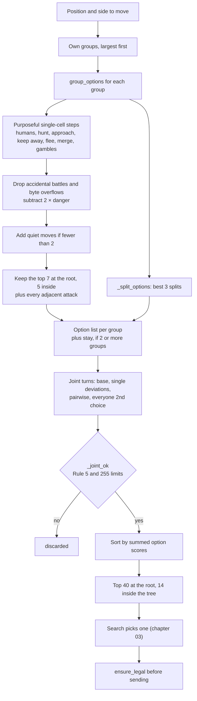

# 🧠 Move generation: imagining candidate turns

How `vvw/movegen.py` proposes a short, ranked list of sensible turns instead of all possible ones, and how `vvw/state.py:validate` and `vvw/safety.py` guarantee that whatever we send is legal.

> **At a glance**
> - Enumerating every way to split every group is hopeless: one group of 12 already has **50,388** ways to spread over its 8 neighbours.
> - Instead, each group gets a handful of **purposeful options** (`group_options`): convert humans, hunt, approach or keep away, flee, merge, gamble when it makes sense, and splits for several human cells.
> - Options are combined into **joint turns** (best per group, plus single and pairwise deviations), filtered for Rule 5 and the 255-per-cell byte limit, and ranked. Up to **40** at the root and **14** inside the tree.
> - Every outgoing move is checked again by `validate` (a mirror of the server's `CheckMoves`). If anything is wrong, `ensure_legal` swaps in a move that is legal by construction.
> - Measured: the new generator (splits, detachments, wider root) scored **0.540** against the previous version (88 W / 260 D / 56 L, p ≈ 0.01).

**Contents**
1. [Why not enumerate everything?](#-why-not-enumerate-everything)
2. [The pipeline](#️-the-pipeline)
3. [Purposeful options for one group](#-purposeful-options-for-one-group)
4. [Danger scoring](#️-danger-scoring)
5. [Splits and detachments](#️-splits-and-detachments)
6. [Root vs inner widths](#-root-vs-inner-widths)
7. [Joint turns](#-joint-turns)
8. [Legality and the safety net](#️-legality-and-the-safety-net)
9. [Measured effect and limitations](#-measured-effect-and-limitations)
10. [Where it lives in the code](#where-it-lives-in-the-code)
11. [Key takeaways](#key-takeaways)

All boards below use: V = vampires, W = werewolves, H = humans, numbers = counts. Coordinates are (x, y), x = column, y = row, (0,0) top-left. Distance is Chebyshev (king moves, so diagonals count 1). Every list of options and turns was printed by calling the real functions, with Vampires as the side to move.

---

## 💥 Why not enumerate everything?

On this server, splits are free: a turn may contain any number of moves, and a group may send any number of creatures to each of its 8 neighbours ([chapter 01](./01-game-rules.md)). Counting the ways to spread **n identical creatures** over the 8 neighbours is a "stars and bars" count:

```
all n move:                C(n + 7, 7)
some may stay behind:      C(n + 8, 8) − 1      (9 "bins", minus "nobody moves")
```

Checked with a tiny Python calculation (`math.comb`, and brute force for n ≤ 4):

| Group size n | all move: `C(n+7, 7)` | some may stay: `C(n+8, 8) − 1` |
|---|---|---|
| 1 | 8 | 8 |
| 2 | 36 | 44 |
| 3 | 120 | 164 |
| 5 | 792 | — |
| 8 | 6,435 | — |
| **12** | **50,388** | **125,969** |
| 20 | 888,030 | — |
| 50 | 264,385,836 | — |

The choices of different groups multiply: **two** groups of 12 already give 50,388² ≈ **2.5 billion** joint turns, before counting the opponent's replies. A search that wants to look several plies ahead in under 1.3 s needs something like **14** candidates per position, not billions. Most of those billions are nonsense anyway, like sending 1 creature in each direction.

---

## 🗺️ The pipeline



The scores in this chapter are only **heuristic ordering**: they decide which turns get proposed and in which order. The search ([chapter 03](./03-search.md)) and the evaluation ([chapter 04](./04-evaluation.md)) decide which one is actually played. At the root, the list is also re-sorted by a 1-ply static look (`Searcher._order_root`) before searching.

---

## 🎯 Purposeful options for one group

`group_options(board, state, side, gp, n, can_stay, max_opts)` looks at one group of `n` creatures on cell `gp`. For each *reason to move*, it scores every neighbouring cell that serves that reason. A cell keeps its **best** score over all reasons. Discounting uses `GAMMA = 0.8` per step (the move generator's own constant, distinct from the evaluation's γ = 0.75).

| Reason | When | Cells scored | Score |
|---|---|---|---|
| **Convert humans** | human cell with `c ≤ n` | every step toward it | `c · 0.8^(d−1)` |
| **Hunt** | enemy `e` with `n ≥ 1.5·e` (sure kill) | every step toward it | `1.2 · e · 0.8^(d−1)` |
| **Approach** (positive-EV battle) | `e < n < 1.5·e` | every step toward it (if adjacent, the attack itself is a deliberate gamble) | `attack_ev(n, e) · 0.8^(d−1)` |
| **Keep away** | same, and `d ≤ 2` | neighbours farther from it | `0.1 · e` (a leader may prefer no battle) |
| **Flee** | `e > n` and `d ≤ 3` | neighbours farther from it | `0.6 · attack_ev(e, n)` |
| **Desperate / even gamble** | `e ≥ n` and adjacent | the enemy's cell | `−attack_ev(e, n)` (0 if equal) |
| **Merge** | any allied group | every step toward it | `0.25 · min(n, a) · 0.8^(d−1)` |
| **Gamble on humans** | adjacent human cell with `c > n` and win chance `n/(2c) ≥ 0.4` | that cell | `p²·(n + c) − n` (always negative: kept only so the search can judge it) |

Then three filters and fixes:

1. **Never stumble into a battle.** A cell holding more humans than `n`, or an enemy we can't kill outright (`n < 1.5·e`), is dropped unless it was added as a *deliberate* gamble above.
2. **Byte limits.** Merging past 255 creatures, or converting humans to a total above 255, is dropped (the server would crash, which counts as our loss).
3. **Danger penalty.** Each remaining cell's score is reduced by `2 · _danger(...)`, the expected loss if a bigger adjacent enemy attacks it next turn (next section).

Finally:

- **At least 2 quiet moves.** If fewer than two options avoid a battle, quiet filler steps are added (score `−2·danger − 0.5 − 0.05 · distance to the nearest human cell`). A gamble is then never the only thing on offer.
- Keep the best `max_opts` (7 at the root, 5 inside), **plus every attack on an adjacent enemy**, whatever its rank, because a desperate gamble is exactly what the search must not overlook. Then append the split options.
- **Stay** (score `−2 · danger` on the current cell) is offered only when the side has more than one group. A turn where everyone stays would be an empty move, which the server punishes as a loss.

### Example 1: one group weighs its options

```
       x→ 0   1   2   3   4   5   6
  y↓ 0   H9   .   .   .  W3   .   .
     1    .   .   .   .   .   .   .
     2    .   .  V6   .   .  H4   .
     3    .   .   .   .   .   .   .
     4    .  W8   .   .   .   .   .
```

V6 at (2,2) sees: W3 at distance 2 (6 ≥ 4.5, a sure kill), H4 at distance 3 (convertible), W8 at distance 2 (bigger, so flee), and H9 (too big, ignored). Output of `group_options` (root width):

| Rank | Option | Score | Why |
|---|---|---|---|
| 1 | 6 (2,2) → (3,1) | 2.880 | hunt W3: `1.2 · 3 · 0.8` (also toward H4, and away from W8) |
| 2 | 6 (2,2) → (3,2) | 2.560 | toward H4: `4 · 0.8²` |
| 3 | 6 (2,2) → (3,3) | 2.560 | toward H4 |
| 4 | 6 (2,2) → (1,1) | 2.033 | flee W8: `0.6 · attack_ev(8, 6) = 0.6 · 3.389` |
| 5 | 6 (2,2) → (2,1) | 2.033 | flee W8 |

The other three neighbours, (1,2), (1,3) and (2,3), serve no purpose, so they are never proposed. There is only one group, so there is no "stay" option, and `generate_moves(board, state, 0, 40)` returns exactly these 5 turns in this order.

---

## ☠️ Danger scoring

`_danger(board, q, n, theirs, exclude=-1)` answers: *"if n of my creatures stand on q, what does the best adjacent bigger enemy gain by attacking them next move?"*

```
danger = max over enemy groups adjacent to q with e > n of  attack_ev(e, n)      (0 if none)
```

- It is subtracted **twice** (`−2 · danger`) from an option's score, so stepping next to a bigger enemy hands it a positive-EV attack and is ranked down hard. Example: 6 creatures stepping next to a W8 lose `2 · 3.389 = 6.78`, more than any of the scores above.
- The size used is the group's size **after** converting humans on that cell, if any (a group that grows on arrival may outgrow the danger).
- `exclude = q` skips the enemy on the target cell itself: when the option *is* the attack on that enemy, its risk is already in the gamble's score.
- For split parts, `_part_ok` uses the same function as a hard filter: a part may land on a cell only if `danger ≤ 0.25 · k` for its size `k`.

---

## ✂️ Splits and detachments

`_split_options(board, state, side, gp, n, targets, singles)` builds at most `MAX_SPLIT_OPTIONS = 3` split moves for a group, and none at all once the side already has `MAX_GROUPS_FOR_SPLIT = 4` groups. `targets` are the convertible human cells with their discounted values. The best 5 are considered.

| Kind | Rule | Score |
|---|---|---|
| **2-way** | two human cells with `c1 + c2 ≤ n`: **exact force** `c` to the cell with fewer humans, the rest to the other | `v1 + v2 − 0.5` |
| **3-way** | only if the side would still have ≤ 4 groups. Three of the best 4 cells, sorted by humans: exact force to the two smallest, the rest (which must be ≥ the largest cell's humans) to the third | `va + vb + vc − 1.0` |
| **Detachment, main body stays** | exactly `c` creatures break off toward one of the best 3 cells, and the main body (`n − c ≥ c`, it keeps the majority) stays | `v − 2·danger(main body) − 0.5` |
| **Detachment, main body acts** | same detachment, while the rest takes one of the group's 2 best single options (not the same cell, not a human cell, and the cell must pass `_part_ok`) | `v + s_main − 0.5` |

The `−0.5` and `−1.0` are a mild preference against splitting. The evaluation adds its own `split_penalty` of 0.4 per extra group ([chapter 04](./04-evaluation.md#-fragmentation)).

**Placing the parts.** `_place(board, state, side, gp, parts)` gives each `(count, target)` part one step toward its target (`board.steps_toward`, up to 3 cells each). It keeps only cells accepted by `_part_ok` (not an enemy cell, no 255 overflow, no humans bigger than the part, `danger ≤ 0.25 · k`), and returns the first combination where all parts land on **distinct** cells, or `[]` if none exists. It uses `itertools.product` rather than a recursive closure on purpose: with the cyclic GC disabled during search, a closure's reference cycle would never be freed (comment in the code, see REPORT.md §3.4).

### Example 2: a 2-way split for two human cells

```
       x→ 0   1   2   3   4   5   6
  y↓ 0    .  H2   .   .   .   .  W4
     1    .   .   .   .   .   .   .
     2    .   .   .  V5   .   .   .
     3    .   .   .   .   .   .   .
     4    .   .   .   .   .  H3   .
```

V5 at (3,2) is 2 steps from both H2 and H3, and 2 + 3 = 5 is exactly its size. Output of `group_options`:

| Score | Option | Kind |
|---|---|---|
| 3.500 | 3 (3,2) → (4,3) + 2 (3,2) → (2,1) | 2-way split: `2.4 + 1.6 − 0.5` (exact force 2 to H2, the rest, 3, to H3) |
| 3.500 | 2 (3,2) → (2,1) + 3 (3,2) → (4,3) | the same moves, found as "detach 2 + main body takes its best option" |
| 2.400 | 5 (3,2) → (4,3) | whole group toward H3: `3 · 0.8` |
| 1.600 | 5 (3,2) → (2,1) | whole group toward H2: `2 · 0.8` |
| 1.100 | 2 (3,2) → (2,1) | detachment of 2, main body (3) stays: `1.6 − 0.5` |
| 1.000 | 5 (3,2) → (4,1) | approach W4 (5 > 4, positive EV): `attack_ev(5, 4) · 0.8² = 1.5625 · 0.64` |
| 1.000 | 5 (3,2) → (4,2) | same |

Next turn each part converts its cell (2 + 2 = 4 and 3 + 3 = 6), and both cells are taken in the time a single group would need for one.

### Example 3: a 3-way split

```
       x→ 0   1   2   3   4   5   6
  y↓ 0    .  H2   .   .   .  H3   .
     1    .   .   .   .   .   .   .
     2    .   .   .  V9   .   .   .
     3    .   .   .   .   .   .   .
     4    .   .   .  H3   .   .  W3
```

The best option for V9 is `2 → (2,1) + 3 → (2,3) + 4 → (4,1)` with score `1.6 + 2.4 + 2.4 − 1.0 = 5.4`: exact force 2 for H2 and 3 for H3 (3,4), and the remaining 4 for H3 (5,0).

### Example 4: a detachment, collecting humans without abandoning the front

```
       x→ 0   1   2   3   4   5   6
  y↓ 0   H3   .   .   .   .   .   .
     1    .   .   .   .   .   .   .
     2    .   .   . V12   .   .  W9
     3    .   .   .   .   .   .   .
     4   H2   .   .   .   .   .   .
```

V12 has a positive-EV fight brewing with W9 (12 vs 9: 83% to win, `attack_ev = 5.08`) and two small human cells behind it. Output of `generate_moves(board, state, 0, 40)`, all 9 turns:

| # | Turn | Score | Kind |
|---|---|---|---|
| 1 | 3 (3,2) → (2,1) + 9 (3,2) → (4,1) | 4.673 | detach 3 toward H3, the main body approaches W9: `1.92 + 3.253 − 0.5` |
| 2 | 3 (3,2) → (2,1) + 9 (3,2) → (4,2) | 4.673 | same, other approach cell |
| 3 | 2 (3,2) → (2,2) + 10 (3,2) → (4,1) | 4.033 | detach 2 toward H2: `1.28 + 3.253 − 0.5` |
| 4–6 | 12 → (4,1), (4,2) or (4,3) | 3.253 | approach W9: `5.08 · 0.8²` |
| 7–8 | 12 → (2,2) or (2,1) | 1.920 | toward H3: `3 · 0.8²` |
| 9 | 12 → (2,3) | 1.280 | toward H2: `2 · 0.8²` |

> ⚠️ **Watch out:** a detachment's score reuses the main body's single-option score, which was computed for the **whole** group. Turn 1 scores the 9-creature main body as if it still had 12 creatures' advantage over W9, while 9 vs 9 is really an even fight. The generator only proposes. The search, which sees the true sizes, decides whether the detachment is worth it.

---

## 📏 Root vs inner widths

`generate_moves(board, state, side, limit)` decides how wide to be from `limit`. The search calls it with `root_limit = 40` at the root and `inner_limit = 14` everywhere else (`Searcher.__init__`):

| | Root (`limit = 40`) | Inside the tree (`limit = 14`) |
|---|---|---|
| Options kept per group (`max_opts`) | `ROOT_GROUP_OPTIONS = 7` | `MAX_GROUP_OPTIONS = 5` |
| Pairwise width (top options per group in pairs) | 3 | 2 |
| Joint turns returned | up to 40 | up to 14 |
| Always added | adjacent attacks, up to 3 splits, stay | same |

The rule in code is `max_opts = 7 if limit >= 20 else 5`. Every root move gets searched anyway, so a wider root costs little and can't miss a good first move. Inside the tree, branching dominates the cost, so it stays narrow. Inner lists are also cached per (position, side) by the search (`mcache`).

---

## 🤝 Joint turns

A turn is one move list for **all** of the side's groups. `generate_moves`:

1. Sorts the side's groups by size (largest first) and builds each group's option list (above). `can_stay` is true only with 2 or more groups.
2. Proposes combinations, as lists of option indices, one per group:
   - **base**: every group takes its best option.
   - **single deviations**: one group takes any other option, the rest keep their best.
   - **pairwise deviations** (only with ≤ 4 groups): for every pair of groups, all combinations of their top 3 (root) or top 2 (inner) options.
   - **diversity**: every group takes its 2nd choice.
3. Scores each combination by the **sum** of its option scores, merges the move lists, and keeps it only if `_joint_ok` accepts it. Duplicates by index choice are skipped (`seen`).
4. Sorts by score and returns the top `limit`.

`_joint_ok(moves, state, side)` rejects:

| Check | Why |
|---|---|
| empty move list | everyone stayed, so the server treats it as a static player and we lose |
| a destination that is also a source (**Rule 5**) | the server's `CheckMoves` rejects it |
| more than 255 arriving at one cell, or own group + arrivals > 255 | counts are bytes server-side |
| humans converted to a total > 255 | same |

### Example 5: two groups, joint turns, and a Rule 5 clash

```
       x→ 0   1   2   3   4
  y↓ 0    .   .   .  H2   .
     1    .  V4  V3   .   .
     2    .   .   .   .   .
     3    .   .   .   .  W9
```

Option lists (root width). V4 sorts first because it is the bigger group:

| V4 at (1,1) | score | V3 at (2,1) | score |
|---|---|---|---|
| 2 → (2,0) + 2 → (0,0) (detach + flee) | 3.500 | 3 → (3,0) (convert H2) | 2.000 |
| 2 → (2,0) + 2 → (0,1) | 3.500 | 3 → (1,0) (flee W9: `0.6 · attack_ev(9, 3)`) | 1.800 |
| 4 → (0,0) (flee W9: `0.6 · 4`) | 2.400 | 3 → (2,0) | 1.800 |
| 4 → (0,1) | 2.400 | 3 → (1,1) (flee, onto V4: a merge) | 1.800 |
| 4 → (0,2) | 2.400 | 3 → (1,2) | 1.800 |
| 4 → (2,0) (toward H2: `2 · 0.8`) | 1.600 | stay | 0.000 |
| 4 → (2,1) (also toward H2, onto V3: a merge) | 1.600 | | |
| 2 → (2,0) (detach, rest stays) | 1.100 | | |
| stay | 0.000 | | |

`generate_moves(..., limit=40)` returns 16 joint turns. The top 3:

```
 1. 2 (1,1)->(2,0) + 2 (1,1)->(0,0) + 3 (2,1)->(3,0)
 2. 2 (1,1)->(2,0) + 2 (1,1)->(0,1) + 3 (2,1)->(3,0)
 3. 2 (1,1)->(2,0) + 2 (1,1)->(0,0) + 3 (2,1)->(1,0)
```

One combination you will **not** find: "V4 merges into (2,1)" while V3 moves to H2. Cell (2,1) would be both a target and a source, which breaks Rule 5:

```python
bad = [(P(1,1), 4, P(2,1)), (P(2,1), 3, P(3,0))]
_joint_ok(bad, st, 0)       # False
validate(b, st, 0, bad)     # 'cell is both source and target in (6, 4, 7)'
```

The same position with `limit = 14` (inner) yields 13 turns from the narrower lists (5 options per group, pairwise width 2). On a busier two-group position, `limit = 40` returned 21 turns and `limit = 14` cut it to 14.

---

## 🛡️ Legality and the safety net

An illegal, empty or malformed move is an **instant loss** on this server ([chapter 01](./01-game-rules.md)). So legality is enforced twice: by construction in the generator, and by an independent check before sending.

### `validate(board, state, side, moves)`: a mirror of the server's `CheckMoves`

It returns `None` if legal, otherwise a reason string. It checks, in order:

| Check | Example reason (real output on the board of Example 5) |
|---|---|
| empty move list | `no move (server: static -> loss)` |
| source or target off the board | `cell out of board in (6, 4, 99)` |
| a cell is both a source and a target (Rule 5) | `cell is both source and target in (6, 4, 7)` |
| source not ours | `source is not ours in (19, 3, 18)` (moving the werewolves' cell) |
| zero creatures | `zero creatures in (6, 0, 11)` |
| more creatures than the cell holds | `too many creatures in (6, 9, 11)` |
| target not one of the 8 neighbours | `target not adjacent in (6, 4, 18)` |
| total leaving a source exceeds the group | `sum leaving 6 exceeds group` (3 + 3 out of V4) |
| more than 255 arriving at one cell | `more than 255 arriving at 12` (200 + 100 into one empty cell) |
| own group + arrivals > 255, or humans converted to > 255 | `cell 7 would exceed 255` (200 moved onto an own group of 100) |

(Cells are the integers `p = y · cols + x`, which is why reasons show numbers: on this 5-column board, 6 is (1,1) and 7 is (2,1). The 255 examples use separate states with big groups.) The off-board and byte checks go beyond `CheckMoves`: the server doesn't check them, it crashes, and a crash also counts as our loss (RULES.md).

### `ensure_legal` and `fallback_move`

```python
moves = ensure_legal(board, state, me, moves)   # vvw/ai.py, on every outgoing move
```

- `ensure_legal(board, state, side, moves)` returns `moves` unchanged if `validate` accepts them, otherwise `fallback_move(...)`.
- `fallback_move(board, state, side)` moves **one whole group to its safest neighbour**, legal by construction (a single move, on the board, from our own cell, all creatures, no 255 overflow). It scores neighbours: +50 for a sure kill, −100 for any other enemy cell, +10 + c for convertible humans, −80 for humans that are too many, −60 for every adjacent enemy that could kill the group there. If every neighbour would overflow a byte, it moves a single creature instead.
- If the search itself throws, `vvw/ai.py` falls back to `fallback_move` directly.

In Example 5, `ensure_legal` on the Rule 5 clash above returns `3 (2,1)->(3,0)`: V3 converts H2.

### How it is tested

- `tests/test_engine.py::test_every_generated_turn_is_legal`: property test on 400 random boards (2×2 to 12×12, group sizes up to 250), both sides, `limit = 40`. **Every** generated turn must pass `validate`, with more than 1,000 turns checked.
- `test_fallback_is_always_legal` (500 random boards) and `test_ensure_legal_replaces_garbage` (empty, zero-count, too many, not ours, not adjacent).
- `tests/test_edge_cases.py`: boxed-in groups, all neighbours full of own 255-creature groups, random states after a full search, and whole games that must never forfeit.

---

## 📊 Measured effect and limitations

From REPORT.md (§5): **new move generation vs the previous version (v5), 0.1 s/move, 404 games: 88 W / 260 D / 56 L, score 0.540 (p ≈ 0.01).** This is the "Splits: 2 or 3 parts, detachments, wider root" change. Against an equally careful engine most games are draws, so the 88 vs 56 decisive games are the signal.

Honest limitations (read from the code):

| Limitation | Consequence |
|---|---|
| Option scores are hand-made heuristics with their own `GAMMA = 0.8` | they only order candidates. A good move that no reason produces is never searched |
| Duplicates are removed by option index, not by move set | the same turn can appear twice (Examples 2 and 3), which wastes a little search |
| Detachment scores reuse the whole group's single-option score | the main body's weakened state is only seen by the search (Example 4) |
| No splits once a side has 4 groups. 3-way only if it stays ≤ 4 | very spread-out plans are out of reach |
| Pairwise deviations only with ≤ 4 groups | with many groups, only single deviations are explored |
| Long plans are beyond the horizon | REPORT.md: "split a guard toward the far human cluster while chasing" is not found |

---

## Where it lives in the code

| File | Function / name | What it does |
|---|---|---|
| `vvw/movegen.py` | `generate_moves` | joint turns, ranked, top `limit` |
| `vvw/movegen.py` | `group_options` | purposeful options for one group |
| `vvw/movegen.py` | `_danger` | expected loss from the best adjacent bigger enemy |
| `vvw/movegen.py` | `_split_options`, `_place`, `_part_ok` | 2-way / 3-way splits and detachments, safe placement |
| `vvw/movegen.py` | `_joint_ok` | Rule 5 and byte limits on a joint turn |
| `vvw/movegen.py` | `GAMMA`, `MAX_GROUP_OPTIONS`, `ROOT_GROUP_OPTIONS`, `MAX_SPLIT_OPTIONS`, `MAX_GROUPS_FOR_SPLIT` | 0.8, 5, 7, 3, 4 |
| `vvw/state.py` | `validate` | mirror of the server's `CheckMoves` + bounds + 255 |
| `vvw/state.py` | `Board.steps_toward` | neighbours one step closer to a target (cached) |
| `vvw/safety.py` | `ensure_legal`, `fallback_move` | the last line of defence |
| `vvw/rules.py` | `attack_ev`, `MAX_CELL` | battle EV, the 255 limit |
| `vvw/search.py` | `Searcher.__init__` (`root_limit = 40`, `inner_limit = 14`), `_ab` | where the generator is called |

## Key takeaways

- **Enumeration explodes** (50,388 ways for one group of 12, ≈ 2.5 billion for two), so the generator *imagines* only purposeful moves.
- **Each option has a reason** (humans, hunt, approach, keep away, flee, merge, gamble), a score, and a danger penalty. Accidental battles are never proposed, and at least two quiet moves always are.
- **Splits are targeted**: exact force for each human cell, or a detachment while the main body keeps doing its job.
- **Joint turns** combine the best options with single and pairwise deviations: 40 at the root, 14 inside the tree.
- **Legal by construction and by check.** `_joint_ok` filters, `validate` mirrors the server, and `ensure_legal` / `fallback_move` guarantee something legal is always sent.
- **It paid off**: 0.540 against the previous generator (88 W / 56 L in decisive games, p ≈ 0.01).

---

← Previous: [Evaluation](./04-evaluation.md) · [Index](../README.md#documentation) · Next: [Pondering and the opponent model](./06-pondering-and-opponent-model.md) →
