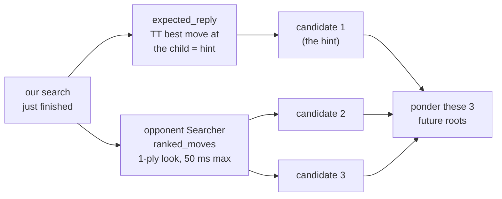
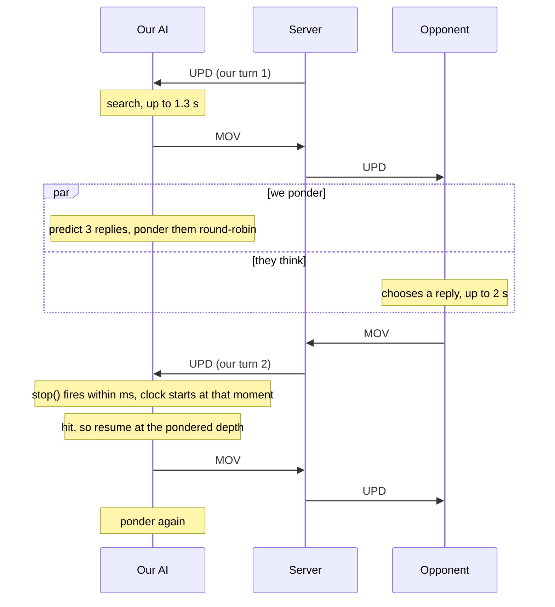
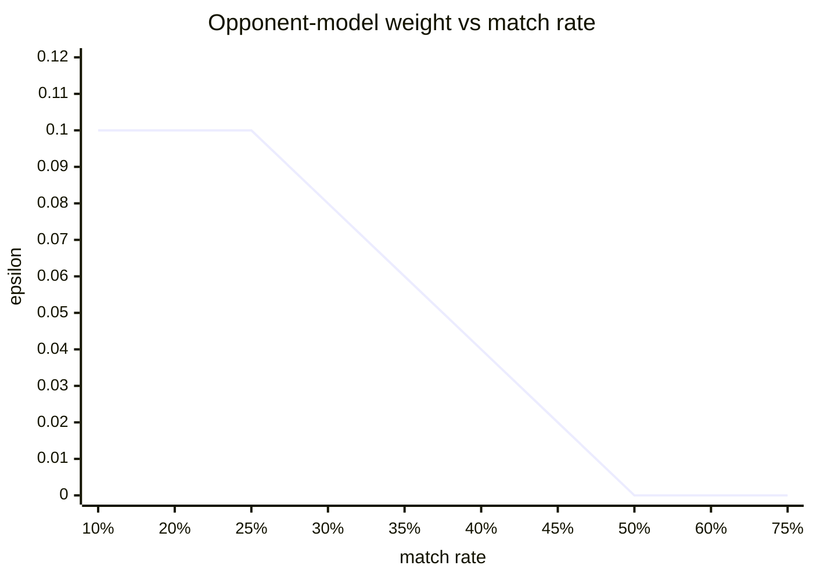
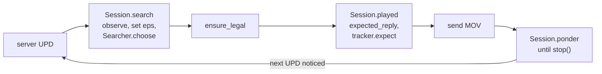

# 🔮 Pondering and the opponent model

This chapter explains how the AI keeps thinking while the opponent is thinking (pondering), and how it measures how predictable the opponent is so it can set traps for opponents that don't find their best reply.

> **At a glance**
> - After sending our move, we **guess the opponent's 3 most likely replies** and pre-search our answer to each, round-robin, until the server's next message arrives.
> - If the real position is one we pondered (a **hit**), the search **resumes** at the depth already reached, with its transposition table. Otherwise (a **miss**) it is an ordinary search and nothing is lost.
> - Measured: the guess is right on **77%** of turns against engines and **2%** against instant-reply bots. Pondering scored **0.519** against the same engine without it (77 W / 265 D / 62 L), which is not statistically significant.
> - `OpponentTracker` counts how often the opponent plays exactly the reply we predicted. Engines match 56–58%, greedy bots 24–26%, random 4%. That rate sets the opponent-model weight ε between 0 and 0.1.
> - `Session` glues search, pondering and tracking together for both the tournament client and the simulator. Pondering needs a free CPU core. `--no-ponder` turns it off.

**Contents**
1. [The idea: think on the opponent's time](#the-idea-think-on-the-opponents-time)
2. [Which positions to prepare](#which-positions-to-prepare)
3. [Sharing the time: round-robin slices](#sharing-the-time-round-robin-slices)
4. [Stopping at once: stop() every 128 nodes](#stopping-at-once-stop-every-128-nodes)
5. [Hit or miss: when the real position arrives](#hit-or-miss-when-the-real-position-arrives)
6. [The move clock starts when the message was noticed](#the-move-clock-starts-when-the-message-was-noticed)
7. [Memory and safety](#memory-and-safety)
8. [Two turns on a timeline](#two-turns-on-a-timeline)
9. [The opponent tracker](#the-opponent-tracker)
10. [The soft-min opponent model](#the-soft-min-opponent-model)
11. [Session: the glue](#session-the-glue)
12. [Measured results and honest assessment](#measured-results-and-honest-assessment)
13. [Why separate processes: the GIL](#why-separate-processes-the-gil)
14. [Where it lives in the code](#where-it-lives-in-the-code)
15. [Key takeaways](#key-takeaways)

---

## The idea: think on the opponent's time

**In plain English.** Chess players do this all the time. While your opponent is thinking, you don't stare at the ceiling. You guess what they will play and start working out your answer. If the guess is right, you have a head start. If it's wrong, you've lost nothing, because you'd have been idle anyway.

Our AI has 2 s per move on the server and uses 1.3 s ([chapter 03](./03-search.md#iterative-deepening-under-a-deadline)). The opponent also gets up to 2 s, and without pondering our process would sit blocked on the socket for all of it. `vvw/ponder.py` turns that dead time into search time for our **next** move.

What makes this cheap to build is the per-root context from [chapter 03](./03-search.md#per-root-contexts). All search tables for a root position live in a `RootContext`, stored in `Searcher.contexts[(root key, plies_left)]`. Pondering simply searches *future* root positions into that dict. When the real position arrives, `Searcher.choose` looks it up there: found means resume, not found means start fresh.

---

## Which positions to prepare

We cannot ponder every reply: the opponent has up to 40 candidate turns. `Ponderer.candidates` picks **`TOP_REPLIES = 3`**, most likely first:

1. **The reply our own search expected.** Our search just built a tree in which it modelled the opponent's best answer to our move. `Searcher.expected_reply(state, our_move, plies_left)` applies our move (taking the most likely branch if it was a battle) and reads the **best move stored in the transposition table** for that child position. That reply is the "hint".
2. **The next best replies by a 1-ply look from the opponent's side.** `Ponderer` owns a second `Searcher` for the *opponent's* species. Its `ranked_moves` generates the opponent's candidate turns and sorts them with the same 1-ply look used for root ordering (`_order_root`), capped at 50 ms. The top entries that differ from the hint fill the remaining slots.

Each reply is applied (most likely outcome again). Duplicate positions and positions where one side has been wiped out are dropped. The result is a list of up to 3 positions with **us** to move: our next root positions.



> 💡 **Tip:** The hint is free. It is a by-product of the search we already ran. If our search was too shallow to expand that child (for example depth 1), there is no table entry and the hint is `None`. Then all 3 candidates come from the 1-ply ranking.

---

## Sharing the time: round-robin slices

We don't know how long the opponent will think. Candidate 1 is the most likely, but if we spent all the time on it, a wrong guess would leave us nothing. So `Ponderer.ponder` deepens the candidates **round-robin** in slices:

| Candidate | Slice per round (`SLICES`) |
|---|---|
| 1 (the hint) | 0.4 s |
| 2 | 0.2 s |
| 3 | 0.2 s |

Each slice is a call to `Searcher.choose(candidate, ..., ponder=True)` with the slice end as the deadline. Iterative deepening resumes in that candidate's context, so the next slice continues where the last one stopped. Two differences from a normal search:

- `ponder=True` **ignores the "next depth can't finish" rule**. The search keeps going until the slice ends, since the time would otherwise be idle.
- `ponder=True` **doesn't keep a partial iteration's move as the answer**. Only completed depths are recorded, so a resumed search starts from a clean, fully searched depth. The table entries from the unfinished depth stay and still speed up the resumed search.

Pondering ends when `stop()` turns true, when every candidate is `done` (maximum depth reached or a forced result), when the memory cap is hit ([below](#memory-and-safety)), or when the game ends with the opponent's move (`plies_opp <= 1`, nothing to prepare).

---

## Stopping at once: stop() every 128 nodes

Pondering must end **the moment** the server's next message arrives. That message starts our real move clock.

- `stop` is `client.has_pending_data`, a zero-timeout `select()` on the socket. It returns `True` as soon as the server's bytes are waiting.
- `Searcher._ab` polls it every 128 nodes (`not self.nodes & 127`), and `Ponderer.ponder` also checks it before every slice.
- When it fires, `_ab` records the time in `Searcher.stopped` and raises `Timeout`. The search unwinds and `ponder` returns that timestamp.

REPORT.md measured that pondering ends within about **1–7 ms**. In our hit/miss runs below, the stop was noticed 0.1 ms and 1.5 ms after the (simulated) message. `tests/test_ponder.py::test_stops_promptly` checks it stays well below 50 ms.

---

## Hit or miss: when the real position arrives

`Session.search` calls `Searcher.choose(actual_position, ...)` as usual. Inside, `_context` looks up `(actual.key(), plies_left)`:

| Case | What `_context` does | Effect |
|---|---|---|
| **Hit**: the position was pondered | Keeps that context and drops the other pondered ones | Iterative deepening **starts at the pondered depth + 1**, with the TT, killers, leaf cache and root order intact. `info.pondered` = the depth reached while pondering. |
| **Miss**: the opponent played something else | Clears all pondered contexts and builds a new one | A normal search from depth 1. `info.pondered = 0`. |

**Correctness guarantee.** A hit is a pure head start. `tests/test_ponder.py::test_hit_continues_deeper_and_matches_fresh_search` ponders to depth 3, plays the predicted reply, and checks that the resumed search returns **exactly the same move and value** as a fresh depth-3 search of the same position. `test_miss_is_a_normal_search` checks that a miss gives an ordinary search (`pondered = 0`) that still returns a move.

Both examples below use the 14×10 test position from `tests/test_ponder.py`, searched with the real 1.3 s budget. We let the "opponent" think for 1.0 s, pondering meanwhile, and drove everything through `Session` exactly as the client does:

```
      x=0  x=1  x=2  x=3  x=4  x=5  x=6  x=7  x=8  x=9 x=10 x=11 x=12 x=13
y=0    .    .    .    .    .    .    .    .    .    .    .    .   H2    .
y=1    .    .    .    .    .    .   H3    .    .    .    .    .    .    .
y=2    .    .   V9    .    .    .    .    .    .    .   W4    .    .    .
y=3    .    .    .    .    .    .    .    .    .    .    .    .    .    .
y=4    .    .    .    .    .    .    .    .   H6    .    .    .    .    .
y=5    .    .    .    .    .   H6    .    .    .    .    .    .    .    .
y=6    .    .    .    .    .    .    .    .    .    .    .    .    .    .
y=7    .    .    .   V4    .    .    .    .    .    .    .   W9    .    .
y=8    .    .    .    .    .    .    .   H3    .    .    .    .    .    .
y=9    .   H2    .    .    .    .    .    .    .    .    .    .    .    .

V = vampires (us), W = werewolves, H = humans, numbers = counts
```

Our move (depth 7, 987 ms) split both groups: `(2,2)-6->(3,3)`, `(2,2)-3->(3,1)`, `(3,7)-2->(2,8)`, `(3,7)-2->(4,6)`. Our search expected the reply `(11,7)-6->(10,6)`, `(11,7)-3->(10,7)`, `(10,2)-4->(11,1)`.

After 1.0 s of pondering, the three contexts looked like this:

| Candidate | Depth completed while pondering | TT entries |
|---|---|---|
| 1 (the hint) | 6 | 6,537 |
| 2 | 5 | 2,229 |
| 3 | 5 | 2,058 |

### Worked example: a hit

The opponent plays the predicted reply. The new position has **40** root moves, which makes it a busy one.

| | Fresh search (no pondering) | Pondered search (hit) |
|---|---|---|
| Depths 1–6 | searched now, 357 ms | already done (`pondered = 6`) |
| Time left for depth 7 | 942 ms | the full 1,300 ms |
| Root moves finished at depth 7 | **13 of 40** | **33–34 of 40** (two runs) |
| Reported | `depth=7 pondered=0` | `depth=7 pondered=6` |

Neither search could finish depth 7 in time. Both played a *partial* depth-7 result, which is still at least as informed as depth 6 because the depth-6 favourite is searched first. The pondered search, though, compared almost all 40 moves at depth 7 instead of a third of them. That is the benefit of a hit: a deeper or more complete search in the same 1.3 s. When the next depth fits in the budget, the head start can be enough to finish it.

### Worked example: a miss

Same game, but the opponent splits its 4-group into 2 + 2 (`(10,2)-2->(11,1)`, `(10,2)-2->(9,1)`), a reply none of the 3 candidates covered.

| | Result |
|---|---|
| `_context` | No match: the 3 pondered contexts are thrown away |
| Our search | `depth=7 pondered=0`, value 24.2 |
| A fresh searcher on the same position | `depth=7 pondered=0`, value 24.2 |

Same depth and same value as if we had never pondered. The pondering cost was CPU time we would have spent idle.

> ⚠️ **Watch out:** If our own move started a random battle, we ponder only its **most likely** outcome. If the dice go the other way, every candidate is a miss.

---

## The move clock starts when the message was noticed

The server starts our 2 s clock when it *sends* the update. If pondering noticed the message 5 ms after it arrived, those 5 ms are already gone. `main.play` accounts for that:

```python
noticed = agent.ponder(client.has_pending_data)   # returns when stop() first fired
...
cmd, payload = client.get_message()
t_recv = time.perf_counter()
if noticed is not None:
    t_recv = min(t_recv, noticed)                  # the clock started when it arrived
...
moves = agent.decide(t_recv)                       # deadline = t_recv + 1.3 s
```

So the 1.3 s budget is measured from when the message was first noticed, not from when we finished reading it. REPORT.md's timing tests had pondering on: worst move 1,300 ms on 30×30 to 50×50 maps, and 1,310 ms with the machine fully loaded (26 simultaneous games). No move went above 1.4 s.

When we play the **Werewolves**, the Vampires move first. `Agent.on_map` calls `Session.opponent_moves_first`, so we ponder the starting position during their first move, without a hint.

---

## Memory and safety

Pondering is optional, so it must never hurt the real move.

| Guard | Where | What it does |
|---|---|---|
| Memory cap | `MAX_TABLE_ENTRIES = 1_500_000` in `ponder.py` | Stop pondering once all pondered contexts together hold 1.5 M TT entries. REPORT.md measured about 240 MB per client on 50×50 maps. |
| Fresh start | `Ponderer.ponder` calls `Searcher.forget()` | Old contexts are dropped before each pondering phase. |
| Keep only the real one | `Searcher._context` (real search) | On a hit, the other two guesses are discarded. On a miss, all three are. |
| Exceptions | `Agent.ponder` | Any exception in pondering is caught. It only drops the pondered tables (`forget()`) and returns `None`. |
| GC off | `gc.disable()` | The cyclic garbage collector paused ~400 ms on these tables. A cycle check finds 0 cycles per search, so nothing leaks without it (REPORT.md). |

---

## Two turns on a timeline

Who talks to whom, over two of our turns:



CPU use in the hit example above (schematic: the opponent thinks 1.0 s, network delays ignored). Both processes are busy at once, which is why pondering needs a **second CPU core**:

```mermaid
gantt
    title CPU use over one opponent turn (opponent thinks 1.0 s)
    dateFormat x
    axisFormat %S.%L
    section Our process
    Search our move               :done, a1, 0, 1300
    Predict 3 replies             :active, a2, 1300, 1350
    Ponder reply 1 for 0.4 s      :a3, 1350, 1750
    Ponder reply 2 for 0.2 s      :a4, 1750, 1950
    Ponder reply 3 for 0.2 s      :a5, 1950, 2150
    Ponder reply 1 again          :a6, 2150, 2300
    Search next move from depth 7 :done, a7, 2300, 3600
    section Opponent process
    Idle                          :b1, 0, 1300
    Opponent thinks               :b2, 1300, 2300
    Idle                          :b3, 2300, 3600
```



---

## The opponent tracker

**In plain English.** Our search assumes the opponent always finds its best reply. Against a strong engine that is right. Against a greedy bot it is too pessimistic: we pass up moves that leave the bot only one good answer, because the search assumes it will find it. So we **measure** how predictable the opponent is and adjust.

**What is counted.** After each of our moves, `Session.played` calls `OpponentTracker.expect(child, opp, hint)`. It stores the position that the predicted reply leads to. On our next turn, `Session.search` calls `observe(actual, det)`, which compares that stored position with the real one.

- It compares **positions** (`State.key()`), not move lists, so two move lists with the same result count as a match.
- It only counts turns where **both** our move and the predicted reply were deterministic (no random battle). Otherwise there is no single "expected" position to compare against.
- It works with `--no-ponder` too: tracking runs whether or not pondering is on.

**Match rate with a prior.** Early in a game there are few observations, so the rate starts from a prior of "a strong opponent":

```
rate = (matches + 0.75 × 6) / (observations + 6)      PRIOR_RATE = 0.75, PRIOR_WEIGHT = 6
```

**From rate to ε**:

```
ε = EPS_MAX × clamp((STRONG − rate) / (STRONG − WEAK), 0, 1)
  = 0.1 × clamp((0.5 − rate) / 0.25, 0, 1)
```

| Match rate | ≤ 25% | 30% | 35% | 40% | 45% | ≥ 50% |
|---|---|---|---|---|---|---|
| ε | **0.10** | 0.08 | 0.06 | 0.04 | 0.02 | **0** |



The thresholds sit between the measured groups:

| Opponent | Measured match rate (REPORT.md) | Resulting ε |
|---|---|---|
| Engines (our own versions) | 56–58% | 0 (pure minimax) |
| Greedy / aggressive bots | 24–26% | close to 0.1 |
| Random bot | 4% | 0.1 |

How fast the prior gives way (computed from the formula):

| Observations | Opponent never matches: rate → ε | Opponent matches 25%: rate → ε |
|---|---|---|
| 0 | 0.75 → 0 | 0.75 → 0 |
| 4 | 0.45 → 0.02 | 0.55 → 0 |
| 10 | 0.28 → 0.088 | 0.41 → 0.038 |
| 20 | 0.17 → 0.10 | 0.37 → 0.054 |
| 40 | 0.10 → 0.10 | 0.32 → 0.074 |

The prior makes the tracker start from "strong opponent" (ε = 0) and move only after evidence builds up. That matches the measurements: wrongly treating a strong engine as weak cost real points (the fixed-ε result [below](#measured-results-and-honest-assessment)), while exploiting a weak bot gains little.

---

## The soft-min opponent model

`Session.search` copies `tracker.eps` into `Searcher.opp_eps` before each search. When ε > 0, `Searcher._ab` hands the **opponent's first reply node** (ply 1 below our root) to `Searcher._soft_min`. Every other node stays pure minimax.

```
value = (1 − ε) × lowest reply + ε × mean(k lowest replies)        k = Weights.opp_k = 3
```

### Why this sets traps

Compare two of our moves, with ε = 0.1. The numbers are values for us after each opponent reply, made up for illustration:

| Our move | Opponent replies (values for us) | Minimax (ε = 0) | Soft-min (ε = 0.1) |
|---|---|---|---|
| A | 2, 3, 10 | 2.00 | 0.9 × 2 + 0.1 × 5.0 = **2.30** |
| B | 2, 9, 11 | 2.00 | 0.9 × 2 + 0.1 × 7.33 = **2.53** |

Minimax sees a tie: the best reply holds both moves to 2. Soft-min prefers **B**, where the opponent has only **one** good answer. A bot that misses it gives us 9 or 11. Under move A it can miss its best reply and still play a decent one.

### How pruning stays exact

A naive soft-min would have to search every reply exactly. `_soft_min` avoids that with two observations:

1. **Only the k lowest values matter.** Each reply is searched with `beta = cap`, the current k-th lowest value (+inf until k values are known). A reply that comes back ≥ cap cannot enter the mean and is ignored. Its value may be just a bound, but that doesn't matter.
2. **More replies can only lower the value.** Once k values are known, `ub = (1 − ε) × lowest + ε × mean(k lowest)` is an upper bound on the node. If `ub <= alpha` (we already have something better at the root), the node **fails low**. It stores `ub` in the TT as an `UPPER` bound and returns.

Here is a step-by-step example with ε = 0.1, k = 3 and alpha = 2.0 (a root move worth 2.0 is already known):

| Reply | Searched with cap | Value | k lowest | Upper bound | Action |
|---|---|---|---|---|---|
| r1 | +inf | 9 | [9] | (fewer than 3) | continue |
| r2 | +inf | 2 | [2, 9] | (fewer than 3) | continue |
| r3 | +inf | 11 | [2, 9, 11] | 0.9 × 2 + 0.1 × 7.33 = 2.53 | > 2.0, continue |
| r4 | 11 | 3 | [2, 3, 9] | 0.9 × 2 + 0.1 × 4.67 = 2.27 | > 2.0, continue |
| r5 | 9 | 1 | [1, 2, 3] | 0.9 × 1 + 0.1 × 2.0 = 1.10 | **≤ 2.0: fail low, return 1.10 (UPPER)** |
| r6... | | | | | skipped |

The TT best move at that node is the lowest reply found. That is also the hint pondering uses next turn.

> ⚠️ **Watch out:** A **fixed** (non-adaptive) ε = 0.1 lost to an equal engine (score 0.475; ε = 0.25 scored 0.493). Against a strong opponent the "it might miss its best reply" assumption is simply wrong, and the engine paid for the traps it set. That result is why ε adapts and starts at 0.

---

## Session: the glue

`Session` (in `vvw/ponder.py`) is one game's thinking: a `Searcher`, a `Ponderer` and an `OpponentTracker`. The tournament client (`vvw/ai.py: Agent`) and the in-process simulator bots (`sim/bots.py: AIBot`) both drive the AI through it, so the code paths measured in simulation are the ones that play in the tournament.

| Call | Who calls it | What it does |
|---|---|---|
| `opponent_moves_first(state, plies)` | `Agent.on_map` / `AIBot.new_game`, as Werewolves | Ponder the start position during the Vampires' first move (no hint) |
| `search(state, plies_left, deadline)` | `Agent.decide` / `AIBot.choose` | `tracker.observe` → set `opp_eps = tracker.eps` → `Searcher.choose` → count a hit if `info.pondered > 0` |
| `played(state, moves, plies_left)` | after `ensure_legal`, with the **final** legal move | Record whether our move was deterministic, get `expected_reply`, `tracker.expect`, and queue `(child, plies_left − 1, hint)` for pondering |
| `ponder(stop)` | `main.play` after sending `MOV` / the referee after each opponent move | Run `Ponderer.ponder` on the queued position until `stop()` |



In the simulator (`sim/referee.py`) the two bots run in one process, one after the other. After each move, the referee lets the *other* bot ponder for exactly as long as the mover thought (at most 2 s). That reproduces the real tournament, where the two AIs run at the same time on separate cores.

---

## Measured results and honest assessment

All from REPORT.md (the score matches are 404 games on point-symmetric random maps, each map played as both species):

| Measurement | Result |
|---|---|
| Hit rate vs engines | **77%** of turns had the real position pondered |
| Hit rate vs instant-reply bots | **2%**: they reply in milliseconds, which leaves almost no time to ponder |
| Pondering vs the same engine without it, 0.1 s/move | 77 W / 265 D / 62 L, score **0.519** |
| *For scale:* double thinking time vs the same engine | 88 W / 260 D / 56 L, score **0.540** |
| Fixed (non-adaptive) ε = 0.1 vs an equal engine | **0.475**: it hurt, hence the adaptive ε (ε = 0.25: 0.493) |
| Adaptive opponent model | within noise: vs greedy 0.770 → 0.775, vs aggressive 0.792 → 0.795 |

**What this means, honestly:**

- **Pondering helps a little, and we can't prove it.** In decisive games it went 77 to 62. A two-sided sign test on those counts gives p ≈ 0.23 (our own calculation; the same test reproduces REPORT.md's p ≈ 0.01 for the 88 / 56 result). The +0.019 is about half of what doubling the thinking time gives here (+0.040). That fits: a 77% hit rate buys extra time on most turns, but less than a full extra budget.
- **The strength match ran at 0.1 s/move**, so each pondering window was only about 0.1 s. We have not measured the effect at the real 1.3 s budget as a separate match.
- **Doubling time is itself worth little** (+0.04). The engine is limited by its evaluation and candidate moves more than by depth ([chapter 03](./03-search.md#honest-limitations)), so any time-based gain is capped.
- **The opponent model is within noise.** It is kept because it is harmless against engines (ε stays 0) and slightly positive against bots.
- **Pondering needs a free CPU core.** It runs while the opponent thinks. If both AIs share one core, pondering competes with the opponent's process for that core instead of using idle time. Use `--no-ponder` then.

---

## Why separate processes: the GIL

CPython has a **global interpreter lock** (GIL): only one thread runs Python bytecode at a time. Two clients in one Python process, each in its own thread, could not ponder and search in parallel. One client's pondering would stall the other's real search and make it miss its deadline.

That is why:
- the protocol tests (`tests/test_protocol.py`) and the fuzzer (`sim/fuzz.py`) run the two clients as **separate `main.py` processes** against the fake server, exactly as in the tournament. The test docstring says so: *"client threads in one interpreter would share the GIL, so one client's pondering would stall the other."*
- the in-process referee does **not** use threads. It runs the pondering phase **sequentially** after each move, for exactly as long as the mover thought.
- `sim/tournament.py` plays many games in parallel with a `multiprocessing` pool of spawned worker processes.

---

## Where it lives in the code

| File | Function / class | Role |
|---|---|---|
| `vvw/ponder.py` | `Ponderer.candidates` | Predict the 3 likely replies, build our future root positions |
| `vvw/ponder.py` | `Ponderer.ponder` | Round-robin slices, stop / deadline / memory cap |
| `vvw/ponder.py` | `TOP_REPLIES`, `SLICES`, `MAX_TABLE_ENTRIES` | 3 replies, 0.4 / 0.2 / 0.2 s, 1.5 M TT entries |
| `vvw/ponder.py` | `OpponentTracker.expect`, `observe`, `rate`, `eps` | Match rate with prior, ε |
| `vvw/ponder.py` | `Session.search`, `played`, `ponder`, `opponent_moves_first` | The glue used by the client and the simulator |
| `vvw/search.py` | `Searcher.expected_reply`, `ranked_moves` | The hint, the 1-ply ranking of replies |
| `vvw/search.py` | `Searcher.choose(..., stop, ponder)`, `_context`, `contexts` | Resume on a hit, `stop()` polled every 128 nodes |
| `vvw/search.py` | `Searcher._soft_min` | `(1 − ε) × min + ε × mean(3 lowest)` with exact pruning |
| `vvw/ai.py` | `Agent.decide`, `Agent.ponder`, `Agent.on_map` | Client side: budget, exception fence, Werewolves ponder first |
| `vvw/client.py` | `ClientSocket.has_pending_data` | The `stop()` test: zero-timeout `select()` |
| `main.py` | `play` (`noticed`), `--no-ponder` | Clock starts when the message was noticed |
| `sim/referee.py` | `play_game` | Lets the other bot ponder for as long as the mover thought |
| `sim/bots.py` | `AIBot` | The simulator's AI, through the same `Session` |
| `tests/test_ponder.py` | 3 tests | Hit = fresh search result, prompt stop, miss = normal search |

---

## Key takeaways

- **Pondering** searches our answers to the opponent's 3 most likely replies (our search's expected reply plus a 1-ply ranking) in 0.4 / 0.2 / 0.2 s round-robin slices while the opponent thinks.
- A **hit** resumes the search at the pondered depth with its tables intact and gives the same answer as a fresh search, only sooner. A **miss** is an ordinary search. `stop()` is polled every 128 nodes, and the move clock starts when the message was noticed.
- **Measured:** 77% hits vs engines, 2% vs instant bots. +0.019 vs the same engine without pondering (not significant), about half of what doubling the time is worth (+0.040).
- **OpponentTracker:** match rate with a 0.75 / 6 prior. ε is 0 at ≥ 50% and 0.1 at ≤ 25%. Engines match 56–58%, greedy bots 24–26%, random 4%. A fixed ε hurt vs engines (0.475), so it adapts. The effect is within noise.
- **Practical:** pondering needs a spare CPU core (`--no-ponder` otherwise), and the tests use separate processes because threads would share the GIL.

---

← Previous: [Move generation](./05-move-generation.md) · [Index](../README.md#documentation) · Next: [Testing and results](./07-testing-and-results.md) →
