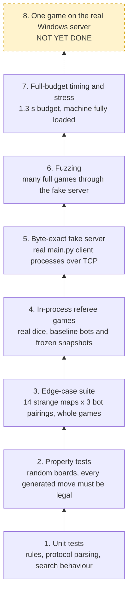
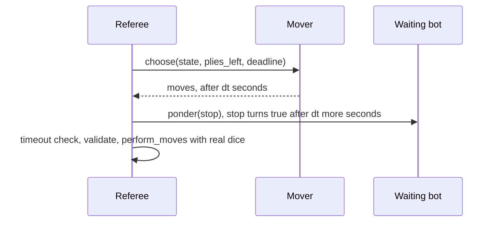
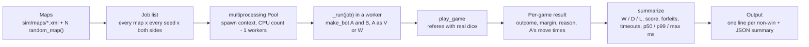
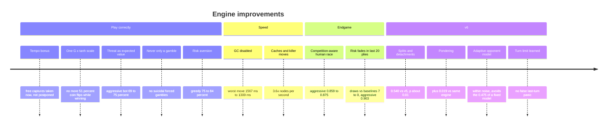

# 🧪 Testing & Results

How we know the AI never forfeits, how we measure how strong it is, and what those measurements say.

> **At a glance**
> - **First goal: never forfeit.** A forfeit on tournament day caps the grade at 10/20, so legality and timing are tested before strength.
> - **46 unit tests** (`tests/`) pass on Python 3.9, 3.11 and 3.14. They are backed by a simulator (`sim/`) with a real-dice referee, baseline bots, a byte-exact fake server, a fuzzer and a tuner.
> - **Strength is measured, not guessed.** Each change was judged on 200–400-game matches, with both species played on every point-symmetric map.
> - **Final engine (v6):** 0.775 vs greedy and 0.795 vs aggressive. Against v5 it wins 88 decisive games and loses 56 (p ≈ 0.01). Worst move time is 1300 ms, against a 2 s limit.
> - **Not yet tested:** a game on the real Windows server on a CTI machine. There is a checklist [below](#-known-limitations-and-what-is-still-untested).

## Contents
1. [Testing philosophy](#-testing-philosophy)
2. [The testing pyramid](#-the-testing-pyramid)
3. [The unit-test suite (`tests/`)](#-the-unit-test-suite-tests)
4. [The simulator (`sim/`)](#-the-simulator-sim)
5. [How to read results](#-how-to-read-results)
6. [Results](#-results)
7. [Why the baseline scores plateau around 0.78–0.80](#-why-the-baseline-scores-plateau-around-078080)
8. [Bugs found by testing](#-bugs-found-by-testing)
9. [Known limitations and what is still untested](#-known-limitations-and-what-is-still-untested)
10. [Where it lives in the code](#where-it-lives-in-the-code)
11. [Key takeaways](#key-takeaways)

---

## 🎯 Testing philosophy

Bugs on tournament day do not all cost the same:

| Failure | What the server does (see [Game rules](./01-game-rules.md)) | Cost |
|---|---|---|
| Illegal or empty move, protocol error, crash | instant loss ("cheating") | worst case: the grade is capped at 10/20 |
| Move later than 2 s | the turn is skipped, and a late `MOV` can desync the next turn | a lost tempo, or an illegal move one turn later |
| Weak move | nothing | fewer wins |

So the order of work was:

1. **Never forfeit.** Every move must be legal *according to the server's own checks*, it must be sent on time, and the client must survive anything the server sends (odd maps, a second game, a longer turn limit).
2. **Then strength.** Only once (1) holds do win rates matter.
3. **Measure, don't guess.** Each change in the [results table](#what-changed-the-results-most) was kept or dropped on match data. Several ideas that looked good were rejected or reworked because the numbers said so (for example the fixed-ε opponent model, which scored 0.475 against an equal engine).

> 💡 **Tip:** "It worked in one game" proves nothing in a dice game. Most games against an equal engine are draws, and a small difference in strength only shows after hundreds of games. See [How to read results](#-how-to-read-results).

---

## 🔺 The testing pyramid

Each layer is slower and closer to the real tournament than the one below it. The cheap layers run on every change. The expensive ones run before the engine is frozen.



| Layer | Where | What it catches | Cost |
|---|---|---|---|
| 1. Unit tests | `tests/test_rules.py`, `test_protocol.py`, `test_engine.py`, `test_ponder.py` | wrong rule formulas, parsing bugs, strategic regressions | seconds |
| 2. Property tests | `test_engine.py::MoveGeneration`, `test_edge_cases.py::EdgeStates` | any generated or searched move the server would reject | seconds |
| 3. Edge-case suite | `tests/test_edge_cases.py::EdgeMaps` | crashes and illegal moves on degenerate boards | seconds |
| 4. Referee games | `sim/referee.py`, `sim/tournament.py` | weak play, timeouts, crashes over thousands of games | minutes |
| 5. Fake server | `sim/fake_server.py`, `test_protocol.py::EndToEnd` | protocol, framing, process-exit and timing bugs | seconds per game |
| 6. Fuzzing | `sim/fuzz.py` | rare protocol failures, hangs, client crashes | minutes |
| 7. Timing/stress | tournaments at `--budget 1.3`, many in parallel | slow moves under CPU contention, GC pauses, memory growth | minutes |
| 8. Real server | `VampiresVSWerewolvesGameServer.exe` on Windows | anything our reimplementation of the server got wrong | **not yet done** |

---

## ✅ The unit-test suite (`tests/`)

**46 tests in 5 modules**, standard-library `unittest` only. They take about 15–20 s and pass on Python 3.9, 3.11 and 3.14 (REPORT.md §4).

```bash
cd "/path/to/Foundation of AI"
uv run --no-project python -m unittest discover tests            # all 46
uv run --no-project python -m unittest tests.test_rules -v       # one module, verbose
uv run --no-project python -m unittest tests.test_engine.Search.test_takes_free_humans_now   # one test
```

Expected tail of the output:

```text
----------------------------------------------------------------------
Ran 46 tests in 15.180s

OK
```

> 💡 **Tip:** No `uv` on a machine (for example the CTI PC)? `python -m unittest discover tests` from the project root does the same thing, because the project only uses the standard library.

### `tests/test_rules.py`: the server's rules (22 tests)

| Class | Tests | What it checks |
|---|---|---|
| `WinProbability` | 5 | `win_probability` matches the server's `Board.GetProba`: equal sizes give 0.5. A weaker attacker gets `E1/(2·E2)`. A stronger attacker vs monsters gets `E1/E2 − 0.5`. The 1.5× kill threshold is **inclusive**. A defender at 1.5× is **not** an automatic win for the defender (P = 10/30). Against humans the threshold is 1×. |
| `Outcomes` | 3 | `battle_outcomes`: converting humans is deterministic (4 + 4 → 8). The kill at exactly 15 vs 10 is deterministic, while 14 vs 10 branches. Random-battle branch probabilities sum to 1. |
| `Validation` | 9 | `validate` mirrors the server's `Board.CheckMoves`. Legal single moves and splits pass. It rejects an empty move list ("stayed static"), a 0-creature move, both Rule 5 violations (target is a source, source is a target), moving from a cell that isn't ours, sending more than the cell holds (summed over splits), non-adjacent moves, staying in place, and byte overflow (200 + 100 > 255). |
| `Transition` | 5 | `apply_moves`: merge + convert + kill in one turn. Moves into the same target are **summed**. A random battle gives 2 branches with probabilities summing to 1. The simulator's `perform_moves` gives the same result as the search model on deterministic moves. Over 4000 dice rolls, the referee's empirical win rate is within ±0.03 of `GetProba` (6 vs 10 → 0.30). |

### `tests/test_protocol.py`: bytes on the wire and the client loop (8 tests)

| Class | Tests | What it checks |
|---|---|---|
| `ClientParsing` | 3 | `ClientSocket` sends `NME` correctly and parses `SET`+`HUM`+`HME` arriving **in one packet** (as the real server sends them), then `MAP`, `UPD`, `END`, `BYE`. A message delivered **one byte at a time** is still parsed. `MOV` is encoded byte-exactly. |
| `CommandLine` | 1 | IP and port are the **last two arguments**, whatever comes before them (`--myparams 123 --name X 123.123.3.5 6666`). |
| `SecondGameSameConnection` | 1 | `END` in the middle of a game resets the agent. A second game on a different board, as the other species, is played correctly, and the client exits after `BYE`. |
| `TurnLimitUnknown` | 1 | If the game outlives the assumed 200 plies, `Agent.plies_left` grows instead of panicking about a "last turn". |
| `EndToEnd` | 2 | **Two real `main.py` processes** play complete games through the byte-exact `FakeServer` (2 s limit, 40 plies) on `testmap2.xml` and `thetrap.xml`, once with pondering on and once with `--no-ponder`. It asserts no "cheated" verdict, zero timeouts, and a clean exit code 0 after `END`/`BYE`. |

### `tests/test_engine.py`: move generation and search behaviour (9 tests)

| Class | Test | What it checks |
|---|---|---|
| `MoveGeneration` | `test_every_generated_turn_is_legal` | **Property test.** 400 random boards (2–12 × 2–12, armies up to 250), both sides, up to 40 candidate turns each. Every turn `generate_moves` proposes must pass `validate`, and more than 1000 turns get checked. |
| | `test_fallback_is_always_legal` | 500 random boards (some 1 cell wide): `fallback_move` is always legal. |
| | `test_ensure_legal_replaces_garbage` | `ensure_legal` turns empty, 0-count, too-many, enemy-cell and non-adjacent moves into legal ones. |
| `Search` | `test_respects_deadline` | A 0.2 s deadline on a 20×20 board returns in < 0.35 s. |
| | `test_takes_free_humans_now` | Regression test for the **tempo bonus**: free conversions are taken now, not postponed. |
| | `test_leader_does_not_gamble` | Ahead 124–120 with nothing left to convert: never start a coin-flip battle. |
| | `test_tie_takes_the_gamble_on_the_last_ply` | Tied on the last ply: attack, because a draw wins nothing. |
| | `test_tie_does_not_gamble_early` | Tied with 150 plies left: keep playing. |
| | `test_trailer_takes_the_gamble_at_the_end` | Behind with 1 ply left: attack, since it is the only way to win. |

### `tests/test_edge_cases.py`: strange-but-legal situations (4 tests)

| Class | Test | What it checks |
|---|---|---|
| `EdgeMaps` | `test_whole_games_never_forfeit` | **14 maps × 3 pairings** (`ai:0.05` vs `greedy`, `greedy` vs `ai:0.05`, `ai:0.05` vs `ai:0.05`), 60-ply whole games: no bad move, no crash, no timeout. The maps are a 1×2 and a 1×5 corridor, a 5×1 column, a 2×2 board with every cell full, no humans, adjacent starts (equal and killable), armies of 200 near the 255 byte limit, humans whose conversion would overflow 255, one creature each, unconvertible humans, very unequal armies (2 vs 40), many 1-human cells, and a 60×60 board. |
| `EdgeStates` | `test_boxed_in_group_still_moves_legally` | Every neighbour holds a bigger enemy or bigger humans, and the AI still sends something legal. |
| | `test_all_neighbours_full_of_own_255` | Every neighbour is full of our own 255s (physically impossible): `ensure_legal` must not crash. |
| | `test_random_states_always_legal_after_search` | 60 random states with counts 1–255 and boards down to 1 cell wide, both sides, 50 ms searches. The result after `ensure_legal` is always legal. |

### `tests/test_ponder.py`: thinking on the opponent's time (3 tests)

| Test | What it checks |
|---|---|
| `test_hit_continues_deeper_and_matches_fresh_search` | When the pondered position is the one that actually happens, `choose` resumes at the pondered depth (3), and returns **exactly the same move and value** (to 6 decimals) as a fresh search of the same depth. Pondering is a pure head start. |
| `test_stops_promptly` | When `stop()` turns true, pondering returns within 50 ms and reports when it noticed. |
| `test_miss_is_a_normal_search` | If the opponent plays something unpredicted, the search starts from scratch (`pondered == 0`) and still returns a move. |

---

## 🧰 The simulator (`sim/`)

Everything here is plain Python and imports the real engine from `vvw/`. All commands run from the project root.

| Module | Role |
|---|---|
| `sim/referee.py` | in-process referee replicating the server's `GameRoutine` + `PerformMoves`, with real dice |
| `sim/bots.py` | opponents: random, greedy, aggressive, our AI, frozen snapshots |
| `sim/maps.py` | load server XML maps, generate point-symmetric random maps |
| `sim/tournament.py` | parallel head-to-head matches on many maps, both species |
| `sim/fake_server.py` | byte-exact stand-in for `VampiresVSWerewolvesGameServer.exe` |
| `sim/fuzz.py` | many full games through the fake server with real `main.py` processes |
| `sim/tune.py` | coordinate-descent weight tuning by self-play |
| `sim/trace.py` | print one game ply by ply |
| `sim/maps/` | `testmap2.xml`, `thetrap.xml` |
| `sim/snapshots/` | frozen earlier versions of the engine, **v1–v6**, used for regression matches |

### Referee (`sim/referee.py`)

`play_game(spec, bots, seed, max_plays=200, move_time_limit=2.0, record=False)` runs one game like the server does:

- `bots[0]` is Vampires and moves first. `bots[1]` is Werewolves.
- **Real dice:** `perform_moves` groups moves by target, sums them, and raises `OverflowError` above 255 like `Convert.ToByte`. Merges wrap at 255 like the server's byte. Random battles roll each survivor separately, exactly as `PerformRandomBattle` does, and humans are converted with probability P too.
- A move slower than `move_time_limit` counts as a **timeout: the turn is skipped**. A move rejected by `validate` loses (`"bad move"`), and a bot exception loses (`"crashed"`).
- The game ends on elimination or at `max_plays`, where the bigger total wins and equal totals are a draw.
- **Simulated pondering:** after each move, the *waiting* bot's `ponder(stop)` runs for **exactly as long as the mover thought** (capped at the move limit). This is what happens on the real server, where the two AIs run at the same time on separate cores.



### Bots (`sim/bots.py`)

All bots go through `make_bot(spec)`, so every tool accepts the same spec strings:

| Spec string | Bot | What it does |
|---|---|---|
| `random` | `RandomBot` | each group steps to a random neighbour (70% whole group, otherwise a random part), made legal by `ensure_legal` |
| `greedy` | `GreedyBot(False)` | each group flees a killer (≥ 1.5×) within 2 cells. Otherwise it goes for the best convertible human or killable enemy (value/distance), or merges with an ally. |
| `aggressive` | `GreedyBot(True)` | greedy, but it also attacks any enemy it merely outnumbers, accepting random battles |
| `ai` / `ai:0.3` | `AIBot` | our engine with a 1.3 s (default) or 0.3 s budget, driven through the same `vvw.ponder.Session` as the real client, without pondering |
| `aip:0.3` | `AIBot(ponder=True)` | same, **with pondering** on the opponent's time |
| `aid:3` | `AIBot(max_depth=3)` | fixed depth, no time limit: deterministic for a given dice seed (used by `tune.py` and `trace.py`) |
| `snap:v5:0.3` | `SnapshotBot` | frozen version v5 from `sim/snapshots/v5`, 0.3 s budget |
| `snapp:v6:0.3` | `SnapshotBot(ponder=True)` | frozen v6, with pondering |
| `snapd:v2:3` | `SnapshotBot` | frozen v2 at fixed depth 3 (one of `tune.py`'s default opponents) |

### Maps (`sim/maps.py`)

- `load_map(path)` reads the server's XML format (`<Map Rows Columns>`, `<Humans/Vampires/Werewolves X Y Count/>`).
- `random_map(rng)` builds a **point-symmetric** map: 5–16 rows, 5–20 columns, 3–12 creatures per side. The Werewolves start at the mirror image of the Vampires (`(cols−1−x, rows−1−y)`), and every human cell has a mirrored twin with the same count. So the layout favours neither species, and any edge comes from the AI.
- `MapSpec.to_xml()` writes a map back out, so a random map can be loaded into the real server.

### Tournaments (`sim/tournament.py`)

```bash
# our AI (0.3 s/move) vs greedy, on the 2 bundled maps + 20 random ones, both sides each
uv run --no-project python -m sim.tournament --a ai:0.3 --b greedy --random-maps 20

# a weight change vs the default engine (ablation)
uv run --no-project python -m sim.tournament --a ai:0.3 --b ai:0.3 --b-weights '{"tempo": 0.0}'

# regression match: current engine vs frozen v5, 0.1 s/move, 202 maps x 2 sides = 404 games
uv run --no-project python -m sim.tournament --a ai:0.1 --b snap:v5:0.1 --random-maps 200

# pondering vs the same engine without it
uv run --no-project python -m sim.tournament --a aip:0.1 --b ai:0.1 --random-maps 200

# held-out maps: no bundled XML, a map seed never used in development
uv run --no-project python -m sim.tournament --a ai:0.5 --b snap:v5:0.5 --maps '' --map-seed 12345 --random-maps 100
```

| Option | Default | Meaning |
|---|---|---|
| `--a`, `--b` | `ai:0.3`, `greedy` | bot specs. All scores are from **A's** point of view. |
| `--a-weights`, `--b-weights` | none | JSON overrides of `DEFAULT_WEIGHTS` for an `AIBot` |
| `--maps` | `sim/maps/*.xml` | glob of XML maps (`''` for none) |
| `--random-maps` | 10 | number of extra random maps |
| `--map-seed` | 7 | seed for the random maps (change it for held-out sets) |
| `--seeds` | 1 | dice seeds per map and side |
| `--workers` | CPU count − 1 | parallel processes |
| `--max-plays` | 200 | plies per game |

How a run is organised:



Each job's dice seed is `1000·map_index + 17·seed + 1`, and it is the same for both sides of a map. Running the same command twice therefore replays the same dice, though time-limited bots can still differ slightly because of timing. The summary JSON reports `games, win, draw, loss, score, avg_margin, a_forfeits, a_timeouts, a_p50_ms, a_p99_ms, a_max_ms, wall_s`.

> ⚠️ **Watch out:** a tournament uses every core but one, for minutes. Don't run two at once, and don't compare timing numbers from a loaded machine with numbers from an idle one.

### Fake server (`sim/fake_server.py`)

A **byte-exact** stand-in for the real server (v3.2.1 `GameRoutine`), rebuilt from the disassembly (see [Running & protocol](./08-running-and-protocol.md)):

- The first connection is player 0 (Vampires) and the second is Werewolves. Each client sends `NME`, then the server sends `SET`+`HUM`+`HME` **in one packet**, then `MAP`.
- Each turn the server **flushes any stale unread bytes** from the player, then sends `UPD` (the union of every player's last changes). It waits for `MOV`+n and then 5n bytes, both within the **same 2 s deadline**.
- A timeout skips the turn. A bad or empty move, an off-board cell, a byte overflow or a protocol error loses ("cheated").
- At the end it sleeps, sends `END` + `BYE` and closes. (`end_sleep` is 0.2 s by default and 0.05 s or less in tests. The real server sleeps 4 s.)

```bash
# terminal 1: the server
uv run --no-project python -m sim.fake_server --map sim/maps/testmap2.xml --port 5555
# terminals 2 and 3: two clients (the first to connect plays Vampires)
uv run --no-project python main.py --log - 127.0.0.1 5555
uv run --no-project python main.py --name Other 127.0.0.1 5555
```

Options: `--map`, `--host`, `--port`, `--players`, `--move-time` (2.0), `--max-plays` (200), `--seed`.

### Fuzzer (`sim/fuzz.py`)

Plays many full games through the fake server, each with **two real `main.py` processes** (pondering on) over TCP, which is exactly the tournament setup. It uses `testmap2.xml`, `thetrap.xml` and then random maps. A game **fails** on any "cheated" verdict, any timeout, a client exit code ≠ 0, or a hang.

```bash
uv run --no-project python -m sim.fuzz                       # 30 games, 0.05 s budget (defaults)
uv run --no-project python -m sim.fuzz --games 40 --budget 1.3   # full thinking budget (slow)
```

Output: `games=30 failures=0 outcomes={...}`, plus a `FAIL ...` line per failing game.

### Tuner (`sim/tune.py`)

Coordinate descent over the evaluation weights (`risk`, `tempo`, `human`, `gamma`, `threat_far`, `threat_adj_victim_moves`, `k_end`, `k_human`, `split_penalty`, `tempo_decay`). Each candidate value is scored by fixed-depth self-play (`aid:3`) against a ladder (`greedy,aggressive,snapd:v2:3` by default) on 80 random maps + the bundled ones. Fixed depth makes each game deterministic for a given dice seed, so timing noise can't affect the comparison. A change is kept only if it beats the incumbent by more than `--min-gain` (0.004).

```bash
uv run --no-project python -m sim.tune --rounds 2
uv run --no-project python -m sim.tune --params risk,tempo --grid '{"risk": [0.1, 0.2]}' --map-seed 11
```

> ⚠️ **Watch out:** tuning overfits its map set. Validate a result on a **different `--map-seed`** before adopting it, as REPORT.md §4 requires.

### Trace (`sim/trace.py`)

Prints one game ply by ply (moves, then every V/W/H cell after the move), followed by the result. This is how strategic bugs such as postponed captures and hopeless chases were spotted.

```bash
# python -m sim.trace <map.xml> <botV> <botW> [seed] [max_lines]
uv run --no-project python -m sim.trace sim/maps/thetrap.xml aid:3 greedy 1 60
```

---

## 📏 How to read results

**Score** = (wins + 0.5 · draws) / games, from A's point of view. 0.5 means equal strength.

**Why we look at decisive games.** Against an equally careful engine, most games are draws (for example 260 of 404). Draws add 0.5 to both sides and carry no information about who is stronger. So the useful number is **wins against losses among the decisive games**, and the question is whether that split could be a coin flip.

**Significance**, using a two-sided sign test on decisive games (computed from the counts in the [results table](#-results)):

| Decisive games | p (two-sided) | Reading |
|---|---|---|
| 88 W vs 56 L | ≈ 0.01 | real improvement |
| 77 W vs 62 L | ≈ 0.23 | not significant on its own |
| 40 W vs 31 L | ≈ 0.34 | not significant on its own |

**Why 400-game samples.** With about a third of games decisive, the standard error of the score over 404 games is about ±0.015, so only differences of about 0.03 or more stand out. A 100-game match has about ±0.03 standard error, too wide to separate 0.54 from 0.50. Smaller samples are fine for spotting forfeits, timeouts or a big jump against a baseline, but not for comparing two versions of the engine.

> 💡 **Tip:** compare a change with what **doubling the thinking time** is worth (+0.040 here). That gives a sense of scale: pondering's +0.019 is about half of it, which fits a 77% hit rate.

---

## 📊 Results

All numbers are from `REPORT.md` §5. Final engine (v6). Each map is played as both species, and the maps are point-symmetric random maps.

| Match | Win / Draw / Loss | Score |
|---|---|---|
| v6 vs v5, 0.5 s/move, 204 games on maps never used in development | 40 / 133 / 31 | 0.522 |
| new move generation vs v5, 0.1 s/move, 404 games | 88 / 260 / 56 | 0.540 (p ≈ 0.01) |
| pondering vs the same engine without it, 0.1 s/move, 404 games | 77 / 265 / 62 | 0.519 |
| *for scale:* double thinking time vs the same engine, 404 games | 88 / 260 / 56 | 0.540 |
| v6 vs greedy, 0.1 s/move, 404 games | 313 / 0 / 91 | 0.775 (v5: 0.780) |
| v6 vs aggressive, 0.1 s/move, 404 games | 321 / 0 / 83 | 0.795 (v5: 0.797) |

> ℹ️ The two 88 / 260 / 56 rows are two different matches (new move generation vs v5, and 0.2 s vs 0.1 s for the same engine) that happened to end with identical counts.

On the earlier 62-map set, v5 scored **0.903** against both greedy bots. The 404-game set scores lower for the reason explained in the [next section](#-why-the-baseline-scores-plateau-around-078080).

Related measurements (REPORT.md §3.1, details in [Pondering & opponent model](./06-pondering-and-opponent-model.md)):

| Measurement | Value |
|---|---|
| Pondered position = real position | **77%** of turns vs engines, 2% vs instant-reply bots |
| Opponent plays exactly our predicted reply | engines 56–58%, greedy bots 24–26%, random 4% |
| Fixed-ε opponent model (ε = 0.1) vs an equal engine | 0.475 (that is why ε adapts; ε = 0.25 gave 0.493) |

### ⏱️ Timing, memory and robustness

| Check | Result |
|---|---|
| Worst move, real 1.3 s budget, pondering on, 30×30 to 50×50 maps | **1300 ms** |
| Same, machine fully loaded (26 simultaneous games, 520 moves) | worst **1310 ms**, none above 1.4 s |
| Server limit | 2000 ms |
| Memory per client, 50×50 maps | ≈ **240 MB** |
| Reference cycles left per search (GC disabled) | 0 |
| Fuzzing, real `main.py` processes through the fake server | **30 games, 0 failures** |
| Forfeits / timeouts in any test | **none** |

### What changed the results most

Each change was measured, not guessed (copied from REPORT.md §5):

| Change | Effect |
|---|---|
| Tempo bonus | stopped endless postponing of free captures (seen in traces) |
| One scale for heuristics and outcomes (`G · tanh`) | stopped 51% coin flips while winning |
| Threat = expected value of *any* bigger attacker | aggressive bot: 69% → 75% |
| Never offer only a gamble; always keep adjacent attacks | removed suicidal forced gambles; fixed "safe" adjacency to a desperate opponent |
| Risk aversion (ours, then also the opponent's gambles) | greedy: 75% → 84%; losses vs aggressive 17 → 7 |
| GC disabled during search | worst-case move time 1567 ms → 1300 ms |
| Leaf-evaluation cache, γ-power table, killer moves | 3.6× more nodes per second (one search depth deeper in busy positions); killers alone 11% faster with identical results |
| Competition-aware human race + endgame cornering | vs aggressive 0.859 → 0.875 on fresh maps |
| Risk aversion fades over the last 20 plies; tied endgames seek contact | draws vs baselines 7 → 0, all converted to wins (aggressive 0.875 → 0.903) |
| Splits: 2 or 3 parts, detachments, wider root | vs v5: 0.540 (88 W / 56 L in decisive games, p ≈ 0.01) |
| Pondering (77% hit rate vs engines) | +0.019 vs the same engine without it, in line with what doubling the time is worth here (+0.040) |
| Adaptive opponent model | within noise everywhere (vs greedy 0.770 → 0.775, vs aggressive 0.792 → 0.795); a fixed version hurt vs engines (0.475), so it adapts |
| Turn limit / game time learned when the game outlives the assumption | no false "last turn" panic if the tournament uses more than 200 plies |

### Timeline of improvements

The same changes in the order REPORT.md lists them. The order is roughly chronological: the scores against the aggressive bot climb from step to step.



---

## 📉 Why the baseline scores plateau around 0.78–0.80

On the earlier 62-map set, v5 beat both greedy bots 0.903 of the time. On the 404-game set the same kind of engine scores 0.775–0.797, and **no version changes that**. The reason is the maps, not the engine:

1. Our random maps are **point-symmetric**, so both sides start with exactly the same chances.
2. The 404-game set has more maps where the **human race ends exactly tied**: each side ends with one group of the same size.
3. The greedy bot then **walks into us**. Two equal groups meeting is a **pure 50/50 battle**, and almost all of the losses in that set are such coin flips.
4. Avoiding the contact is not an option: **on a finite board a single pursuer can always force contact** (push the evader to a wall, then into a corner). So an endgame lead below 1.5× is not safe over many plies, and the AI takes the battle on its own terms, because attacking gives the better odds.

So 0.78–0.80 is close to the ceiling against these bots *on this map set*. Against them, the real gains show up as zero draws, zero forfeits and zero gambles lost while leading, not in the score.

---

## 🐛 Bugs found by testing

| Symptom | Found by | Fix |
|---|---|---|
| The search postponed free captures forever: a capture "later" had the same final value as "now" | `sim/trace.py` traces | **tempo bonus** `tempo · λ^k`, scaled by `root_slope`. Regression test `test_takes_free_humans_now`. |
| It took 51% coin flips while winning | tournaments vs baselines | one scale for heuristics and outcomes, `raw + G · tanh(raw/k)`. Test `test_leader_does_not_gamble`. |
| A gamble was sometimes the only candidate (suicidal forced gamble), and "safe" adjacency to a desperate opponent was misjudged | traces | always keep ≥ 2 quiet moves, always keep adjacent attacks |
| Games lost to a 50/50 battle *we* started: 11 of 16 losses | loss analysis | risk aversion (`risk × mean-absolute-deviation`), now 0 such losses |
| Draws vs baselines in tied endgames | tournaments | risk aversion fades over the last 20 plies, and tied endgames seek contact: 7 draws → 0 |
| Move times up to **1567 ms**: the cyclic GC paused for about 400 ms on the search tables | timing runs | `gc.disable()` in `main.py` and `Searcher.choose`, giving a worst case of 1300 ms |
| With the GC off, memory leaked: a **recursive closure** in the move generator was a reference cycle that is never freed | GC check during searches | rewritten as an `itertools.product` loop (`movegen._place`). 0 cycles per search, about 240 MB per client. |
| End-to-end tests with both clients as **threads** in one interpreter: they shared the GIL, so one client's pondering stalled the other | `test_protocol.py` | clients run as **separate processes**, as in the tournament |
| A fixed-ε opponent model lost to an equal engine (0.475) | tournament vs same engine | ε adapts to the measured prediction rate |
| A game longer than the assumed 200 plies would trigger "last turn" behaviour | edge-case review | the turn limit and game time are learned. Test `TurnLimitUnknown`. |

> ⚠️ **Watch out:** the defences against a late `MOV` desyncing the next turn (`main.play` checks `has_pending_data()` before sending) and against byte overflow came from **reading the server's code** ([RULES.md](../RULES.md)), not from a failing test. The fake server reproduces the stale-byte flush so that the defences are exercised.

---

## 🚧 Known limitations and what is still untested

**Untested:**

| Gap | Why it matters |
|---|---|
| **No game on the real `VampiresVSWerewolvesGameServer.exe`** on a CTI Windows machine | Everything protocol-related is tested against our own reimplementation. If we misread the disassembly, the fake server repeats the mistake. |
| The fake server and referee use **our own `vvw.state.validate`** to judge moves | A bug in the validator would be invisible to every layer of the pyramid. Only the real server can check it independently. |
| Windows-specific behaviour (Python version on the CTI PC, firewall, scheduler and timer under load) | All timing numbers come from our own machines |
| Real opponents | The baselines are simple, and other teams' AIs may behave in ways no bot here imitates |
| Matches at the full 1.3 s budget | The strength numbers are at 0.1–0.5 s/move. Timing was checked at 1.3 s, but strength was not measured there. |

**Engine limitations seen in testing** (REPORT.md §5):

- Doubling the thinking time gains only +0.04 against an equal engine. The engine is limited by its evaluation and move choices more than by speed.
- Pondering needs a free CPU core. If both AIs share one core, use `--no-ponder`.
- Search reaches roughly depth 4–7 in busy positions, so long plans are beyond the horizon. Example seen in a trace: a 120 v 64 lead spent chasing a group that could never be caught, while that group collected 50 humans.
- Against an equally careful opponent on a symmetric map, the result is often decided by a final-turn 50/50 battle. The AI takes it because a draw wins nothing.

### ✔️ Recommended pre-tournament checklist

1. On the CTI machine: `python --version` (3.9 or newer is tested), then `python -m unittest discover tests` and expect `Ran 46 tests ... OK`.
2. Start the **real** server with a bundled map and connect two copies of our client: `run.bat 127.0.0.1 <port>` twice, or one copy against a classmate's AI.
3. Watch the server window: no "cheated" verdict, no timeouts, and both clients exit cleanly after `END`/`BYE`.
4. Repeat on a large map (e.g. 50×50, generated with `MapSpec.to_xml()`) with `--log game.log` and check the logged move times stay well under 2 s.
5. Read the server's settings. If the move time is not 2 s, adjust `--budget`. If `MaxPlays` is not 200, pass `--max-plays` (the agent extends the limit by itself, but it is better to know).
6. Check the core count. If both AIs will share one core, add `--no-ponder`.
7. Allow Python through the Windows firewall before the first game, so a pop-up doesn't eat the first move's time.
8. Check free memory: about 240 MB per client on big maps.

---

## Where it lives in the code

| File | Function / class |
|---|---|
| `tests/test_rules.py` | `WinProbability`, `Outcomes`, `Validation`, `Transition` |
| `tests/test_protocol.py` | `ClientParsing`, `CommandLine`, `SecondGameSameConnection`, `TurnLimitUnknown`, `EndToEnd` |
| `tests/test_engine.py` | `MoveGeneration.test_every_generated_turn_is_legal` (property test), `Search` |
| `tests/test_edge_cases.py` | `EDGE_MAPS`, `EdgeMaps`, `EdgeStates` |
| `tests/test_ponder.py` | `Ponder` |
| `sim/referee.py` | `play_game`, `perform_moves`, `_random_battle`, `initial_state` |
| `sim/bots.py` | `make_bot`, `RandomBot`, `GreedyBot`, `AIBot`, `SnapshotBot` |
| `sim/maps.py` | `load_map`, `random_map`, `MapSpec.to_xml` |
| `sim/tournament.py` | `run_match`, `build_maps`, `summarize`, `_run` |
| `sim/fake_server.py` | `FakeServer.run`, `FakeServer._flush`, `FakeServer._recv_exact` |
| `sim/fuzz.py` | `one_game`, `main` |
| `sim/tune.py` | `score`, `GRID`, `main` |
| `sim/trace.py` | `main` |
| `vvw/state.py` | `validate` (the server-mirroring checker every test relies on), `apply_moves` |
| `vvw/safety.py` | `ensure_legal`, `fallback_move` |
| `main.py` | `gc.disable()`, desync guard in `play` |

## Key takeaways

- **Never forfeit first.** Every move is checked against a mirror of the server's validator, on random boards, degenerate maps and full games through a byte-exact fake server with real client processes. No forfeit or timeout appeared in any test.
- **Measure in decisive games.** Against an equal engine most games are draws, so we compare wins against losses over about 400 games. 88 vs 56 is real (p ≈ 0.01), while 77 vs 62 is not significant on its own.
- **The final engine (v6)** beats v5 (0.540 in the move-generation match, 0.522 on held-out maps) and scores 0.775 / 0.795 against greedy / aggressive. Those baseline scores sit at a ceiling set by symmetric maps that end in 50/50 battles.
- **Timing is safe:** worst move 1300 ms, or 1310 ms under full load, against a 2000 ms limit, at about 240 MB per client.
- **The biggest open risk is untested:** one real game on the Windows server. Run the checklist above before the tournament.

---

← Previous: [Pondering & opponent model](./06-pondering-and-opponent-model.md) · [Index](../README.md#documentation) · Next: [Running & protocol](./08-running-and-protocol.md) →
