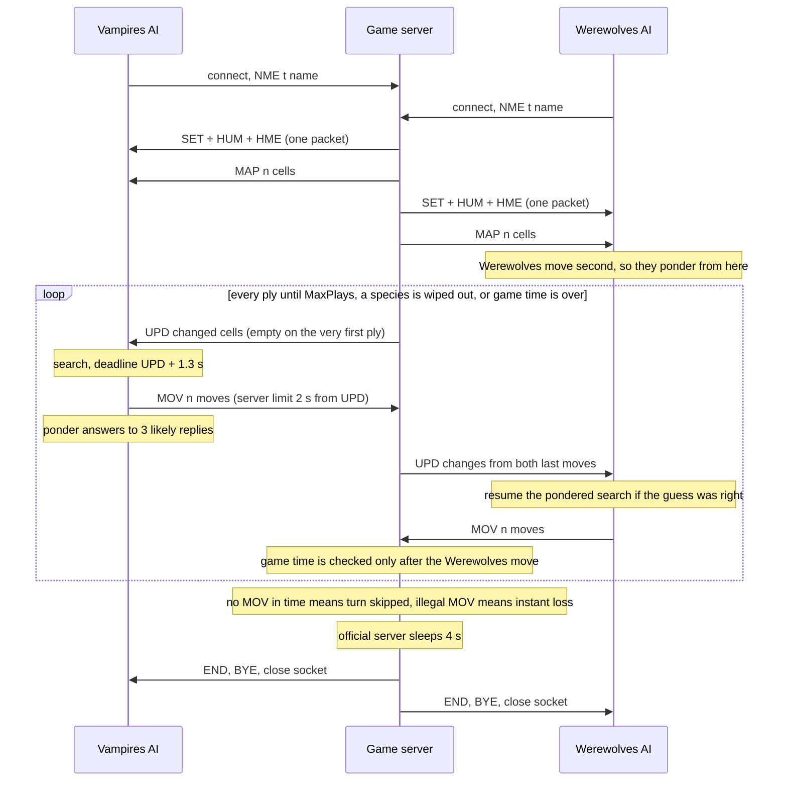

# 🚀 Running the AI and the wire protocol

How to launch Nosferatu-AB locally or on tournament day, what travels over the socket byte by byte, how it spends its 2 seconds, how to read its logs, and what to do when something goes wrong.

> **At a glance**
> - `python main.py [options] <ip> <port>`. The IP and port are **always the last two arguments**, because the tournament launcher appends them.
> - Nothing to install: plain Python 3 standard library. `run.sh` / `run.bat` just call `main.py` from their own folder.
> - The protocol is binary: a 3-byte ASCII command followed by 1-byte fields. A move is 5 bytes `(x_from, y_from, count, x_to, y_to)`, and the whole `MOV` goes out in a single write.
> - Out of the 2 s per move, we use a **1.3 s** search budget. While the opponent thinks, we **ponder**: we pre-search our answers to its 3 most likely replies.
> - Everything here was tested against our byte-exact fake server. It has **not yet** been run against the official Windows server.

## Contents

- [Requirements](#requirements)
- [Command line](#command-line)
- [Launcher scripts](#launcher-scripts)
- [Playing locally with the fake server](#playing-locally-with-the-fake-server)
- [Playing on a Windows CTI machine with the official server](#playing-on-a-windows-cti-machine-with-the-official-server)
- [The wire protocol](#the-wire-protocol)
- [A full game, message by message](#a-full-game-message-by-message)
- [Timing model](#timing-model)
- [Reading the logs](#reading-the-logs)
- [Troubleshooting](#troubleshooting)
- [What to upload](#what-to-upload)

---

## Requirements

| What | Needed | Notes |
|---|---|---|
| Python | 3.8 or newer | `pyproject.toml` declares `>=3.8`. The test suite was run on 3.9, 3.11 and 3.14. |
| Packages | none | Standard library only (`socket`, `select`, `argparse`, …). There is no `pip install` step. |
| CPU | 1 core to play, ideally 1 more free core | Pondering runs while the opponent thinks. If both AIs share one core, use `--no-ponder`. |
| Memory | ≈ 240 MB per client | Measured on 50×50 maps with pondering on (REPORT.md §3.4). |
| Network | TCP to the server's IP and port | `TCP_NODELAY` is set, so small packets go out immediately. |

> 💡 **Tip:** With `uv` installed, `uv run --no-project python main.py ...` runs the same code without creating a project environment. It is never required.

---

## Command line

```text
python main.py [--name N] [--budget S] [--max-plays N] [--max-game-time S] [--log FILE] [--no-ponder] <ip> <port>
```

`main.parse_args` always takes the IP and port from `argv[-2]` and `argv[-1]`, and parses the options from whatever comes before them. Unknown options are **ignored** rather than rejected (`parse_known_args`), so extra parameters from the launcher can never crash the AI.

| Option | Default | Meaning |
|---|---|---|
| `--name N` | `Nosferatu-AB` | Name sent in `NME` (ASCII, at most 255 bytes, longer names are truncated). |
| `--budget S` | `1.3` | Seconds of thinking per move, measured from when the server's `UPD` arrived. Keep it well under the server's move limit. |
| `--max-plays N` | `200` | Total plies (both players) the game is assumed to last. The server setting can't be read, so if the game outlives this value the agent raises it by 50 on its own. |
| `--max-game-time S` | `300` | Assumed game duration in seconds (the server default is 5 min). After 10 plies the agent also estimates plies left from the time used so far, and it extends this value if the game runs longer. |
| `--log FILE` | off | Append one line per decision to `FILE`. Use `-` for stderr. |
| `--no-ponder` | pondering on | Don't think on the opponent's time. |
| `<ip> <port>` | required | Server address. The port must be an integer. |

Examples:

```bash
python main.py 127.0.0.1 5555                              # defaults
python main.py --name Nosferatu-AB --log game.log 10.0.0.12 5555
python main.py --budget 0.5 --no-ponder 127.0.0.1 5555     # weaker, lighter on the CPU
```

> ⚠️ **Watch out:** Options go **before** the IP and port. `python main.py 127.0.0.1 5555 --log x.log` would read `--log` as the IP and `x.log` as the port, and it crashes on `int("x.log")`.

When it starts, `main.py` disables Python's cyclic garbage collector (`gc.disable()`). It was measured pausing ~400 ms on the search tables, which is too much for a 2 s clock. The search data has no reference cycles, so reference counting still frees everything.

---

## Launcher scripts

Both scripts first change to their own folder, so they work from any working directory, and they forward every argument unchanged.

| Script | What it does |
|---|---|
| `run.sh` | `cd "$(dirname "$0")"`, then `exec python3 main.py "$@"` (falls back to `python` if there is no `python3`). |
| `run.bat` | `cd /d "%~dp0"`, then `python main.py %*` if `where python` finds one, else `py -3 main.py %*`. |

```bash
./run.sh --log game.log 127.0.0.1 5555      # Linux / macOS
run.bat  --log game.log 127.0.0.1 5555      # Windows
```

---

## Playing locally with the fake server

The official server is a Windows .NET program. To test on any OS, `sim/fake_server.py` re-implements its game routine byte for byte, using the logic recovered from the disassembly (see [RULES.md](../RULES.md)). It accepts two TCP clients: the first to connect is player 0 (Vampires) and the second is player 1 (Werewolves). It then plays one game and prints the result.

Run these from the **project root**. The `-m sim...` form and the default map path both depend on it.

```bash
# Terminal 1
python3 -m sim.fake_server --port 5555
# [server] listening on 127.0.0.1:5555

# Terminal 2
python3 main.py --log - 127.0.0.1 5555

# Terminal 3
python3 main.py --name Rival --log rival.log 127.0.0.1 5555
```

At the end the server prints one line. Here is a real one, from a game with `--max-plays 40` on the server and both clients:

```text
[server] {'winner': 0, 'reason': 'max plays', 'plies': 40, 'totals': (16, 14), 'names': ['Alpha', 'Beta'], 'timeouts': [0, 0]}
```

| Fake-server option | Default | Meaning |
|---|---|---|
| `--map` | `sim/maps/testmap2.xml` | Map in the server's XML format (`sim/maps/` also has `thetrap.xml`). |
| `--host` | `127.0.0.1` | Interface to listen on. |
| `--port` | `5555` | TCP port. |
| `--players` | `2` | Number of clients to wait for. |
| `--move-time` | `2.0` | Seconds per move, counted from when `UPD` is sent. |
| `--max-plays` | `200` | Total plies. |
| `--seed` | `0` | Seed for the random battles. |

Differences from the real server: there is no GUI, the game-time limit is fixed at 300 s, and it waits only 0.2 s (instead of 4 s) before `END`/`BYE`. For many games in a row, `python3 -m sim.fuzz --games 40` plays full games between real `main.py` processes and reports any cheat verdict, timeout, crash or hang. See [chapter 07](./07-testing-and-results.md).

---

## Playing on a Windows CTI machine with the official server

> ⚠️ **Watch out:** We have **not run** the AI against the official server yet: the server only runs on Windows and development was on macOS. The steps below come from the shipped files and the disassembly. Do this dry run first on tournament day.

1. **Unzip the server.** `Server v3.2.1 (1).zip` contains `VampiresVSWerewolvesGameServer.exe`, its `.exe.config`, `VVSW.Controls.dll` and `VVSW.Model.dll`. The config asks for .NET Framework 4.5.
2. **Edit `VampiresVSWerewolvesGameServer.exe.config`.** These are the shipped values:

   | Key | Shipped value | What to set |
   |---|---|---|
   | `ServerIP` | `127.0.0.1` | The IP the clients will use. |
   | `ServerPort` | `5555` | Any free port. |
   | `PlayersCount` | `1` | **`2`** to play two AIs against each other. |
   | `Map` | `testmap.xml` | Path to a real map file. `testmap.xml` is not in any zip, but `testmap2.xml` and `thetrap.xml` (map generator zip, also in `sim/maps/`) are. |
   | `MaxGameDuration` | `00:05:00` | Leave it. It matches our `--max-game-time 300`. |
   | `MaxPlayDuration` | `00:00:05` | The brief says 2 s per move. Our 1.3 s budget fits either. |
   | `MaxPlays` | `200` | Leave it. It matches our `--max-plays 200`. |
   | `AutoRestart` | `False` | |
   | `DebugMode` | `True` | |

3. **Start the server**, then open two `cmd` windows in the AI folder:

   ```bat
   run.bat --log vamp.log 127.0.0.1 5555
   run.bat --log wolf.log 127.0.0.1 5555
   ```

4. **Check** that the game reaches `END`/`BYE` and that both logs show a decision on every turn with no `crashed` lines. Each process exits after `BYE`: the server allows one game per connection, so the launcher starts a new process for each game.

> 💡 **Tip:** The brief's GUI section names the configuration fields `Ip`, `Port`, `Trace` and `Map`, but the v3.2.1 `.config` we have uses the keys above. Trust the file you are actually given.

---

## The wire protocol

Every message is a **3-byte ASCII command** followed by its parameters. Every number is **one unsigned byte** (0–255). Coordinates are `(x, y)` with x = column, y = row, and (0,0) is the top-left cell. Messages have no length prefix and no terminator. The receiver has to know each command's layout, so `ClientSocket._recv_exact` reads exactly the number of bytes the layout announces, however TCP happens to split them.

### Commands

| Direction | Command | Meaning |
|---|---|---|
| client → server | `NME` | Our name. Sent once, right after connecting. |
| server → client | `SET` | Grid size. |
| server → client | `HUM` | Positions of the human houses. |
| server → client | `HME` | Our starting cell. This is how we learn our species. |
| server → client | `MAP` | Full initial board: every non-empty cell. |
| server → client | `UPD` | Start of our turn: the cells changed by **both** players' last moves. |
| client → server | `MOV` | Our moves for this turn. |
| server → client | `END` | Game over. Clear the game state. |
| server → client | `BYE` | The server is closing the connection. |

### Byte layouts

**NME** (client → server)

| Bytes | 3 | 1 | t |
|---|---|---|---|
| Field | `NME` | t = name length | name, ASCII |

**SET** — note that **rows come first**:

| Bytes | 3 | 1 | 1 |
|---|---|---|---|
| Field | `SET` | rows | cols |

**HUM**

| Bytes | 3 | 1 | n × 2 |
|---|---|---|---|
| Field | `HUM` | n = number of houses | `x y` per house |

**HME**

| Bytes | 3 | 1 | 1 |
|---|---|---|---|
| Field | `HME` | x | y |

**MAP** and **UPD** (same layout)

| Bytes | 3 | 1 | n × 5 |
|---|---|---|---|
| Field | `MAP` / `UPD` | n = number of cells | `x y humans vampires werewolves` per cell |

Each 5-tuple gives the cell's **complete new content**, not a difference. A tuple of three zero counts means the cell is now empty (`State.from_updates` deletes it).

**MOV** (client → server)

| Bytes | 3 | 1 | n × 5 |
|---|---|---|---|
| Field | `MOV` | n = number of moves | `x_from y_from count x_to y_to` per move |

**END**, **BYE**: just the 3 command bytes.

### Worked example: the opening on `testmap2.xml`

`testmap2.xml` is a 15-row × 29-column map. Werewolves start at (0,0) and Vampires at (28,14), each with 10 creatures, and there are five human houses. Here are the bytes our fake server sent to the first client (Vampires) after `NME\x05Alpha`, all arriving in a single read (captured with a raw socket):

```text
53 45 54 0f 1d                         SET  rows=15 cols=29
48 55 4d 05 1c 00 00 0e 0e 07 0a 03 12 0b
                                       HUM  n=5: (28,0) (0,14) (14,7) (10,3) (18,11)
48 4d 45 1c 0e                         HME  (28,14)  -> we start on the Vampire cell
4d 41 50 07                            MAP  n=7 cells:
   00 00 00 00 0a                           (0,0)   h=0  v=0  w=10
   1c 00 02 00 00                           (28,0)  h=2
   0a 03 04 00 00                           (10,3)  h=4
   0e 07 14 00 00                           (14,7)  h=20
   12 0b 04 00 00                           (18,11) h=4
   00 0e 02 00 00                           (0,14)  h=2
   1c 0e 00 0a 00                           (28,14) v=10
55 50 44 00                            UPD  n=0  (the first player's first UPD is empty)
```

The client learns its species by looking up the `HME` cell in `MAP`. Here (28,14) holds vampires, so `Agent.on_map` sets `me = VAMPIRES`.

Our first move was `(28,14) -10-> (27,13)`. The server's next `UPD` to the same client (single-player capture, so it contains just our own move) was:

```text
55 50 44 02  1b 0d 00 0a 00  1c 0e 00 00 00
UPD n=2      (27,13) v=10    (28,14) now empty
```

### Worked example: a real two-move MOV

This is from the logged game in [Reading the logs](#reading-the-logs), Vampires' 8th turn. The AI split its army: 8 vampires step from (21,8) to (20,9), and 2 step from (21,7) to (22,6).

```text
      x=20 x=21 x=22                 x=20 x=21 x=22
y=6    .    .    .             y=6    .    .   V2
y=7    .   V2    .     ==>     y=7    .    .    .
y=8    .   V8    .             y=8    .    .    .
y=9    .    .    .             y=9   V8    .    .
Legend: V = vampires (number = count), . = empty
```

`ClientSocket.send_mov([(21, 8, 8, 20, 9), (21, 7, 2, 22, 6)])` writes these 14 bytes in **one** `sendall`:

| Offset | Hex | Meaning |
|---|---|---|
| 0–2 | `4d 4f 56` | `MOV` |
| 3 | `02` | n = 2 moves |
| 4 | `15` | move 1: x_from = 21 |
| 5 | `08` | y_from = 8 |
| 6 | `08` | count = 8 |
| 7 | `14` | x_to = 20 |
| 8 | `09` | y_to = 9 |
| 9 | `15` | move 2: x_from = 21 |
| 10 | `07` | y_from = 7 |
| 11 | `02` | count = 2 |
| 12 | `16` | x_to = 22 |
| 13 | `06` | y_to = 6 |

```text
4d 4f 56 02 15 08 08 14 09 15 07 02 16 06
```

The packet is 4 + 5·n bytes long. The server reads the first 4 bytes and then the remaining 5·n, both within the **same** deadline. Sending it in one write means it can never arrive half-written.

### What the server does with a MOV

These are the server's checks, recovered from `Board.CheckMoves` (details in [chapter 01](./01-game-rules.md) and [RULES.md](../RULES.md)):

| Situation | Server reaction |
|---|---|
| `MOV` complete and legal | Moves applied, battles resolved, next player's turn. |
| Empty move list (`n = 0`) | **Loss** ("stayed static"). |
| Bad move: wrong species, too many creatures, more than 1 step, 0 creatures, a cell that is both source and target, off-board target, a summed count above 255 | **Loss** (treated as cheating). |
| Nothing (or only part of it) received within the move limit | Turn **skipped**, not a loss. |
| A late `MOV` arrives before the next turn starts | Discarded: the server flushes up to 1300 unread bytes before each `UPD`. |
| A late `MOV` arrives *after* the next `UPD` | Read as the answer to the new turn. If it is now illegal, that is a loss. Our desync guard prevents this. |

Our client calls `state.validate` (a mirror of these checks) through `safety.ensure_legal` before every send, and swaps in `fallback_move` if anything is wrong.

---

## A full game, message by message



On the client side, `main.play` is one loop over `ClientSocket.get_message()`:

| Message | `main.play` does |
|---|---|
| `set` | `agent.new_game()`, `agent.on_set(rows, cols)` |
| `hum` | Nothing. The house contents arrive with `MAP`. |
| `hme` | `agent.on_hme(x, y)` |
| `map` | `agent.on_map(...)` (detects the species and builds the `Searcher` and `Session`), then `agent.ponder(...)`. Only the Werewolves have something to ponder at this point. |
| `upd` | `agent.on_upd(...)`. If a newer message is already waiting, skip this turn. Otherwise `agent.decide(t_recv)`. If a newer message arrived meanwhile, don't send. Otherwise `send_mov`, then `agent.ponder(...)`. |
| `end` | `agent.new_game()`. A second game on the same connection is handled. |
| `bye` / socket closed | Leave the loop and close the socket and log. |

---

## Timing model

In plain words: the server gives each player 2 s per move, starting from when it sends `UPD`. We give ourselves **1.3 s** of that and keep 0.7 s of margin for Python, the operating system and the network. After sending our move we don't sit idle. We guess the opponent's reply and start working on our answer.

```text
server sends UPD
   |
   |<------------- our search (deadline = t_recv + 1.3 s) ------------->|  margin  |
   0 s                                                                1.3 s      2.0 s
   |  depth 1 | depth 2 | depth 3 | ... | depth d (may be cut off)      |          | server stops waiting
                                                                        ^ ensure_legal + one sendall
After MOV:  ponder candidate 1 (0.4 s) -> candidate 2 (0.2 s) -> candidate 3 (0.2 s) -> repeat
            ... until the next server message is waiting (checked every 128 nodes)
```

| Mechanism | Detail | Code |
|---|---|---|
| Move clock | Starts at `t_recv`, when the `UPD` was read. If pondering noticed the message earlier, the clock starts from that earlier moment, because the server's clock started then. | `main.play` |
| Hard deadline | `deadline = t_recv + budget`, checked at **every node**. When it passes, the current iteration is abandoned and the best root move found so far in it is used. | `Searcher._ab`, `Searcher.choose` |
| Early stop | If the time left is less than 1.5 × the time used so far, the next depth would probably not finish, so it isn't started. That is why many turns end well before 1.3 s. | `Searcher.choose` |
| Max depth | 12 plies, or earlier when a forced result is found. | `Searcher(max_depth=12)` |
| Pondering | Up to 3 predicted replies (the one our search expected, plus the next best by a 1-ply look from the opponent's side). They are deepened round-robin in slices of 0.4 / 0.2 / 0.2 s, and pondering stops early once the tables pass 1.5 M entries. | `vvw/ponder.py` |
| Stop latency | During pondering, `stop()` (a zero-timeout `select` on the socket) is polled every 128 nodes, so pondering ends within ~1–7 ms of the message arriving. | `ClientSocket.has_pending_data` |
| Pondering pays off | When the real position was pondered, the search resumes at the depth reached, with its transposition table. A test checks this gives the same move and value as a fresh search. | `Searcher._context`, `tests/test_ponder.py` |
| Desync guard | A turn is skipped rather than answered late. | `main.play` |
| Plies left | Taken from `--max-plays`, raised by 50 if the game runs longer. After 10 plies it is also capped by an estimate from game time. | `Agent.plies_left` |

Measured (REPORT.md §5): the worst move took 1300 ms on 30×30 to 50×50 maps, and 1310 ms with the machine fully loaded (26 simultaneous games, 520 moves, none above 1.4 s). Against engines, the pondered position was the real one on 77% of turns.

> ⚠️ **Watch out:** Pondering assumes the opponent runs on **another core**. If both AIs share one core, our pondering steals the opponent's CPU time and the opponent steals ours. Use `--no-ponder` in that case.

---

## Reading the logs

With `--log FILE` (append mode) or `--log -` (stderr), the agent writes one line per decision. These are real lines from the 40-ply local game above (Vampires' turn 7 is the MOV example):

```text
[09:46:16] turn=7 plies_left=26 depth=10 pondered=8 nodes=102193 value=6.5 root=12 t=1052ms opp_match=0.88 eps=0.00 moves=(21,8)-8->(20,9) (21,7)-2->(22,6)
[09:46:19] turn=8 plies_left=24 depth=10 pondered=8 nodes=122119 value=11.3 root=18 t=1300ms opp_match=0.89 eps=0.00 moves=(20,9)-8->(19,10) (22,6)-2->(23,5)
```

| Field | Meaning | In the first line |
|---|---|---|
| `[09:46:16]` | Wall-clock time. | |
| `turn` | Our turn number, from 0. Skipped turns count too. | Our 8th turn. |
| `plies_left` | Plies left in the game, including this one. | 26 of the 40. |
| `depth` | Deepest iteration reached. It may be a partially searched one when `t` hit the budget. | 10 plies ahead. |
| `pondered` | Depth already finished on the opponent's time for this exact position. 0 means the position wasn't predicted, or there was no pondering. | Pondering had already done depth 8, so only depths 9 and 10 ran now. |
| `nodes` | Nodes searched this turn, not counting pondering. | 102,193. |
| `value` | Score of the chosen move, in creatures (`raw + G·tanh(raw/k)`, see [chapter 04](./04-evaluation.md)). Above +1.5·G means a forced win, below −1.5·G a forced loss. | +6.5: a small edge. |
| `root` | Number of candidate moves at the root. | 12. |
| `t` | Search time this turn, in ms. `1300ms` means it hit the deadline. | 1052 ms, then the early stop kicked in. |
| `opp_match` | Smoothed rate at which the opponent played the reply we predicted (prior 0.75, weighted like 6 observations). | 0.88: very predictable. |
| `eps` | Opponent-model weight, from 0 (pure minimax, rate ≥ 0.5) to 0.1 (rate ≤ 0.25). See [chapter 06](./06-pondering-and-opponent-model.md). | 0: full minimax. |
| `moves` | What was sent: `(x,y)-count->(x,y)` per move. | A split: 8 to (20,9), 2 to (22,6). |

Two more patterns from the same game:

```text
[09:46:30] turn=14 plies_left=11 depth=11 pondered=11 nodes=0 value=-158.0 root=6 t=10ms ...   (Werewolves)
[09:46:31] turn=16 plies_left=8 depth=8 pondered=2 nodes=11557 value=158.0 root=20 t=41ms ...  (Vampires)
```

- `pondered=11 nodes=0 t=10ms`: pondering had already finished the search for this position, so no new search was needed.
- `value=±158.0`: a forced result. On this map G = 2 × (10 + 10 + 32 humans) = 104, so 1.5·G = 156, and the +2 is the final margin. The server's result `totals: (16, 14)` agrees: Vampires won by 2.

Other lines you may see: `search crashed:`, `session.played crashed:` or `ponder crashed:`, each followed by a Python traceback. In every case the game goes on. A search crash sends `fallback_move`, and a ponder crash just drops the pondered tables. These lines should never appear, so report them if they do.

---

## Troubleshooting

| Symptom | Likely cause | Fix |
|---|---|---|
| `usage: python main.py [--name N] ...` and exit | Fewer than 2 arguments. | Pass `<ip> <port>` last. |
| `ValueError: invalid literal for int()` | The port isn't the last argument, or isn't a number. | Put every option **before** `<ip> <port>`. |
| `ConnectionRefusedError` | The server isn't running yet, or the IP/port is wrong. | Start the server first. Check `ServerIP`/`ServerPort` or `--port`. |
| Client starts but the official server never begins the game | `PlayersCount` is 1 in the shipped config, or only one client is connected. | Set `PlayersCount` to 2 and start both clients. |
| `OSError: [Errno 48] Address already in use` (fake server; the errno varies by OS) | A previous server is still bound to the port. | Wait, kill it, or use another `--port`. |
| `ModuleNotFoundError: No module named 'sim'` or `FileNotFoundError: sim/maps/testmap2.xml` | The fake server was started outside the project root. | `cd` to the project root, or pass `--map` with an absolute path. |
| `'python' is not recognized` (Windows) | Python isn't on `PATH`. | `run.bat` falls back to `py -3`. Otherwise install Python 3 or call it by full path. |
| Server log: `player N timed out (turn skipped)` | The machine is overloaded, or both AIs share one core. | Use `--no-ponder` and/or a lower `--budget` (e.g. `0.8`). |
| Server log: `flushed N stale bytes` | A late `MOV` arrived after the deadline and was discarded. | Same as above. Our desync guard normally prevents this. |
| Server: `player N cheated: ...` | An illegal move reached the server. This should be impossible for our AI. | Keep the log and the map, then reproduce with `python3 -m sim.trace`. |
| `crashed:` lines in our log | A bug in the search or in pondering (a legal fallback was sent). | Report it with the traceback. The game was not forfeited. |
| Log file empty or missing | `--log` not given, or given after the IP/port. | `--log FILE` before `<ip> <port>`. The file is appended, never overwritten. |
| High memory use | Pondering tables on big maps (≈ 240 MB measured). | `--no-ponder` if memory is tight. |
| Weak play when both AIs run on a single-core VM | Pondering competes with the opponent for the core. | `--no-ponder`. |

---

## What to upload

The AI needs only `main.py`, `vvw/` and a launcher. Everything else is documentation or optional tooling.

| Include | Why |
|---|---|
| `main.py` | Entry point. |
| `vvw/` (all `.py` files) | The AI. |
| `run.sh`, `run.bat` | Launchers for Linux/macOS and Windows. |
| `REPORT.md` | The report required by the brief (algorithms mapped to files and functions). |
| `RULES.md` | The server rules the report refers to. |
| `README.md`, `docs/` | This documentation. |
| *optional* `tests/`, `sim/` (without `sim/snapshots/`) | Reproducible tests and the simulator. `tests/` imports from `sim/`. |
| *optional* `pyproject.toml` | Metadata only, with no dependencies. |

| Exclude | Why |
|---|---|
| `*.zip` (server, map generator, starter kit), `Projectv10.pdf` | Course material, not our work. |
| `__pycache__/`, `.venv/`, `.ruff_cache/`, `.DS_Store` | Generated files. |
| `sim/snapshots/` | Frozen old engine versions, used only for regression matches. |

On macOS or Linux, run this from the project root:

```bash
zip -r nosferatu-ab.zip main.py run.sh run.bat REPORT.md RULES.md README.md docs vvw tests sim pyproject.toml \
    -x '*__pycache__*' 'sim/snapshots/*' '*.DS_Store'
```

> 💡 **Tip:** Before uploading, unzip the archive into an empty folder and run `python3 -m unittest discover -s tests` there. A file missing from the archive shows up immediately.

---

## Where it lives in the code

| File | Function / class |
|---|---|
| `main.py` | `parse_args` (IP/port = last two args, unknown options tolerated), `play` (message loop, desync guard, move clock) |
| `vvw/client.py` | `ClientSocket.get_message`, `_recv_exact`, `send_nme`, `send_mov` (single write), `has_pending_data` |
| `vvw/ai.py` | `Agent.on_set`, `on_hme`, `on_map` (species detection), `on_upd`, `decide`, `ponder`, `plies_left`, `_log` |
| `vvw/state.py` | `State.from_updates` (MAP/UPD tuples), `validate` (server `CheckMoves` mirror) |
| `vvw/safety.py` | `ensure_legal`, `fallback_move` |
| `vvw/search.py` | `Searcher.choose` (deadline, early stop), `SearchInfo` (the log fields) |
| `vvw/ponder.py` | `Session.ponder`, `Ponderer.ponder` (`TOP_REPLIES`, `SLICES`, `MAX_TABLE_ENTRIES`), `OpponentTracker.rate` / `eps` |
| `sim/fake_server.py` | `FakeServer.run` (handshake, flush, UPD, MOV deadline, END/BYE), `main` (CLI) |
| `run.sh`, `run.bat` | Launchers |

## Key takeaways

- **The IP and port come last, and options come before them.** Unknown options are ignored, so the launcher can't break the AI.
- **The protocol is all single bytes.** Coordinates and counts are 0–255, `SET` sends rows before columns, and each `MAP`/`UPD` tuple holds a cell's full content.
- **A `MOV` is 4 + 5·n bytes, sent in one write**, and only after `validate` has checked it. An illegal or empty move loses the game on the spot.
- **1.3 s of thinking out of the 2 s, plus pondering on the opponent's time.** The clock starts when the `UPD` arrived, and pondering stops within milliseconds.
- **The logs tell the story of each turn.** `depth`, `pondered`, `value`, `t` and `opp_match` show how far it saw, how much pondering helped, how good the position is and how predictable the opponent is.
- **Not yet verified on the official Windows server.** Make the dry run the first thing done on tournament day.

---

← Previous: [Testing and results](./07-testing-and-results.md) · [Index](../README.md#documentation)
